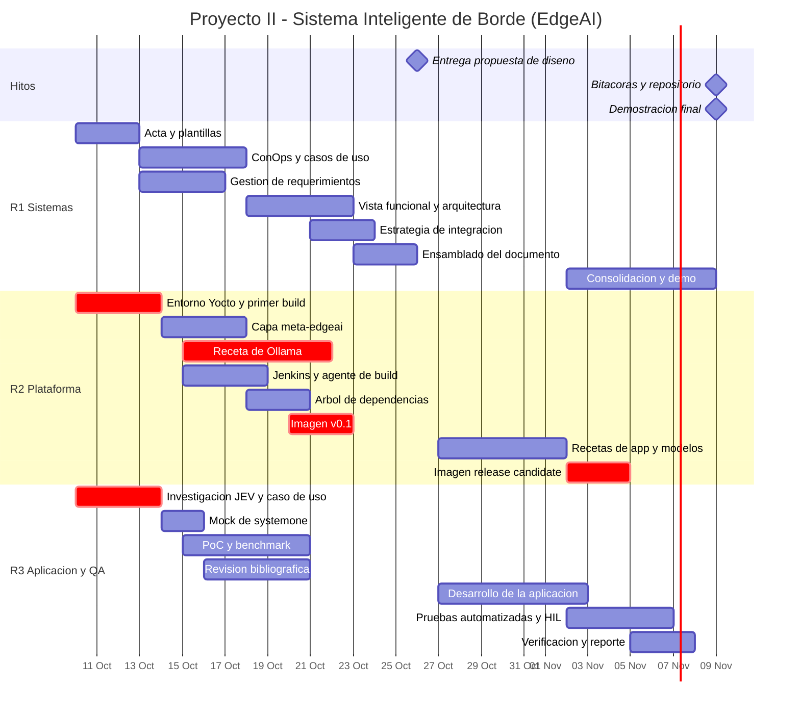

# Proyecto II — Sistema Inteligente de Borde (EdgeAI)

**Curso:** Sistemas Embebidos · TEC — Escuela de Ingeniería Electrónica
**Facilitador:** Dr. Ing. Johan Carvajal Godínez
**Equipo:** 3 personas
**Repositorio público:** GitHub · **CI/CD:** Jenkins · **Build de imagen:** Yocto Project · **Inferencia local:** Ollama ≥ 0.35

---

## 0. Cómo leer este documento

Este README es el **plan de trabajo**, no la propuesta de diseño. Su propósito es que los tres integrantes sepan, desde hoy, qué les toca, qué necesitan de los demás, y en qué fecha. Las secciones 5, 6 y 7 son las que hay que revisar en cada reunión.

| Sección | Para qué sirve |
|---|---|
| 1–3 | Contexto, decisiones pendientes y restricciones técnicas reales |
| 4 | Arquitectura propuesta y principios de escalabilidad |
| 5 | **División del trabajo (equitativa)** |
| 6 | **Matriz de dependencias entre roles** |
| 7 | **Ruta crítica y estrategias de desacople** |
| 8 | Cronograma y Gantt |
| 9 | Estrategia Jenkins |
| 10–11 | Repositorio, convenciones y escalabilidad |
| 12–14 | Definition of Done, trazabilidad con la rúbrica y riesgos |

---

## 1. Decisiones que hay que cerrar antes de empezar (bloqueantes)

El instructivo tiene tres puntos ambiguos. **Consultar al profesor en el horario de consulta (M 13:00–14:00 / V 11:00–12:00) a más tardar el lunes 13 de octubre.** Son bloqueantes: definen qué construye el líder técnico.

| # | Ambigüedad del instructivo | Por qué importa | Propuesta del equipo |
|---|---|---|---|
| D1 | La presentación y la ruta de aprendizaje dicen **Raspberry Pi** (6 menciones), pero el objetivo específico 3 dice **JETSON NANO** | Define el BSP de Yocto: `meta-raspberrypi` vs `meta-tegra`. Son flujos de trabajo radicalmente distintos en dificultad | **Raspberry Pi 4/5 (8 GB)** como plataforma primaria. Yocto sobre Jetson exige `meta-tegra` y alineación con L4T/JetPack: es un proyecto en sí mismo para 4 semanas |
| D2 | Pide equipos de **3 personas** pero define **4 roles** (director, líder técnico, investigador, auditor de calidad) y **una bitácora por rol** | Afecta el entregable del 9 de noviembre | Tres bitácoras nominales + **una cuarta bitácora de auditoría con rotación semanal**, firmada por quien audita esa semana (ver §5.4) |
| D3 | No fija tamaño ni familia de modelo | De esto depende si la imagen cabe y si el nodo responde | Cascada **tev1:0.8b** (decisión) + **LLM 1B–3B cuantizado** (generación). Ver §3 |

> Mientras no haya respuesta, **se trabaja asumiendo Raspberry Pi**. El diseño de capas de §11 permite migrar a Jetson cambiando `MACHINE` y agregando una capa BSP, sin tocar la aplicación. Eso mismo es parte del argumento de escalabilidad del documento.

---

## 2. Objetivo del sistema

Diseñar, sintetizar y demostrar un **sistema embebido de inferencia local** que combine:

- un **modelo de decisión System One (JEV)** para juicios tipados, rápidos y de latencia acotada, y
- un **LLM pequeño** para generación de texto cuando la decisión lo amerite,

todo corriendo **sin conexión a internet**, sobre una imagen Linux generada con **Yocto Project**, con el ciclo de build, prueba e integración automatizado en **Jenkins**.

### 2.1 Caso de uso candidato (a confirmar en la reunión de arranque)

El caso debe explotar lo que JEV realmente hace bien: *triaje, enrutamiento y puntuación de urgencia*. Tres candidatos, en orden de recomendación:

1. **Triaje de reportes de mantenimiento industrial / planta (recomendado).** Un nodo en planta recibe reportes de operarios (texto o voz transcrita). JEV responde en una sola llamada: `choice` → área responsable; `score` → urgencia 0–4; `noul` → ¿requiere parada de línea? Si la urgencia supera un umbral, el LLM redacta la orden de trabajo en español. Actores: operario, supervisor de mantenimiento, sistema CMMS.
2. **Enrutamiento de alarmas SCADA.** Las alarmas crudas se convierten en un `state` estructurado; JEV decide severidad y destinatario; el LLM resume el incidente para el turno siguiente.
3. **Asistente de bitácora de laboratorio.** Clasificación y enrutamiento de solicitudes de uso de equipo del laboratorio del TEC.

**Nota técnica importante:** el camino de imágenes a través de GGUF en Ollama rinde claramente peor que el de texto. Si se quiere usar cámara, el patrón correcto es **visión → descripción textual / estado estructurado → JEV**, no mandarle la imagen directa al modelo de decisión. Eso además deja el diseño más limpio y más escalable.

---

## 3. Restricciones técnicas reales (verificadas, no asumidas)

Esto condiciona el plan completo. Verificado en documentación pública de Ollama y TypeSafe:

| Hecho | Consecuencia para el proyecto |
|---|---|
| `POST /v1/systemone` existe desde **Ollama 0.35** (liberada el 29 set 2026) | La receta de Yocto **debe** fijar versión ≥ 0.35. Una receta de `meta-*` que traiga 0.3x no sirve |
| Local no requiere API key; endpoint `http://localhost:11434/v1/systemone` | No hay dependencia de nube → respalda el requisito de operación offline |
| Tipos de pregunta: `choice`, `noul` (sí/no), `score` | El diseño funcional debe expresar las decisiones en estos tres tipos. Es un insumo directo para la vista funcional |
| Hasta **64 preguntas** y **64 KiB** por solicitud | Límite de diseño explícito → se convierte en un requisito no funcional con número |
| Los modelos de decisión **no están aún en el CLI ni en las librerías Python/JS de Ollama** | La aplicación debe hablar **HTTP crudo** contra el endpoint, o usar el SDK de TypeSafe. **Esto afecta la lista de dependencias que recibe el líder técnico** |
| Un modelo de chat normal es **rechazado** por `/v1/systemone` | No se puede improvisar con Llama o Qwen en ese endpoint; se requiere un modelo entrenado para System One |
| Modelos disponibles: `tev1:0.8b` (812 MB), `tev1` 4B (4.5 GB), `nimble` 9B (9.5 GB) | **Solo `tev1:0.8b` es realista en Raspberry Pi.** Nimble 9B queda descartado por memoria |
| Sin GPU en Raspberry Pi | Inferencia solo en CPU. Hay que presupuestar latencia y limitar `num_ctx`, `OLLAMA_NUM_PARALLEL` y `keep_alive` |

**Riesgo identificado desde ya:** no hay garantía de una receta Yocto madura y mantenida para Ollama 0.35 en `arm64`. Se evalúan dos caminos en la semana 1 y se escoge uno (ver §14, R-01).

---

## 4. Arquitectura de referencia

Arquitectura de **doble carril de inferencia**. Este es el corazón técnico de la propuesta y el principal argumento de escalabilidad.

```
┌───────────────────────── Raspberry Pi (nodo de borde) ─────────────────────────┐
│                                                                                 │
│  Sensores / cámara / entrada de texto                                           │
│            │                                                                    │
│            ▼                                                                    │
│  ┌──────────────────┐   state (JSON)   ┌─────────────────────────────┐          │
│  │ Adaptador de     │ ───────────────► │ Orquestador (edgeai-app)    │          │
│  │ entrada          │                  │  - construye el state       │          │
│  └──────────────────┘                  │  - política de cascada      │          │
│                                        └───────┬──────────┬──────────┘          │
│                                 carril rápido  │          │  carril lento       │
│                                                ▼          ▼                     │
│                              POST /v1/systemone      POST /api/generate         │
│                              ┌──────────────┐        ┌──────────────┐           │
│                              │  tev1:0.8b   │        │  LLM 1B–3B   │           │
│                              │  (decisión)  │        │ (generación) │           │
│                              └──────┬───────┘        └──────┬───────┘           │
│                                     └────────┬──────────────┘                   │
│                                              ▼                                  │
│                                   ┌─────────────────────┐                       │
│                                   │ Salida: actuador /  │                       │
│                                   │ MQTT / API / UI     │                       │
│                                   └─────────────────────┘                       │
│                                                                                 │
│  Servicio ollama.service (systemd)   ·   Config en /etc/edgeai/config.yaml       │
└─────────────────────────────────────────────────────────────────────────────────┘
```

**Por qué el doble carril importa.** El carril rápido resuelve el 90 % de los eventos con una decisión tipada, barata y de latencia acotada. El carril lento solo se activa cuando la decisión indica que hace falta texto. Esto es lo que permite que un nodo con 8 GB y sin GPU sostenga carga real, y es el mecanismo concreto de escalabilidad vertical del sistema.

---

## 5. División del trabajo

### 5.1 Roles asignados

| Rol | Persona | Responsabilidad nuclear |
|---|---|---|
| **R1 — Director de Proyecto / Ingeniero de Sistemas** | _(asignar)_ | Ingeniería de sistemas y el documento de propuesta |
| **R2 — Líder Técnico / Arquitecto de Plataforma** | _(asignar)_ | Yocto, BSP, recetas, imagen, infraestructura de build |
| **R3 — Investigador / Desarrollador de Aplicación y QA** | _(asignar)_ | Investigación de Ollama/JEV, aplicación, verificación |

El rol de **auditor(a) de calidad** rota semanalmente entre los tres (§5.4).

### 5.2 Desglose detallado

#### R1 — Director de Proyecto / Ingeniero de Sistemas

- Convocar reuniones, llevar actas y acuerdos, ser el punto de contacto con el profesor.
- **Concepto de operaciones (ConOps)**: escenarios operativos, actores, modos de operación.
- **Diagramas de casos de uso y de secuencia** por segmento y elemento del sistema.
- **Gestión de requerimientos**: descomponer los requisitos del instructivo en requisitos derivados con formato estándar e IDs trazables (§5.5).
- **Vista funcional**: descomposición funcional del sistema y asignación función → componente.
- **Arquitectura del sistema**: diagrama de mapeo de funciones e interfaces a componentes de hardware y software.
- **Estrategia de integración** de hardware y software (ítem de mayor peso junto con la vista operacional).
- **Planeamiento**: Gantt, hitos, control de avance.
- **Ensamblado y edición final del PDF** de la propuesta; conclusiones.
- En Jenkins: etapa `docs` (generación automática del PDF y verificación de trazabilidad de requisitos).

#### R2 — Líder Técnico / Arquitecto de Plataforma

- Proponer la arquitectura de capas y defender las decisiones técnicas.
- Montar el entorno Yocto: *poky* + `meta-openembedded` + `meta-raspberrypi`, con revisiones **fijadas** (sin `master` flotante).
- Crear la capa propia **`meta-edgeai`**: `layer.conf`, recetas de Ollama, de modelos, de la aplicación, unidades systemd, y la receta de imagen `edgeai-image.bb`.
- **Árbol de dependencias**: paquetes de software necesarios y sus relaciones, documentado y graficado.
- Construir, flashear e instalar la imagen en el hardware.
- Redactar el **documento paso a paso** de generación e instalación de la imagen.
- Infraestructura Jenkins: controlador, agente de build, cachés `SSTATE_DIR` y `DL_DIR` compartidos, etapa `build-image`.
- Cuando el caso lo permita, exponer un **SDK / sysroot** o una imagen de desarrollo temprana para R3.

#### R3 — Investigador / Desarrollador de Aplicación y QA

- Investigar a fondo el flujo de Ollama y JEV: tipos de pregunta, límites, formato de respuesta, probabilidades y confianza.
- **Seleccionar el caso de uso y mapear los actores** (insumo de arranque para todo el equipo).
- Construir el cliente HTTP contra `/v1/systemone` y `/api/generate`, la lógica de orquestación y la política de cascada.
- Integración con sensores / cámara / entrada de datos.
- **Mock server** de `/v1/systemone` para desacoplar al equipo del hardware (§7.2).
- **Benchmarking en el borde**: latencia p50/p95 por decisión, RSS, temperatura, comportamiento con carga. Estos números alimentan la justificación y las conclusiones del documento.
- Plan de pruebas y pruebas automatizadas; etapas `unit-test` y `hil-test` en Jenkins.
- **Revisión bibliográfica**: las 10 referencias adicionales que exige el nivel esperado del ítem 1 de la rúbrica.

### 5.3 Balance de carga estimado

Horas estimadas por fase. El objetivo es que la diferencia entre integrantes se mantenga por debajo del 10 %.

| Fase | R1 | R2 | R3 |
|---|---:|---:|---:|
| Arranque e investigación (S0–S1) | 8 | 10 | 12 |
| Propuesta de diseño (S1–S2) | 20 | 8 | 8 |
| Infraestructura y CI (S1–S2) | 2 | 10 | 6 |
| Implementación (S3) | 6 | 14 | 14 |
| Integración y verificación (S4) | 8 | 10 | 12 |
| Bitácoras, repositorio, demo (S4–S5) | 6 | 6 | 6 |
| **Total** | **50** | **58** | **58** |

R1 queda con menos horas técnicas porque absorbe la carga de documentación, que es el entregable con mayor peso en la nota (la propuesta vale 10 % y su rúbrica tiene 10 ítems). Para cerrar la brecha, **R1 asume adicionalmente la redacción de la introducción, la gestión del repositorio de referencias y la consolidación del documento de instalación** que redacta R2. Con eso los tres quedan en torno a 56–58 h.

### 5.4 Rotación del rol de auditoría

| Semana | Auditor(a) | Qué audita |
|---|---|---|
| S1 (13–19 oct) | R3 | Trazabilidad de requisitos y completitud del ConOps |
| S2 (20–26 oct) | R2 | Documento de propuesta contra la rúbrica, ítem por ítem |
| S3 (27 oct–1 nov) | R1 | Recetas, árbol de dependencias y cobertura de pruebas |
| S4 (2–8 nov) | R3 | Imagen final, repositorio, reproducibilidad del build |

Cada auditoría deja una entrada fechada y firmada en `docs/bitacoras/bitacora-auditoria.md` con: hallazgos, severidad, responsable y fecha de cierre. **Toda PR requiere la aprobación de quien audita esa semana.**

### 5.5 Formato de requisitos (lo define R1 el día 1)

```
REQ-<CAT>-<nnn> | El <sujeto> deberá <acción> <objeto> <condición> <criterio medible>
CAT: FUN (funcional) · PER (desempeño) · INT (interfaz) · ESC (escalabilidad) · OPE (operación)
Campos: ID · enunciado · origen (instructivo / derivado / stakeholder) · verificación (I/A/D/T) · prioridad
```

Semilla para arrancar (R1 los descompone y amplía):

| ID | Enunciado | Verificación |
|---|---|---|
| REQ-FUN-001 | El sistema deberá resolver decisiones tipadas (`choice`, `noul`, `score`) de forma local, sin acceso a red externa | Demostración |
| REQ-FUN-002 | El sistema deberá invocar el carril de generación únicamente cuando la decisión supere el umbral configurado | Prueba |
| REQ-PER-001 | La latencia p95 de una decisión de hasta 4 preguntas no deberá exceder _X_ ms sobre la plataforma objetivo | Prueba |
| REQ-PER-002 | La imagen deberá operar con un RSS total menor a _Y_ MB con el modelo cargado | Prueba |
| REQ-INT-001 | La aplicación deberá consumir el endpoint `/v1/systemone` respetando los límites de 64 preguntas y 64 KiB por solicitud | Análisis |
| REQ-ESC-001 | El cambio de plataforma de destino deberá requerir únicamente la modificación de `MACHINE` y la adición de la capa BSP, sin cambios en las recetas de aplicación | Inspección |
| REQ-ESC-002 | El modelo de decisión deberá ser sustituible mediante configuración, sin reconstruir la imagen | Demostración |
| REQ-OPE-001 | El servicio deberá arrancar automáticamente al inicio y reintentar ante fallo | Prueba |

Los valores _X_ e _Y_ los fija R3 tras el benchmark de la semana 1. **Un requisito sin número no es un requisito.**

---

## 6. Matriz de dependencias entre roles

Esta es la sección que evita que alguien se quede bloqueado. Cada fila es una **entrega interna** con fecha límite y consecuencia de incumplimiento.

| # | De → Para | Artefacto | Fecha límite | Qué desbloquea | Si se atrasa |
|---|---|---|---|---|---|
| H1 | **R3 → R1, R2** | Caso de uso seleccionado, actores y modelos objetivo | **lun 13 oct** | Absolutamente todo | El proyecto completo se corre. Es el hito más crítico |
| H2 | **R1 → R2, R3** | Baseline de requisitos v0.1 con IDs | **mié 15 oct** | Diseño de recetas y de la aplicación | Se implementa contra supuestos y hay retrabajo en S3 |
| H3 | **R3 → R2** | Lista de dependencias de la aplicación: paquetes, librerías, modelos y tamaños | **jue 16 oct** | Escritura de recetas y árbol de dependencias | R2 no puede avanzar en el ítem de mayor riesgo técnico |
| H4 | **R2 → R1, R3** | Jenkins operativo con job de build funcionando | **sáb 18 oct** | CI de los tres | Se vuelve al "funciona en mi máquina" |
| H5 | **R2 → R1** | Árbol de dependencias + diagrama de capas Yocto | **lun 20 oct** | Ítems 7 y 8 de la rúbrica (20 % de la propuesta) | R1 no puede cerrar el documento |
| H6 | **R1 → R2, R3** | **Baseline A**: arquitectura y requisitos congelados | **mar 21 oct** | Implementación de S3 | Cambios de alcance en plena implementación |
| H7 | **R3 → R1** | Resultados de PoC y benchmark con números reales | **jue 22 oct** | Justificación, requisitos de desempeño y conclusiones | El documento queda sin evidencia cuantitativa |
| H8 | **R2 → R3** | Imagen v0.1 que arranca y levanta `ollama.service` | **jue 22 oct** | Pruebas sobre hardware real | Se sigue probando solo contra el mock (mitigado, ver §7.2) |
| H9 | **R2, R3 → R1** | Secciones técnicas redactadas del documento | **sáb 24 oct** | Ensamblado y revisión final | Entrega apurada el domingo |
| — | **R1 → profesor** | **Propuesta de diseño en PDF** | **lun 26 oct, 12:00 md** | — | Pérdida del 10 % |
| H10 | **R2 → R3** | Imagen *release candidate* con la aplicación integrada | **mié 4 nov** | Pruebas de aceptación y ensayo de demo | No hay margen para corregir hallazgos |
| H11 | **R3 → R1, R2** | Reporte de verificación y hallazgos cerrados | **vie 6 nov** | Guion de la demo | Demo improvisada |
| H12 | **todos → R1** | Bitácoras individuales completas y revisadas | **dom 8 nov** | Entrega del 9 de noviembre | Pérdida del 5 % |

### 6.1 Dependencias inversas (qué necesita cada quien recibir)

```
R1 necesita de R2 ──► árbol de dependencias, diagrama de capas, procedimiento de instalación
R1 necesita de R3 ──► caso de uso, actores, referencias bibliográficas, números del benchmark
R2 necesita de R1 ──► decisión de plataforma (D1), requisitos no funcionales con número
R2 necesita de R3 ──► lista de dependencias de la app, artefacto empaquetado, modelos elegidos
R3 necesita de R1 ──► requisitos funcionales, política de cascada, criterios de aceptación
R3 necesita de R2 ──► imagen/SDK, acceso SSH al target, agente Jenkins de hardware
```

**Regla de oro del equipo:** ninguna dependencia se comunica verbalmente. Cada entrega interna de la tabla anterior es un *issue* de GitHub con etiqueta `handoff`, asignado a quien recibe, y se cierra cuando quien recibe confirma que le sirve.

---

## 7. Ruta crítica y desacople

### 7.1 Ruta crítica

```
[H1 caso de uso] → [H3 dependencias] → [receta de Ollama en Yocto] → [primer build exitoso]
      → [H8 imagen v0.1] → [integración de la app] → [H10 RC] → [verificación] → [demo]
```

El cuello de botella no es escribir código: es **el primer `bitbake` exitoso**. Un build limpio de `core-image-base` para Raspberry Pi puede tomar entre 3 y 8 horas según la máquina, y la primera receta de Ollama probablemente falle varias veces.

**Por eso R2 arranca el build el sábado 10 de octubre, hoy, aunque no exista todavía ni el caso de uso ni la aplicación.** Construir `core-image-base` sin personalizar no depende de ninguna decisión de diseño, y deja la `sstate-cache` caliente para todas las iteraciones siguientes. Posponer esto es el error más caro posible en este cronograma.

### 7.2 Estrategias de desacople

Cinco mecanismos para que nadie se quede esperando:

1. **Contratos primero (antes del miércoles 15 de octubre).** Se congelan, en el repositorio, el esquema JSON del `state`, el catálogo de preguntas con sus tipos, el nombre de la unidad systemd, la ruta de configuración `/etc/edgeai/config.yaml` y los códigos de salida. Con los contratos escritos, los tres pueden avanzar en paralelo contra la interfaz en lugar de contra la implementación del otro.

2. **Mock de `/v1/systemone`.** R3 entrega el día 3 un servidor falso en Python (~50 líneas) que responde con la forma exacta del endpoint real. Permite desarrollar y correr pruebas unitarias sin hardware, sin modelo descargado y sin esperar a Yocto. Vive en `tools/mock-systemone/`.

3. **Doble vía de desarrollo.** R3 desarrolla la aplicación sobre **Raspberry Pi OS con Ollama instalado manualmente** mientras R2 construye la imagen Yocto en paralelo. Las dos vías convergen en la semana 4. Esto rompe la dependencia más peligrosa del proyecto: que el desarrollo de software quede bloqueado por el flujo de build del sistema operativo.

4. **Jenkins desde el día 5, no al final.** Un pipeline que se monta en la última semana no automatiza nada: solo documenta. Montado temprano, cada commit construye y cada build deja artefactos versionados que sirven de evidencia para la bitácora.

5. **Timeboxes con plan B explícito.** Cada tarea de la ruta crítica tiene fecha de corte. Si la receta de Ollama en Yocto no funciona al **viernes 24 de octubre**, se aplica el plan B (§14, R-01) y se documenta la decisión como un hallazgo de ingeniería, no como una falla.

---

## 8. Cronograma

### 8.1 Por semana

| Semana | Fechas | R1 | R2 | R3 | Hito |
|---|---|---|---|---|---|
| **S0** | 10–12 oct | Acta de arranque, plantilla del documento, formato de requisitos | **Arrancar el build de `core-image-base`**, montar el entorno | Investigar JEV, preseleccionar caso de uso | Repositorio creado |
| **S1** | 13–19 oct | ConOps, casos de uso, requisitos v0.1 | Capa `meta-edgeai`, receta de Ollama, Jenkins arriba | PoC de `/v1/systemone`, mock, benchmark inicial | H1·H2·H3·H4 |
| **S2** | 20–26 oct | Vistas funcional y de arquitectura, integración, Gantt, **ensamblado del PDF** | Árbol de dependencias, imagen v0.1, documento de instalación | Resultados de benchmark, 10 referencias, sección de aplicación | H5·H6·H7·H8 · **Entrega 26 oct 12:00 md** |
| **S3** | 27 oct–1 nov | Seguimiento, gestión de cambios, auditoría de recetas | Recetas de la aplicación y de modelos, `edgeai-image.bb` | Aplicación completa, pruebas unitarias e integración en CI | Aplicación funcional en banco |
| **S4** | 2–8 nov | Consolidación de bitácoras, guion de la demo | Imagen RC, flasheo, instalación verificada | Pruebas de aceptación, HIL en Jenkins, reporte | H10·H11·H12 |
| **S5** | desde 9 nov | **Entrega de bitácoras y repositorio (9 nov)** · **Demostración presencial en K1-420** | | | Entrega final |

### 8.2 Gantt (fuente para el ítem 9 de la rúbrica)



### 8.3 Ritmo de reuniones

| Cuándo | Duración | Agenda |
|---|---|---|
| Lunes y jueves, 19:00 | 30 min | Qué hice, qué sigue, qué me bloquea. Revisión de la tabla §6 |
| Viernes | 45 min | Revisión del auditor de la semana y planificación de la siguiente |
| Consulta con el profesor | según horario | Al menos una vez antes del 26 de octubre y una antes del 9 de noviembre |

Actas en `docs/actas/YYYY-MM-DD.md`, responsabilidad de R1. Un acuerdo sin acta no existe.

---

## 9. Estrategia de CI/CD con Jenkins

Jenkins no es decorativo en este proyecto: un build de Yocto es lento, frágil y difícil de reproducir, y ahí es exactamente donde la automatización paga. Además da evidencia fechada y reproducible para las bitácoras.

### 9.1 Topología

| Nodo | Etiqueta | Dónde corre | Función |
|---|---|---|---|
| Controlador | — | Docker en el equipo de R2 (o VM del laboratorio) | Orquestación, interfaz, artefactos |
| Agente de build | `yocto-builder` | Host Linux x86-64, ≥ 16 GB RAM, ≥ 150 GB libres | `bitbake`, cachés `SSTATE_DIR` y `DL_DIR` persistentes en volumen |
| Agente de aplicación | `app` | Contenedor Python | Lint, pruebas unitarias, empaquetado |
| Agente de hardware | `rpi-target` | **La propia Raspberry Pi como agente Jenkins** | Pruebas *hardware-in-the-loop* |

Que el target sea un agente Jenkins es lo que convierte el pipeline en algo verificable de verdad: las pruebas corren sobre el sistema embebido real, no sobre una emulación.

### 9.2 Etapas del pipeline

| # | Etapa | Dueño | Disparador | Qué hace |
|---|---|---|---|---|
| 1 | `checkout` | R2 | todo | Clona y resuelve submódulos |
| 2 | `lint` | R3 | todo | `ruff` + `shellcheck` + `yamllint` + `oelint-adv` sobre las recetas |
| 3 | `unit-test` | R3 | todo | `pytest` contra el mock de `/v1/systemone`, con reporte de cobertura |
| 4 | `package-app` | R3 | todo | Construye el *wheel* versionado de `edgeai-app` |
| 5 | `build-image` | R2 | `main` + nocturno | `bitbake edgeai-image`, parametrizado por `MACHINE`, timeout 6 h |
| 6 | `artifacts` | R2 | tras etapa 5 | Archiva `.wic.bz2`, manifiesto de licencias, `buildhistory` y SBOM |
| 7 | `hil-test` | R3 | nocturno | Despliega al agente `rpi-target`, valida el servicio, mide latencia y compara contra REQ-PER-001 |
| 8 | `docs` | R1 | todo | Genera el PDF de la propuesta y valida la trazabilidad de requisitos |
| 9 | `release` | R2 | tag `v*` | Publica la *release* en GitHub con la imagen y el documento |

**Disparadores:** *pull request* → etapas 1–4 y 8 · *merge* a `main` → 1–6 y 8 · nocturno (02:00) → pipeline completo con 7.

**Parámetros del job:** `MACHINE` (`raspberrypi4-64` / `raspberrypi5` / `jetson-nano`), `IMAGE`, `DECISION_MODEL` (`tev1:0.8b`), `GEN_MODEL`, `MODEL_DELIVERY` (`baked` / `pull-on-first-boot`).

### 9.3 Decisiones de diseño del pipeline

- **`SSTATE_DIR` y `DL_DIR` en un volumen persistente compartido.** Sin esto, cada build son horas; con esto, un rebuild incremental baja a minutos. Es la diferencia entre un CI usable y uno que nadie usa.
- **Reproducibilidad:** las revisiones de todas las capas se fijan en `yocto/conf-templates/bblayers.conf.sample`; el pipeline falla si una capa apunta a una rama móvil.
- **Build matricial:** la etapa 5 se declara como matriz sobre `MACHINE`. Hoy corre con un solo valor; agregar Jetson es agregar un valor al eje, no reescribir el pipeline. Es escalabilidad del propio CI y vale la pena mencionarlo en la propuesta.
- **Artefactos versionados** con `v<major>.<minor>.<build>` y el hash corto del commit embebido en `/etc/edgeai/version`. Cada demo es trazable a un commit exacto.

---

## 10. Estructura del repositorio

```
edgeai-proyecto2/
├── README.md                      ← este documento
├── Jenkinsfile
├── docs/
│   ├── propuesta/                 fuentes del documento (Markdown/LaTeX) y figuras
│   ├── diagramas/                 fuentes PlantUML/Mermaid + exportaciones
│   ├── imagen/                    procedimiento paso a paso de generación e instalación
│   ├── actas/
│   └── bitacoras/
│       ├── bitacora-director.md
│       ├── bitacora-lider-tecnico.md
│       ├── bitacora-investigador.md
│       └── bitacora-auditoria.md  (rotativa, entradas firmadas)
├── app/
│   ├── src/edgeai/
│   │   ├── decision.py            cliente de /v1/systemone
│   │   ├── generation.py          cliente de /api/generate
│   │   ├── orchestrator.py        política de cascada
│   │   └── config.py
│   ├── tests/
│   └── pyproject.toml
├── yocto/
│   ├── meta-edgeai/
│   │   ├── conf/layer.conf
│   │   ├── recipes-ai/ollama/
│   │   ├── recipes-ai/models/
│   │   ├── recipes-edgeai/edgeai-app/
│   │   └── recipes-core/images/edgeai-image.bb
│   ├── conf-templates/            local.conf.sample · bblayers.conf.sample
│   └── scripts/setup-env.sh
├── ci/
│   ├── build-image.sh
│   ├── hil-smoke-test.sh
│   └── agents/
├── contracts/                     esquemas JSON del state y catálogo de preguntas
└── tools/mock-systemone/
```

### 10.1 Convenciones

- **Ramas:** `main` protegida · ramas cortas `feat/`, `fix/`, `docs/`, `yocto/` · sin commits directos a `main`.
- **Pull requests:** obligatorias, con aprobación del auditor de la semana. Toda PR enlaza el ID de requisito o el issue que atiende.
- **Commits:** *conventional commits* (`feat:`, `fix:`, `docs:`, `ci:`, `build:`).
- **Issues:** etiquetas `handoff` (dependencias de §6), `blocker`, `rubrica-<n>`.
- **Bitácoras:** una entrada por sesión de trabajo con fecha, actividades, productos obtenidos, problemas encontrados y referencias consultadas, tal como lo exige el instructivo. **Se escriben el mismo día**; reconstruirlas al final se nota y cuesta puntos.

---

## 11. Escalabilidad

Requisito explícito del equipo. Se aborda en cuatro dimensiones, cada una con un mecanismo concreto y verificable.

### 11.1 Escalabilidad de plataforma (cambiar el hardware)

- Capa `meta-edgeai` **agnóstica de máquina**: ninguna receta de aplicación referencia `raspberrypi` directamente. Lo específico de plataforma vive en `conf/machine/` y en *bbappends*.
- Migrar a Jetson = agregar `meta-tegra` a `bblayers.conf` y cambiar `MACHINE`. **Verificable por inspección (REQ-ESC-001).**
- El pipeline de Jenkins ya está declarado como matriz sobre `MACHINE`.

### 11.2 Escalabilidad de modelo (cambiar el cerebro)

- Interfaz de abstracción `DecisionEngine` / `GenerationEngine` en la aplicación. Ollama es *una* implementación; `llama.cpp`, un endpoint remoto o un servicio en nube son otras, sin tocar el orquestador.
- Modelo seleccionable por configuración (`/etc/edgeai/config.yaml`), no por recompilación. Pasar de `tev1:0.8b` a `tev1` 4B en una plataforma con más memoria es editar una línea y reiniciar el servicio. **Verificable por demostración (REQ-ESC-002).**
- Dos políticas de entrega de modelo: `baked` (horneado en la imagen, arranque offline garantizado, imagen más pesada) y `pull-on-first-boot` (imagen liviana, requiere red la primera vez). Parámetro del pipeline, no decisión irreversible.

### 11.3 Escalabilidad de carga (más eventos por nodo)

- **Cascada de inferencia**: el carril rápido absorbe la mayoría de eventos; el LLM solo se invoca bajo umbral. Mecanismo principal de escalabilidad vertical.
- **Lotes de preguntas**: el endpoint admite hasta 64 preguntas por solicitud, reutilizando el prefijo compartido. Agrupar preguntas en una sola llamada es sustancialmente más barato que hacer *n* llamadas.
- Cola acotada con política de descarte explícita y `keep_alive` configurado para evitar recargas de modelo.
- Presupuesto de latencia documentado y verificado en CI contra REQ-PER-001.

### 11.4 Escalabilidad horizontal (más nodos)

- Broker **MQTT** (`mosquitto`) en la imagen: cada nodo publica en `edgeai/<node_id>/<topico>`. Agregar un nodo no requiere reconfigurar los existentes.
- Identidad de nodo derivada del número de serie del hardware, generada en el primer arranque.
- **Degradación en cascada**: si el nodo local no puede atender la carga, puede delegar a otro nodo o a un servicio remoto. Se diseña la interfaz aunque la implementación quede fuera del alcance de estas cuatro semanas; decirlo así en la propuesta es honesto y además demuestra criterio de diseño.
- **Actualizaciones OTA**: se contempla el esquema de partición A/B con RAUC o swupdate en el diseño de la imagen. Declarar el camino sin implementarlo es legítimo; lo que no es legítimo es no haberlo pensado.

### 11.5 Escalabilidad del proceso (el equipo y el build)

- Cachés `sstate` compartidas: el tiempo de build no crece linealmente con el número de iteraciones.
- Builds matriciales y agentes etiquetados: agregar plataformas no multiplica el trabajo manual.
- Contratos versionados en `contracts/`: un integrante nuevo puede incorporarse leyendo las interfaces, sin arqueología de código.

---

## 12. Definition of Done

### Propuesta de diseño (entrega 26 oct)

- [ ] Los 10 ítems de la rúbrica están cubiertos al nivel *esperado*, no al *regular*
- [ ] Introducción con **10 referencias adicionales** a las del instructivo (es el criterio literal del nivel esperado del ítem 1)
- [ ] El problema está sintetizado **con palabras propias** — reusar el texto del instructivo baja el ítem 2 a *deficiente*
- [ ] Requisitos derivados con IDs, no una lista copiada del instructivo
- [ ] ConOps + diagrama de casos de uso + diagrama de secuencia, **descritos en detalle** (ítem 4, 15 %)
- [ ] Descomposición funcional completa y trazada a requisitos
- [ ] Diagrama de arquitectura con mapeo función → componente de hardware y software
- [ ] Árbol de dependencias graficado con relaciones entre paquetes, no una lista plana
- [ ] Arquitectura integrada de hardware y software ilustrada y descrita (ítem 8, 15 %)
- [ ] Diagrama de Gantt + lista de actividades e hitos
- [ ] Conclusiones con aspectos concretos a considerar para la implementación
- [ ] Revisión cruzada del auditor de la semana, completada **antes** del domingo 25

### Bitácoras y repositorio (entrega 9 nov)

- [ ] Cuatro bitácoras en PDF con fecha, actividades, productos, problemas y referencias por entrada
- [ ] Repositorio público en GitHub, README actualizado, build reproducible desde cero documentado
- [ ] Pipeline de Jenkins con historial de ejecuciones y artefactos conservados
- [ ] Procedimiento paso a paso de generación e instalación de la imagen, **validado por alguien que no lo escribió**

### Demostración (semana del 9 nov, K1-420)

- [ ] Imagen final instalada y arrancando desde cero en el hardware
- [ ] Al menos tres casos de uso demostrables en vivo
- [ ] Flujo de síntesis del sistema operativo explicado con las recetas a la vista
- [ ] Ensayo completo cronometrado al menos 48 horas antes
- [ ] Plan de contingencia: video de respaldo de la demo y una segunda tarjeta SD flasheada

---

## 13. Trazabilidad con la rúbrica

| Ítem de la rúbrica | Peso | Responsable | Insumos de |
|---|---:|---|---|
| 1. Justificación y revisión bibliográfica | 10 % | R1 | R3 (referencias) |
| 2. Descripción y síntesis del problema | 10 % | R1 | R3 (caso de uso) |
| 3. Gestión de requerimientos | 10 % | R1 | R2, R3 (restricciones técnicas) |
| 4. Vista operacional | 15 % | R1 | R3 (actores y escenarios) |
| 5. Vista funcional | 10 % | R1 | R3 (funciones de la aplicación) |
| 6. Arquitectura del sistema | 10 % | R1 | R2 (componentes de plataforma) |
| 7. Análisis de dependencias | 5 % | **R2** | R3 (dependencias de la app) |
| 8. Estrategia de integración | 15 % | R1 + R2 | — |
| 9. Planeamiento de la ejecución | 5 % | R1 | este README |
| 10. Conclusiones | 10 % | R1 | R3 (benchmark) |

Los ítems 4 y 8 suman el 30 % de la propuesta: son los que más esfuerzo merecen. Nótese además que **R1 redacta la mayoría del documento, pero depende de insumos de R2 y R3 para seis de los diez ítems**. Esa es precisamente la razón de ser de la tabla de §6.

---

## 14. Riesgos

| ID | Riesgo | Prob. | Impacto | Mitigación / Plan B |
|---|---|---|---|---|
| **R-01** | No existe receta Yocto madura para Ollama ≥ 0.35 en `arm64` | **Alta** | **Alto** | Vía A: receta que empaquete el binario oficial `arm64`. Vía B: compilar desde fuente con `go.bbclass`. Se prueban ambas en S1. **Corte: viernes 24 oct**; si ninguna funciona, Plan B = imagen Yocto con contenedor (`meta-virtualization` + Podman) ejecutando Ollama, y se documenta la decisión como hallazgo de ingeniería |
| **R-02** | Ambigüedad Raspberry Pi vs Jetson Nano sin resolver | Media | **Alto** | Consulta al profesor el 13 oct. Diseño agnóstico de máquina (§11.1) que reduce el costo de cambiar |
| **R-03** | El build de Yocto consume más tiempo del presupuestado | **Alta** | Medio | Arrancar hoy, `sstate-cache` compartida, builds nocturnos en Jenkins |
| **R-04** | Memoria insuficiente en el target con el modelo cargado | Media | **Alto** | Usar `tev1:0.8b` (812 MB); descartar Nimble 9B; medir RSS en S1 y fijar REQ-PER-002 con dato real |
| **R-05** | Los modelos de decisión no están en el CLI ni en las librerías de Ollama | **Confirmado** | Medio | La aplicación habla HTTP crudo desde el día 1. Ya está contemplado en el diseño |
| **R-06** | Latencia inaceptable en CPU sin GPU | Media | Medio | Cascada de inferencia, lotes de preguntas, `num_ctx` acotado, `keep_alive` configurado |
| **R-07** | Horneado de modelos infla la imagen más allá de lo manejable | Media | Bajo | Parámetro `MODEL_DELIVERY` con las dos políticas ya previstas (§11.2) |
| **R-08** | Desbalance de carga entre integrantes | Media | Medio | Revisión del balance de §5.3 en la reunión de los viernes; reasignación explícita si la brecha supera el 15 % |
| **R-09** | Falla de hardware o de tarjeta SD durante la demo | Baja | **Alto** | Segunda SD flasheada, video de respaldo, ensayo 48 h antes |

---

## 15. Primeras acciones (hoy y mañana)

| Quién | Qué | Cuándo |
|---|---|---|
| Los tres | Reunión de arranque: asignar R1/R2/R3, acordar caso de uso preliminar | Hoy |
| R2 | **Lanzar `bitbake core-image-base` para `raspberrypi4-64`.** No esperar nada ni a nadie | Hoy |
| R1 | Crear el repositorio con la estructura de §10 y abrir los 12 issues `handoff` de §6 | Hoy |
| R3 | Instalar Ollama 0.35 en una máquina de desarrollo, hacer `ollama pull tev1:0.8b` y la primera llamada a `/v1/systemone` | Hoy |
| R1 | Redactar la consulta al profesor con los tres puntos de §1 | Domingo |
| R3 | Cerrar el caso de uso y escribir el catálogo de preguntas tipadas | Lunes 13 |

---

## Referencias técnicas consultadas

- Documentación de la API System One de Ollama (`POST /v1/systemone`, Ollama ≥ 0.35)
- Catálogo de modelos de decisión en Ollama: `tev1:0.8b`, `tev1` (4B), `nimble` (9B)
- Documentación de TypeSafe sobre los modelos JEV y los tipos de pregunta `choice`, `noul` y `score`
- Yocto Project Reference Manual y `meta-raspberrypi`
- Jenkins Pipeline — sintaxis declarativa y builds matriciales

> R3 amplía esta lista a las 10 referencias adicionales que exige el nivel esperado del ítem 1 de la rúbrica, priorizando artículos arbitrados sobre inferencia en el borde, cuantización y síntesis de sistemas operativos embebidos.
