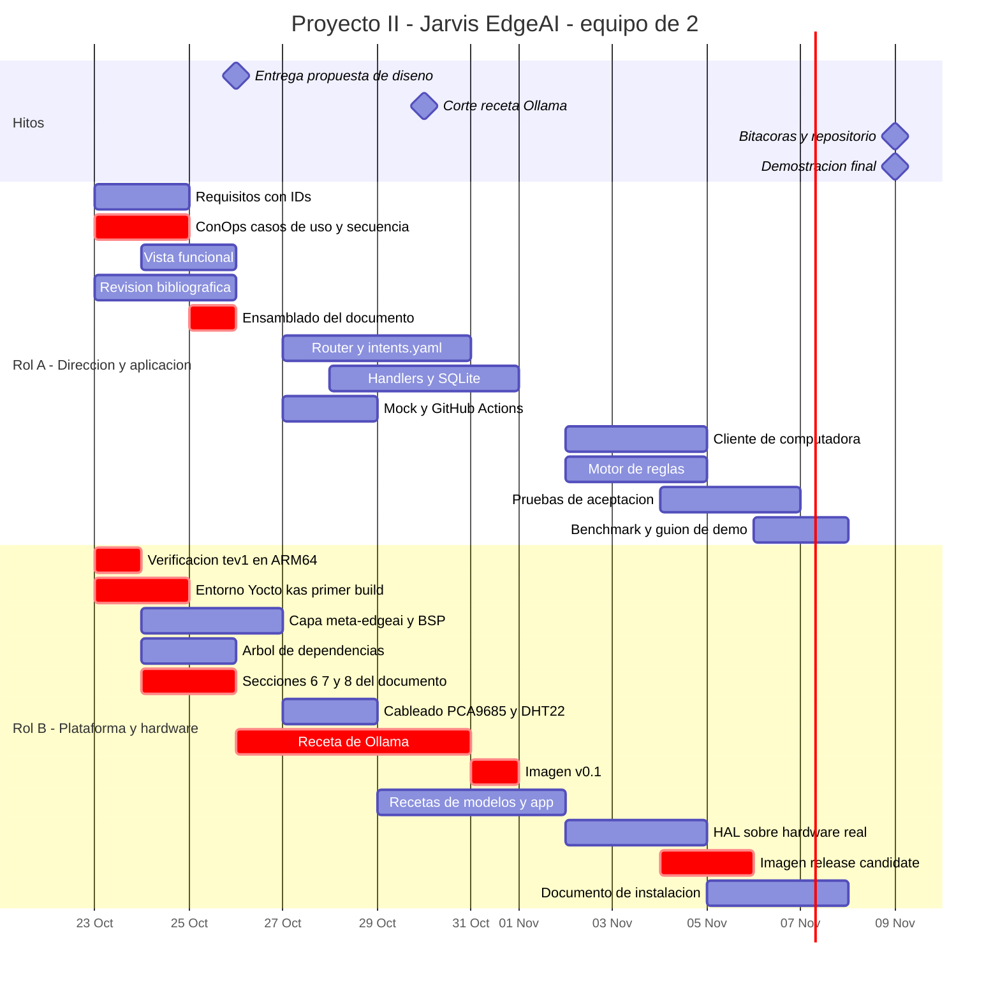

# Proyecto II — Sistema Inteligente de Borde (EdgeAI): "Jarvis"

**Curso:** Sistemas Embebidos · TEC — Escuela de Ingeniería Electrónica
**Facilitador:** Dr. Ing. Johan Carvajal Godínez
**Equipo:** 2 personas · **Rol A:** _(compañero)_ · **Rol B:** Josué
**Plataforma:** Raspberry Pi 4 (8 GB) · MicroSD
**Repositorio:** `github.com/Daniiell03/Sistemas_Inteligentes_de_borde_EdgeAI`
**Build de imagen:** Yocto Project + kas · **Inferencia local:** Ollama ≥ 0.35 (`/v1/systemone` + chat)

---

## 0. Cómo leer este documento

Este README es el **plan de trabajo**, no la propuesta de diseño. Las secciones 3 (catálogo de operaciones), 6 (división del trabajo) y 7 (cronograma) son las que se revisan en cada reunión.

**Cambio de alcance respecto a la versión anterior:** la interacción de la primera iteración es por **comandos de texto**, no por voz. El pipeline de voz (wake word + STT) se mantiene diseñado y con las interfaces listas, pero se implementa solo si sobra tiempo (§9.3). Esto libera la ruta crítica, elimina dos dependencias pesadas de Yocto y permite pruebas deterministas y repetibles del router de decisión.

---

## 1. Decisiones

| # | Punto | Estado |
|---|---|---|
| D1 | El objetivo 3 del instructivo menciona JETSON NANO; el resto dice Raspberry Pi | **Resuelto:** es un error del instructivo. Se trabaja sobre Raspberry Pi 4 (8 GB) |
| D2 | El instructivo define 4 roles y una bitácora por rol; el equipo es de 2 | Rol A = Director + Investigador · Rol B = Líder Técnico · Auditoría rotativa (§6.3). Cuatro bitácoras en total |
| D3 | Interacción por voz | **Diferida** a trabajo futuro / extra. Primera iteración por texto |
| D4 | Driver de LEDs | **PCA9685 por I2C** (16 canales de PWM por hardware) en lugar de PWM por software |

---

## 2. Objetivo del sistema

Diseñar, sintetizar y demostrar un **asistente personal embebido, totalmente local**, que:

1. recibe comandos en lenguaje natural escrito desde un cliente ligero en la computadora del usuario,
2. **clasifica la intención con un modelo de decisión System One (Jev)** servido por Ollama en `/v1/systemone`, con probabilidades y umbral de confianza,
3. ejecuta la acción correspondiente sobre: agenda y tareas (SQLite), iluminación de cuatro habitaciones simuladas (LEDs RGB), operaciones en la computadora del usuario, y sensado ambiental (DHT22),
4. invoca un **LLM pequeño local** solo cuando la operación requiere generar lenguaje,

todo sobre una imagen Linux generada con **Yocto Project**.

### 2.1 Reglas de oro de la plataforma

> **R1.** Después del arranque, ningún modelo se lee ni se escribe en la MicroSD. Ambos modelos quedan residentes en RAM. Se verifica midiendo `/proc/diskstats` antes y después de varias órdenes.
>
> **R2.** Ninguna operación requiere conexión a internet. Se verifica desconectando la Pi de la red durante la demostración.

### 2.2 La tesis del proyecto

La mayor parte del trabajo de un asistente **no es generación de texto, es decisión acotada**. Separar ambos carriles reduce la latencia de segundos a décimas en hardware restringido.

| | Carril de decisión | Carril generativo |
|---|---|---|
| Modelo | `tev1:0.8b` | `llama3.2:3b` (o `:1b`) |
| Endpoint | `POST /v1/systemone` | `POST /api/chat` |
| Salida | Opción tipada + probabilidad | Texto libre |
| Latencia objetivo | < 1 s | 3–8 s |
| % de comandos | ~85 % | ~15 % |

Esta comparación se mide y se reporta: es el resultado central de la verificación.

### 2.3 Memoria residente (Pi 4, 8 GB)

| Componente | Estimado |
|---|---|
| `tev1:0.8b` (Q4) | ~0.7 GB |
| `llama3.2:3b` (Q4) | ~2.0 GB |
| Ollama + app + SQLite + SO | ~1.3 GB |
| **Total** | **~4 GB** — holgura suficiente |

`OLLAMA_KEEP_ALIVE=-1` en ambos modelos, con servicio de calentamiento al arranque.

---

## 3. Catálogo de operaciones

### 3.1 Router de dos etapas

El límite de Tev1 es de **24 criterios por pregunta `choice`**, y la precisión cae cuando las opciones son muchas y semánticamente cercanas. Por eso la clasificación es jerárquica:

```
Etapa 1 — DOMINIO (6 opciones)
    AGENDA · CASA · SISTEMA · AMBIENTE · CONOCIMIENTO · META

Etapa 2 — ACCIÓN dentro del dominio (máx. 12 opciones)
    + preguntas auxiliares en la misma solicitud:
        destino   (choice: habitación o aplicación)
        completo  (noul: ¿tiene toda la información necesaria?)
        riesgo    (noul: ¿es una acción destructiva?)
```

Ambas etapas aplican umbral de confianza. Si cualquiera de las dos queda por debajo, el sistema responde que no entendió en lugar de actuar — y eso cuenta como comportamiento correcto, no como falla.

### 3.2 Dominio AGENDA — organización del día

| ID | Comando de ejemplo | Carril | Efecto en LEDs |
|---|---|---|---|
| `TASK_ADD` | "agregá comprar café a mis tareas" | Decisión | Parpadeo de confirmación |
| `TASK_LIST` | "¿qué tengo pendiente hoy?" | Decisión | — |
| `TASK_COMPLETE` | "marcá como hecha la tarea del informe" | Decisión | Verde breve |
| `TASK_DELETE` | "borrá la tarea de comprar café" | Decisión + **confirmación** | Rojo breve |
| `TASK_NEXT` | "¿qué sigue ahora?" | Decisión | — |
| `TASK_RESCHEDULE` | "pasá esa tarea para mañana" | Decisión | — |
| `EVENT_ADD` | "tengo reunión el jueves a las 3" | Decisión | — |
| `EVENT_LIST` | "¿qué agenda tengo mañana?" | Decisión | — |
| `REMIND_ADD` | "recordame llamar al doctor en una hora" | Decisión | — |
| `REMIND_CANCEL` | "cancelá ese recordatorio" | Decisión | — |
| `DAY_SUMMARY` | "resumime cómo va el día" | **Generativo** | — |
| `DAY_PLAN` | "¿cómo se ve mañana?" | **Generativo** | — |
| `DAY_CLOSE` | "cerrá el día" | **Generativo** + compuesta | Secuencia de apagado |

### 3.3 Dominio CASA — iluminación de 4 habitaciones

Habitaciones: `SALA`, `COCINA`, `CUARTO`, `OFICINA`.

| ID | Comando de ejemplo | Carril | Efecto en LEDs |
|---|---|---|---|
| `LIGHT_ON` | "prendé la luz de la cocina" | Decisión | Habitación → blanco cálido |
| `LIGHT_OFF` | "apagá el cuarto" | Decisión | Habitación → apagada |
| `LIGHT_ALL_OFF` | "apagá todo" | Decisión | Las 4 apagadas |
| `LIGHT_DIM` | "bajá la luz de la sala" | Decisión | Brillo al 20 % |
| `LIGHT_COLOR` | "poné la oficina en azul" | Decisión | Color indicado |
| `LIGHT_STATUS` | "¿qué luces están prendidas?" | Decisión | — |
| `SCENE_APPLY` | "modo cine" / "modo despertar" | Decisión | Escena completa |
| `RULE_ADD` | "cuando pasen los 28 grados poné la sala en azul" | Decisión (multi-pregunta) | Confirmación |
| `RULE_LIST` | "¿qué automatizaciones tengo?" | Decisión | — |
| `RULE_DELETE` | "quitá esa regla" | Decisión + **confirmación** | — |

**Escenas predefinidas:** `CINE` (sala azul 15 %, resto apagado), `DESPERTAR` (cuarto ámbar ascendente), `DORMIR` (todo apagado menos cuarto ámbar 10 %), `SALIR` (todo apagado), `ENFOQUE` (oficina blanco frío 100 %).

### 3.4 Dominio SISTEMA — operaciones en la computadora

Ejecutadas por el cliente ligero, nunca por la Pi.

| ID | Comando de ejemplo | Carril |
|---|---|---|
| `APP_OPEN` | "abrime el navegador" | Decisión |
| `APP_CLOSE` | "cerrá Spotify" | Decisión |
| `VOLUME_SET` | "subí el volumen" / "ponelo en 30" | Decisión |
| `VOLUME_MUTE` | "silenciá" | Decisión |
| `BRIGHTNESS_SET` | "bajá el brillo" | Decisión |
| `SCREEN_LOCK` | "bloqueá la pantalla" | Decisión |
| `SYSTEM_SUSPEND` | "suspendé la compu" | Decisión + **confirmación** |
| `FOCUS_START` | "modo enfoque 25 minutos" | Decisión |
| `FOCUS_STOP` | "cortá el enfoque" | Decisión |
| `CLIP_SUMMARIZE` | "resumime lo que copié" | **Generativo** |
| `CLIP_TRANSLATE` | "traducí lo copiado al inglés" | **Generativo** |
| `CLIP_REWRITE` | "reescribí eso más formal" | **Generativo** |

> **Fuera de alcance explícito:** búsqueda y manipulación de archivos. Se descarta por dependencia del sistema operativo del cliente y por superficie de riesgo ante una clasificación errónea. Documentado como decisión de alcance, no como omisión.

### 3.5 Dominio AMBIENTE — sensado

| ID | Comando de ejemplo | Carril |
|---|---|---|
| `READ_TEMP` | "¿a cuánto estamos?" | Decisión |
| `READ_HUM` | "¿qué tan húmedo está?" | Decisión |
| `ENV_HISTORY` | "¿a qué hora hizo más calor hoy?" | Decisión |
| `ENV_COMFORT` | "¿está cómodo el ambiente?" | Decisión (`score`) |

### 3.6 Dominio CONOCIMIENTO

| ID | Comando de ejemplo | Carril |
|---|---|---|
| `ASK_GENERAL` | "¿cómo funciona un transistor?" | **Generativo** |

### 3.7 Dominio META

| ID | Comando de ejemplo | Carril |
|---|---|---|
| `STATUS` | "¿cómo estás?" / "estado del sistema" | Decisión |
| `HELP` | "¿qué podés hacer?" | Decisión |
| `CONFIRM` / `CANCEL` | "sí" / "no" ante una confirmación pendiente | Decisión (`noul`) |
| `UNKNOWN` | confianza bajo umbral | — |

**Total: 42 operaciones** en 6 dominios.

### 3.8 Casos de uso de la demostración

| # | Comando | Qué demuestra |
|---|---|---|
| CU-01 | "prendé la cocina" | Decisión → actuación física. Latencia sub-segundo |
| CU-02 | "¿a cuánto estamos?" | Integración del sensor por driver del kernel |
| CU-03 | "agregá terminar el informe a mis tareas" y "¿qué tengo pendiente?" | Estado persistente en SQLite |
| CU-04 | "cuando pasen los 28 grados poné la sala en azul" | **Decisión multi-pregunta** → regla tipada almacenada y evaluada |
| CU-05 | "me voy a dormir" | **Comando compuesto**: cierra tareas, aplica escena DORMIR, bloquea la compu y genera el resumen de mañana. Tres dominios y ambos carriles en una orden |
| CU-06 | "contame un chiste sobre Yocto" | Enrutamiento al carril generativo |
| CU-07 | "asdfgh qwerty" | Confianza bajo umbral → no ejecuta. **El sistema sabe cuándo no confiar en la IA** |
| CU-08 | Desconectar la red y repetir CU-01 a CU-05 | Regla de oro R2 |

CU-07 y CU-08 son tan importantes como los demás.

---

## 4. Arquitectura

### 4.1 Diagrama de bloques

```
┌─ COMPUTADORA DEL USUARIO ────────────────┐
│  jarvis-client (Python, ~200 líneas)     │
│   · CLI de texto                         │
│   · ejecutor de acciones locales         │
│   · sin modelos, sin estado              │
└───────────────┬──────────────────────────┘
                │ HTTP / JSON · LAN
                ▼
┌─ RASPBERRY PI 4 · 8 GB ──────────────────────────────────────────┐
│                                                                   │
│  ┌─────────────────────────────────────────────────────────┐    │
│  │ jarvis-app (FastAPI :8000)                              │    │
│  │                                                          │    │
│  │   Router de decisión ──► POST /v1/systemone (tev1:0.8b) │    │
│  │     etapa 1: dominio                                     │    │
│  │     etapa 2: acción + destino + completo + riesgo        │    │
│  │     umbral de confianza                                  │    │
│  │                                                          │    │
│  │   Despachador (SOLID) ──► handler por intención          │    │
│  │                                                          │    │
│  │   Carril generativo ──► POST /api/chat (llama3.2:3b)    │    │
│  │                                                          │    │
│  │   Motor de reglas (evaluación periódica)                 │    │
│  └──────┬──────────────────┬───────────────────┬───────────┘    │
│         │                  │                   │                 │
│         ▼                  ▼                   ▼                 │
│  ┌────────────┐   ┌─────────────────┐   ┌──────────────┐        │
│  │ SQLite     │   │ HAL             │   │ ollama.service│       │
│  │ tareas     │   │  RoomLight      │   │ ambos modelos │       │
│  │ eventos    │   │  TempHumSensor  │   │ keep_alive=-1 │       │
│  │ reglas     │   └────────┬────────┘   └──────────────┘        │
│  │ histórico  │            │                                     │
│  └────────────┘            │ I2C / GPIO                          │
└────────────────────────────┼─────────────────────────────────────┘
                             │
          ┌──────────────────┴──────────────────┐
          ▼                                     ▼
   ┌─────────────┐                      ┌──────────────┐
   │ PCA9685     │                      │ DHT22        │
   │ 12 canales  │                      │ driver IIO   │
   │ 4 LED RGB   │                      │ del kernel   │
   └─────────────┘                      └──────────────┘
```

### 4.2 Ejemplo de solicitud — etapa 1

```json
POST http://localhost:11434/v1/systemone
{
  "model": "tev1:0.8b",
  "state": "cuando pasen los 28 grados poné la sala en azul",
  "questions": {
    "dominio": {
      "type": "choice",
      "instructions": "¿A qué dominio pertenece la orden del usuario?",
      "criteria": {
        "AGENDA":       "Tareas, eventos, recordatorios o resumen del día",
        "CASA":         "Luces de habitaciones, escenas o automatizaciones",
        "SISTEMA":      "Operaciones en la computadora del usuario",
        "AMBIENTE":     "Temperatura, humedad o confort del ambiente",
        "CONOCIMIENTO": "Pregunta abierta que requiere explicación",
        "META":         "Estado del asistente, ayuda o confirmación"
      }
    }
  }
}
```

### 4.3 Ejemplo de solicitud — etapa 2 (multi-pregunta)

```json
{
  "model": "tev1:0.8b",
  "state": "cuando pasen los 28 grados poné la sala en azul",
  "questions": {
    "accion":    { "type": "choice", "criteria": { "LIGHT_ON": "...", "RULE_ADD": "...", "...": "..." } },
    "destino":   { "type": "choice", "criteria": { "SALA": "...", "COCINA": "...", "CUARTO": "...", "OFICINA": "...", "NINGUNA": "..." } },
    "completo":  { "type": "noul",   "instructions": "¿La orden tiene toda la información necesaria para ejecutarse?" },
    "riesgo":    { "type": "noul",   "instructions": "¿Es una acción destructiva o irreversible?" }
  }
}
```

Una sola solicitud resuelve cuatro dimensiones. Es exactamente la capacidad que describe el instructivo.

### 4.4 Decisiones de diseño

| Decisión | Justificación |
|---|---|
| Router de dos etapas | 42 operaciones exceden el límite de 24 criterios; además la precisión del 0.8B cae con muchas opciones cercanas |
| Umbral de confianza obligatorio | Precisión publicada del 0.8B: 63.5 %. Sin umbral, el sistema actuaría equivocado en lugar de abstenerse |
| Confirmación por riesgo | El router marca acciones destructivas; estas requieren un `CONFIRM` explícito antes de ejecutarse |
| **PCA9685 por I2C** para los LEDs | 12 canales de PWM por hardware. El PWM por software en Linux parpadea bajo carga de CPU, justo durante la inferencia |
| DHT22 por driver del kernel (`dtoverlay=dht11,gpiopin=4`) leído por IIO | El *bit-banging* desde Python es inestable en Linux |
| Hilo de muestreo del sensor cada 2 s con último valor válido en caché | El DHT22 falla esporádicamente; la respuesta no espera al sensor |
| SQLite para tareas, eventos, reglas e histórico | Dependencia trivial en Yocto, sobrevive reinicios, demuestra estado real |
| El catálogo vive en `intents.yaml`, no en el código | Agregar una operación no toca el orquestador (principio abierto/cerrado) |
| Build con **kas** (un YAML con capas, revisiones fijadas, máquina e imagen) | Reconstrucción con un solo comando; base directa del documento de instalación |
| Cliente sin modelos ni estado | Toda la inteligencia vive en el borde; el cliente es reemplazable |

### 4.5 Presupuesto de latencia (objetivo; se reemplaza con datos medidos)

| Etapa | Objetivo |
|---|---|
| Transporte cliente → Pi (LAN) | < 50 ms |
| Decisión etapa 1 (`tev1:0.8b`, CPU) | 200–500 ms |
| Decisión etapa 2 | 200–600 ms |
| Despacho + actuación I2C | < 50 ms |
| **Total, comando de decisión pura** | **< 1.5 s** |
| Total, comando generativo (+ LLM) | 4–9 s |

---

## 5. Hardware

| Componente | Detalle |
|---|---|
| Raspberry Pi 4 | 8 GB, MicroSD, disipador o ventilador |
| Fuente | 5 V / 3 A para la Pi; rama separada para los LEDs |
| PCA9685 | I2C (`0x40`), 16 canales PWM de 12 bits |
| 4 × LED RGB | Ánodo o cátodo común, con resistencia por canal |
| Resistencias | ~330 Ω rojo · ~220 Ω verde y azul (a 5 V, ~10 mA por canal) |
| DHT22 | GPIO4 con resistencia de pull-up de 10 kΩ |

**Mapa de canales del PCA9685:** SALA 0–2 · COCINA 3–5 · CUARTO 6–8 · OFICINA 9–11.

---

## 6. División del trabajo

### 6.1 Roles

| Rol | Persona | Roles del instructivo | Responsabilidad nuclear |
|---|---|---|---|
| **Rol A — Director de Proyecto e Ingeniero de Aplicación** | _(compañero)_ | Director(a) + Investigador(a) | Documento de propuesta, router de decisión, aplicación, verificación |
| **Rol B — Líder Técnico / Arquitecto de Plataforma** | **Josué** | Líder técnico | Yocto, recetas, imagen, HAL, hardware, instalación |

Auditoría de calidad rotativa (§6.3).

**Criterio de la división:** cada persona es dueña de un lado de una interfaz bien definida. A trabaja *por encima* de la HAL y de los endpoints de Ollama; B trabaja *por debajo* (sistema operativo, servicios, drivers, hardware). La frontera son los contratos de §7.2.

### 6.2 Desglose

#### Rol A — compañero

**Gestión.** Convocar reuniones, llevar actas, ser punto de contacto con el profesor, controlar el avance del cronograma.

**Propuesta de diseño (autor principal).** Introducción y justificación con 10 referencias adicionales (ítem 1) · síntesis del problema con palabras propias (ítem 2) · gestión de requerimientos con IDs trazables (ítem 3) · **concepto de operaciones, casos de uso y diagramas de secuencia** (ítem 4, 15 %) · vista funcional (ítem 5) · Gantt y conclusiones (ítems 9 y 10) · ensamblado y edición final del PDF.

**Aplicación.** Router de dos etapas y calibración del umbral · `intents.yaml` con las 42 operaciones · handlers por dominio · esquema y capa de acceso a SQLite · motor de reglas · cliente `jarvis-client` para la computadora · **mock de `/v1/systemone`** y HAL falsa para desarrollar sin hardware.

**Verificación.** Benchmark: latencia por etapa (p50/p95) de ambos carriles, RAM residente, temperatura, tasa de acierto de intención por dominio · pruebas unitarias contra el mock · pruebas de aceptación CU-01 a CU-08 · GitHub Actions con lint y pruebas.

#### Rol B — Josué

**Plataforma Yocto.** Entorno *poky* + `meta-openembedded` (`meta-oe`, `meta-python`) + `meta-raspberrypi`, con revisiones fijadas en `jarvis.yml` (kas), `MACHINE = "raspberrypi4-64"`.

Capa propia **`meta-edgeai`**:
- receta de **Ollama** (≥ 0.35) y su unidad systemd,
- receta de modelos (`tev1:0.8b` y `llama3.2:3b` horneados, `OLLAMA_MODELS` apuntando a ellos),
- receta de `python3-adafruit-pca9685` y dependencias de I2C,
- receta de la aplicación `jarvis-app` y `jarvis.service`,
- receta de imagen `jarvis-image.bb`.

Configuración del BSP: `RPI_EXTRA_CONFIG` con el overlay del DHT22, habilitación de I2C, journald volátil, `/tmp` en tmpfs y, si da tiempo, rootfs de solo lectura.

Construir, flashear e instalar la imagen; **documento paso a paso** de generación e instalación basado en `kas build jarvis.yml`.

**Hardware y HAL.** Cableado y validación del PCA9685, los 4 LEDs RGB y el DHT22 · fuente y disipación · implementación de `RoomLight` (PCA9685) y `TempHumSensor` (DHT22 vía IIO) sobre las interfaces de `hal.py`.

**Propuesta de diseño (secciones técnicas).** Arquitectura del sistema y mapeo función → componente (ítem 6, coautor con A) · **árbol de dependencias** graficado (ítem 7) · **estrategia de integración** de hardware y software (ítem 8, 15 %).

### 6.3 Rotación de auditoría

Toda *pull request* la aprueba la otra persona. Además, auditoría formal semanal:

| Semana | Auditor | Qué audita |
|---|---|---|
| S1 (20–25 oct) | **B** | Documento de propuesta contra la rúbrica, ítem por ítem |
| S2 (26 oct – 1 nov) | **A** | Recetas, árbol de dependencias, cumplimiento de R1 en la imagen |
| S3 (2–8 nov) | **B** | Aplicación, pruebas y resultados de verificación |
| Cierre (8 nov) | **A** | Reproducibilidad del build desde cero y documento de instalación |

Cada auditoría deja entrada fechada en la bitácora correspondiente: hallazgos, severidad, responsable y fecha de cierre.

---

## 7. Ruta crítica y desacople

### 7.1 Ruta crítica

```
[build de core-image-base] → [receta de Ollama ≥ 0.35] → [imagen v0.1]
   → [recetas de modelos y app] → [imagen RC] → [verificación] → [demo]
```

El cuello de botella es **la receta de Ollama en Yocto**, no la aplicación. No existe capa pública mantenida y el tarball `ollama-linux-arm64` pesa ~1.45 GB. **B lanza el build de `core-image-base` de inmediato**, sin esperar nada de la aplicación: deja la `sstate-cache` caliente para todas las iteraciones siguientes.

### 7.2 Contratos congelados (antes del lunes 26)

Se fijan en el repositorio y no cambian sin acuerdo de ambos:

- `intents.yaml` — las 42 operaciones con dominio, descripción, handler y respuesta.
- `hal.py` — interfaces abstractas `RoomLight` y `TempHumSensor`.
- `schema.sql` — tablas de tareas, eventos, reglas e histórico ambiental.
- Nombres de unidades systemd, ruta `/etc/jarvis/config.yaml`, puertos (`11434` Ollama, `8000` jarvis-app).
- Contrato HTTP cliente ↔ Pi: `POST /command {text}` → `{intent, confidence, action, response, needs_confirmation}`.

### 7.3 Desacople

1. **Mock de `/v1/systemone` y HAL falsa.** Permiten a A desarrollar sin hardware, sin modelo y sin Yocto. Son también lo que usan las pruebas de CI.
2. **Dos tarjetas SD.** SD-1 con Raspberry Pi OS para desarrollo de A; SD-2 con la imagen Yocto de B. El build corre en la PC, así que la Pi queda libre para A casi siempre.
3. **Timebox con plan B.** Si la receta de Ollama no funciona al **viernes 30 de octubre**, se pasa a Ollama en contenedor (`meta-virtualization` + Podman) y se documenta como hallazgo de ingeniería, no como falla.
4. **Riesgo abierto que B despeja primero:** confirmar que `tev1:0.8b` corre en ARM64 sobre la Pi 4. Si no, cambia el árbol de dependencias de la propuesta. Es la verificación número uno.

---

## 8. Cronograma

| Semana | Fechas | Rol A | Rol B | Hito |
|---|---|---|---|---|
| **S1** | 20–25 oct | ConOps, casos de uso, secuencia, requisitos, vista funcional, referencias, **ensamblado del PDF** | Build de Yocto, kas, `meta-edgeai`, **verificación de tev1 en ARM64**, árbol de dependencias, secciones 6–8 | Contratos congelados (dom 25) |
| **S2** | 26 oct – 1 nov | **Entrega de la propuesta (lun 26, 12:00)**, router, `intents.yaml`, handlers, SQLite, mock, CI | Receta de Ollama, imagen v0.1, recetas de modelos | **Corte de la receta de Ollama (vie 30)** |
| **S3** | 2–8 nov | Cliente, motor de reglas, pruebas de aceptación, benchmark, guion de demo | Imagen RC y final, HAL sobre hardware real, documento de instalación | Imagen final (vie 6) · bitácoras (dom 8) |
| **S4** | desde 9 nov | **Bitácoras y repositorio** · **Demostración en K1-420** | | Entrega final |

### 8.1 Gantt



### 8.2 Reuniones

| Cuándo | Duración | Agenda |
|---|---|---|
| Lunes y jueves | 30 min | Qué hice, qué sigue, qué me bloquea. Turnos de la Pi |
| Viernes | 30 min | Revisión del auditor de la semana y planificación |
| Consulta con el profesor | M 13:00–14:00 · V 11:00–12:00 | Al menos una antes del 26 de octubre |

Las actas las lleva A.

---

## 9. Escalabilidad

### 9.1 De plataforma
`meta-edgeai` es agnóstica de máquina: ninguna receta de aplicación referencia `raspberrypi`; lo específico vive en *bbappends* del BSP. Migrar de plataforma = cambiar `MACHINE` en el archivo kas y agregar la capa BSP.

### 9.2 De modelo
Interfaces `DecisionEngine` y `TextGenerator` en la app. Modelos seleccionables en `/etc/jarvis/config.yaml`: pasar de `tev1:0.8b` a `tev1` 4B en hardware con más memoria es editar una línea y reiniciar el servicio, sin reconstruir la imagen.

### 9.3 De funcionalidad
Una operación nueva es una entrada en `intents.yaml`, un handler registrado y su respuesta: el orquestador no cambia. Un sensor o actuador nuevo es una clase más sobre `hal.py`. El **pipeline de voz** (wake word + Whisper.cpp) se conecta como una fuente de entrada adicional al mismo contrato `POST /command`: el resto del sistema no se entera.

### 9.4 Multi-cliente
El límite real no es la RAM (los modelos se cargan una sola vez, los clientes no cargan nada) sino la **concurrencia**: las solicitudes al carril generativo se encolan. Se reporta como "N clientes con latencia p95 bajo X". El carril de decisión es lo bastante barato como para no notarse.

### 9.5 Horizontal y de proceso (fuera de alcance, diseñado)
Publicación de eventos por MQTT para varios nodos contra un concentrador · actualizaciones OTA con partición A/B (RAUC o swupdate) contempladas en el diseño de la imagen · integración continua para builds automatizados y pruebas *hardware-in-the-loop*. El archivo kas deja ese paso preparado.

---

## Referencias técnicas consultadas

- Ollama — notas de versión 0.35 a 0.40.x: endpoint `/v1/systemone`, modelos de decisión
- Documentación de TypeSafe sobre Jev / System One y los tipos `choice`, `noul` y `score`
- Together AI — ficha del modelo Tev1-0.8B-experimental
- Yocto Project Reference Manual, `meta-raspberrypi` y kas
- NXP PCA9685 — hoja de datos
- Documentación del driver IIO `dht11` del kernel Linux
- GitHub Actions — flujos de trabajo para Python

> A amplía esta lista a las 10 referencias adicionales del ítem 1, priorizando artículos arbitrados sobre inferencia en el borde, modelos de decisión, cuantización y síntesis de sistemas operativos embebidos.
