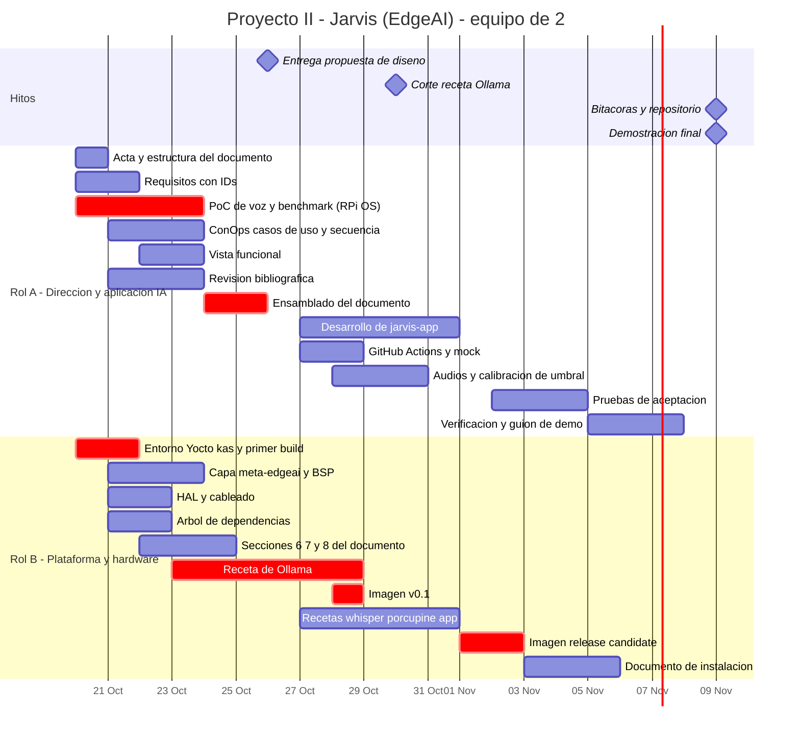

# Proyecto II — Sistema Inteligente de Borde (EdgeAI): "Jarvis"

**Curso:** Sistemas Embebidos · TEC — Escuela de Ingeniería Electrónica
**Facilitador:** Dr. Ing. Johan Carvajal Godínez
**Equipo:** 2 personas (Rol A y Rol B)
**Plataforma:** Raspberry Pi 4 (8 GB) · MicroSD
**Repositorio público:** GitHub · **Build de imagen:** Yocto Project + kas · **Pruebas automáticas:** GitHub Actions · **Inferencia local:** Ollama ≥ 0.35 (API System One / Jev)

---

## 0. Cómo leer este documento

Este README es el **plan de trabajo**, no la propuesta de diseño. Su propósito es que los dos integrantes sepan, desde hoy (martes 20 de octubre), qué les toca y en qué fecha. Las secciones 5 y 6 son las que se revisan en cada reunión.

| Sección | Para qué sirve |
|---|---|
| 1–3 | Decisiones pendientes, objetivo del sistema y restricciones técnicas reales |
| 4 | Arquitectura del pipeline de voz y presupuesto de latencia |
| 5 | **División del trabajo entre Rol A y Rol B** |
| 6 | **Ruta crítica y estrategias de desacople** |
| 7 | Cronograma y Gantt |
| 8 | Escalabilidad |

---

## 1. Decisiones pendientes

Se aclaran con el profesor en consulta (M 13:00–14:00 / V 11:00–12:00). **Mientras no haya respuesta, se trabaja con la propuesta del equipo**; ninguna de estas decisiones detiene el arranque.

| # | Punto | Propuesta del equipo mientras tanto |
|---|---|---|
| D1 | El objetivo específico 3 menciona **JETSON NANO**; el resto del instructivo dice **Raspberry Pi** | Raspberry Pi 4 (8 GB). El diseño de capas (§8.1) permite migrar cambiando `MACHINE` y agregando la capa BSP |
| D2 | El instructivo define **4 roles** y **una bitácora por rol**; el equipo es de **2 personas** | Rol A = Director + Investigador · Rol B = Líder técnico · Auditoría rotativa (§5.3). Cuatro bitácoras en total |
| D3 | Motor de *wake word*: Porcupine requiere AccessKey y validación periódica en línea | Porcupine como primario (trae "jarvis" integrado); **openWakeWord** como plan B 100 % offline |

---

## 2. Objetivo del sistema

Diseñar, sintetizar y demostrar un **asistente de voz embebido, totalmente local**, que:

1. despierta con la palabra clave **"Jarvis"**,
2. transcribe la orden hablada en el propio dispositivo (Whisper.cpp),
3. **decide la intención con un modelo de decisión System One (Jev)** servido por Ollama en `/v1/systemone`, con probabilidades y confianza,
4. actúa sobre hardware real (sensor DHT22, LED) mediante un despachador en Python con arquitectura SOLID, y
5. responde por voz concatenando audios pregrabados,

todo sobre una imagen Linux generada con **Yocto Project**.

### 2.1 Regla de oro de la plataforma

> **Después del arranque, ningún modelo se lee ni se escribe en la MicroSD.** Todos los modelos se cargan una sola vez en RAM al encender y permanecen ahí. Esta regla se verifica con medición (`/proc/diskstats` antes y después de varias órdenes), no se asume.

### 2.2 Por qué un modelo de decisión y no un LLM de chat

La tarea central de Jarvis es **clasificar una frase en una intención acotada**: exactamente lo que hacen los modelos de decisión. No generan texto, sino que eligen entre opciones y reportan la probabilidad de cada una. Eso da tres ventajas que se defienden en la propuesta:

- **Salida tipada por construcción**: no hay JSON mal formado que parsear.
- **Confianza explícita**: si la confianza no supera el umbral, Jarvis responde "no entendí" en lugar de ejecutar una acción equivocada.
- **Una sola solicitud resuelve varias preguntas** (intención, dispositivo destino, si es una orden o una consulta), que es justo lo que describe el instructivo.

### 2.3 Casos de uso de la demostración (mínimo tres)

| # | El usuario dice | Decisión esperada | Acción | Respuesta |
|---|---|---|---|---|
| CU-01 | "Jarvis… hace mucho calor, ¿a cuánto estamos?" | `intent = READ_TEMP` | Lectura del DHT22 | "La temperatura es · 24 · grados" |
| CU-02 | "Jarvis… ¿qué tan húmedo está?" | `intent = READ_HUM` | Lectura del DHT22 | "La humedad es · 61 · por ciento" |
| CU-03 | "Jarvis… prende la luz" / "apágala" | `intent = LED_ON / LED_OFF` | GPIO del LED | "Luz encendida" / "Luz apagada" |
| CU-04 | "Jarvis… cuéntame un chiste" | `intent = UNKNOWN` **o** confianza < umbral | Ninguna | "No entendí, jefe" |

CU-04 es tan importante como los otros: demuestra que el sistema **sabe cuándo no confiar en la IA**.

---

## 3. Restricciones técnicas reales (verificadas)

| Hecho | Consecuencia para el proyecto |
|---|---|
| `POST /v1/systemone` existe desde **Ollama 0.35** (28 sep 2026). La versión estable actual es la 0.40.x | La receta de Yocto fija versión **≥ 0.35**; se recomienda la 0.40.x más reciente al momento del build |
| Los modelos de decisión devuelven **elecciones, probabilidades y puntajes**, no texto. Tipos de pregunta: `choice`, `noul` (sí/no), `score` | El diseño funcional se expresa en esos tres tipos. Insumo directo para la vista funcional |
| `/v1/systemone` sirve solo modelos de decisión (`tev1`, `tev1:0.8b`, `nimble`, …), no modelos de chat como Llama | **No se usa Llama 3.2** en el carril de decisión |
| Una pregunta `choice` de Tev1 admite **máximo 24 opciones**, cada una con descripción no vacía | Límite de diseño explícito para el catálogo de intenciones |
| Precisión publicada en 13 datasets: Tev1 4B 73.3 %, **Tev1 0.8B 63.5 %** | El **umbral de confianza es obligatorio**, no opcional. Se calibra con frases reales del equipo |
| Solo `tev1:0.8b` es realista en la Pi 4 (Nimble 9B queda descartado por memoria y latencia) | Modelo de decisión: `tev1:0.8b`, seleccionable por configuración |
| Desde Ollama 0.40.4 el CLI soporta decisiones con `ollama run <modelo> --ask` | Útil para pruebas manuales; **la aplicación habla HTTP crudo** contra el endpoint |
| El tarball oficial `ollama-linux-arm64` pesa **~1.45 GB** | Receta binaria posible, pero pesada. Se evalúa contra compilar desde fuente |
| Porcupine requiere **AccessKey** y la valida **en línea cada cierto tiempo** | Riesgo en la demo si no hay red; plan B openWakeWord |
| La Pi 4 **no tiene entrada de micrófono** y no tiene GPU utilizable por Ollama | Micrófono USB o tarjeta de sonido USB. Inferencia solo en CPU |
| No hay capa Yocto pública y mantenida para Ollama | Receta propia en `meta-edgeai` |

---

## 4. Arquitectura de referencia

### 4.1 Pipeline

```
┌──────────────────────── Raspberry Pi 4 · 8 GB (todo en RAM tras el arranque) ────────────────────────┐
│                                                                                                       │
│  Micrófono USB                                                                                        │
│      │ PCM 16 kHz                                                                                     │
│      ▼                                                                                                │
│  ┌──────────────────┐  "jarvis"  ┌────────────────────┐  audio en memoria  ┌──────────────────────┐   │
│  │ 1. Wake word     │ ─────────► │ 2. Captura + VAD   │ ─────────────────► │ 3. STT               │   │
│  │ Porcupine ~20 MB │   pitido   │ corta al silencio  │                    │ whisper-server       │   │
│  └──────────────────┘            └────────────────────┘                    │ (persistente)        │   │
│                                                                            └──────────┬───────────┘   │
│                                                                                       │ texto          │
│                                                                                       ▼                │
│  ┌──────────────────────────────┐  POST /v1/systemone   ┌───────────────────────────────────────┐    │
│  │ 4. Decisión (Jev)            │ ◄──────────────────── │ Orquestador (jarvis-app)              │    │
│  │ ollama.service · tev1:0.8b   │ ────────────────────► │  - construye el state y las preguntas │    │
│  │ keep_alive = -1              │  choice + confianza   │  - aplica el umbral de confianza      │    │
│  └──────────────────────────────┘                       └──────────────────┬────────────────────┘    │
│                                                                            │ intención                │
│                                                                            ▼                          │
│                                     ┌──────────────────────────────────────────────────────┐          │
│                                     │ 5. Despachador (SOLID)                               │          │
│                                     │  registro intención → handler                        │          │
│                                     │  HAL: TempHumSensor (DHT22 vía IIO) · Led (gpiod)    │          │
│                                     └───────────────────────┬──────────────────────────────┘          │
│                                                             │ resultado (ej. 24.5 °C)                 │
│                                                             ▼                                         │
│                                     ┌──────────────────────────────────────────────────────┐          │
│                                     │ 6. Motor de plantillas de audio                      │          │
│                                     │  la_temperatura_es.wav + 24.wav + grados.wav → ALSA  │ ─► Parlante│
│                                     └──────────────────────────────────────────────────────┘          │
│                                                                                                       │
│  systemd: ollama.service → jarvis-warmup.service → whisper-server.service → jarvis.service            │
│  Config: /etc/jarvis/config.yaml · journald volátil · /tmp en tmpfs                                   │
└───────────────────────────────────────────────────────────────────────────────────────────────────────┘
```

### 4.2 Ejemplo de solicitud al carril de decisión

```json
POST http://localhost:11434/v1/systemone
{
  "model": "tev1:0.8b",
  "state": "hace mucho calor, dime a cuánto estamos",
  "questions": {
    "intent": {
      "type": "choice",
      "instructions": "¿Qué acción pide el usuario?",
      "criteria": {
        "READ_TEMP": "Consultar la temperatura",
        "READ_HUM":  "Consultar la humedad",
        "LED_ON":    "Encender una luz",
        "LED_OFF":   "Apagar una luz",
        "UNKNOWN":   "Ninguna de las anteriores"
      }
    }
  }
}
```

El catálogo de intenciones **no vive en el código**: vive en un archivo de configuración (`intents.yaml`, §6.2).

### 4.3 Decisiones de diseño clave

| Decisión | Justificación |
|---|---|
| `whisper-server` como servicio persistente, no `whisper-cli` por comando | Invocar el CLI recarga el modelo desde la SD en cada orden y viola la regla de oro |
| VAD en lugar de grabación de duración fija | Menos latencia y sin frases cortadas |
| DHT22 por el driver del kernel (`dtoverlay=dht11,gpiopin=4`, compatible con DHT22) leído por IIO en `/sys/bus/iio/` | El *bit-banging* desde Python es inestable en Linux |
| Hilo de muestreo del sensor cada 2 s que mantiene el último valor válido | El DHT22 no admite lecturas más frecuentes y falla esporádicamente; la respuesta no espera al sensor |
| LED con `libgpiod` (`python3-gpiod`) | RPi.GPIO y la interfaz sysfs están en desuso |
| Respuestas por concatenación de WAV pregrabados (mismo formato para todos) | Latencia y consumo de CPU casi nulos frente a TTS en tiempo real |
| `OLLAMA_KEEP_ALIVE=-1` + servicio de calentamiento al arranque | El modelo queda residente desde que el sistema enciende |
| Build de la imagen con **kas** (un YAML con capas, revisiones fijadas, máquina e imagen) | Cualquiera de los dos reconstruye la imagen con un solo comando; base directa del documento de instalación |

### 4.4 Presupuesto de latencia (estimación inicial; Rol A la reemplaza con datos el viernes 23)

| Etapa | Estimado |
|---|---|
| Detección de wake word | < 0.1 s |
| Fin de habla detectado por VAD | 0.5–1 s después de callar |
| Transcripción (Whisper tiny/base) | 1–4 s |
| Decisión (`tev1:0.8b`, CPU) | 2–6 s |
| Despacho + lectura en caché del sensor | < 0.1 s |
| Inicio de la respuesta de audio | < 0.2 s |
| **Total desde que el usuario calla** | **≈ 4–10 s** → objetivo a fijar como requisito de desempeño |

Mientras procesa, Jarvis reproduce un sonido corto de "procesando" para que la espera no se perciba como falla.

---

## 5. División del trabajo

### 5.1 Roles

| Rol | Persona | Roles del instructivo que cubre | Responsabilidad nuclear |
|---|---|---|---|
| **Rol A — Director de Proyecto e Ingeniero de Aplicación de IA** | _(asignar)_ | Director(a) de proyecto + Investigador(a) | Documento de propuesta, pipeline de voz e IA, benchmark y verificación |
| **Rol B — Líder Técnico / Arquitecto de Plataforma** | _(asignar)_ | Líder técnico | Yocto, recetas, imagen, capa de hardware (HAL) e instalación |

El rol de **auditor(a) de calidad** rota semanalmente entre A y B (§5.3).

**Criterio de la división:** cada persona es dueña de un lado de una interfaz bien definida. A trabaja *por encima* de la HAL y del endpoint de Ollama; B trabaja *por debajo* (sistema operativo, servicios, drivers y hardware). La frontera son los contratos de §6.2.

### 5.2 Desglose detallado

#### Rol A — Director de Proyecto e Ingeniero de Aplicación de IA

**Gestión**
- Convocar reuniones, llevar actas y ser el punto de contacto con el profesor.
- Control de avance del cronograma (§7).

**Propuesta de diseño (autor principal)**
- Introducción y justificación con **10 referencias adicionales** a las del instructivo (ítem 1).
- Síntesis del problema **con palabras propias** (ítem 2).
- Gestión de requerimientos: descomposición con IDs trazables y criterios medibles (ítem 3).
- **Concepto de operaciones**, diagrama de casos de uso y diagramas de secuencia por etapa del pipeline (ítem 4, 15 %).
- Vista funcional: descomposición funcional y asignación función → componente (ítem 5).
- Gantt, hitos y conclusiones (ítems 9 y 10).
- Ensamblado y edición final del PDF.

**Aplicación**
- Investigación de Ollama/Jev: tipos de pregunta, límites, formato de respuesta, comportamiento de la confianza en español.
- Prueba de concepto en **Raspberry Pi OS** (tarjeta SD de desarrollo) con el pipeline completo.
- Módulos `wakeword`, `capture` (con VAD), `stt` (cliente de `whisper-server`), `decision` (cliente de `/v1/systemone`), `orchestrator`, `dispatcher` y `voice` (motor de plantillas).
- Catálogo de intenciones `intents.yaml` y **calibración del umbral de confianza**.
- Grabación y normalización de los audios de respuesta (mismo *sample rate*, canales y profundidad).
- **Mock de `/v1/systemone`** y HAL falsa para pruebas sin hardware.

**Verificación**
- Benchmark en el borde: latencia por etapa (p50/p95), RAM residente, temperatura, tasa de aciertos de intención y falsas activaciones del wake word.
- Pruebas unitarias (contra el mock y la HAL falsa) y pruebas de aceptación de CU-01 a CU-04.
- Flujo de **GitHub Actions** que corre lint y pruebas unitarias en cada *pull request*.

#### Rol B — Líder Técnico / Arquitecto de Plataforma

**Plataforma Yocto**
- Entorno: *poky* + `meta-openembedded` (`meta-oe`, `meta-python`, `meta-multimedia`) + `meta-raspberrypi`, con revisiones **fijadas** en un archivo **kas** (`jarvis.yml`). `MACHINE = "raspberrypi4-64"`.
- Capa propia **`meta-edgeai`**:
  - receta de **Ollama** (≥ 0.35) y su unidad systemd,
  - receta de modelos (`tev1:0.8b` horneado en la imagen, `OLLAMA_MODELS` apuntando a él),
  - receta de **whisper.cpp** + modelo + unidad `whisper-server.service`,
  - receta de **pvporcupine** (o openWakeWord en plan B),
  - receta de la aplicación `jarvis-app`, los audios y `jarvis.service`,
  - receta de imagen `jarvis-image.bb`.
- Configuración del BSP: `RPI_EXTRA_CONFIG` con el *overlay* del DHT22, audio ALSA USB, journald volátil, `/tmp` en tmpfs y, si da tiempo, rootfs de solo lectura.
- Construir, flashear e instalar la imagen; **documento paso a paso** de generación e instalación (basado en `kas build jarvis.yml`).

**Hardware y HAL**
- Cableado y validación del DHT22, LED, micrófono USB y parlante; disipador o ventilador; fuente 5 V / 3 A.
- Implementación de la HAL en Python: `Dht22IioSensor` y `GpiodLed` sobre las interfaces abstractas acordadas en `hal.py`.

**Propuesta de diseño (autor de las secciones técnicas)**
- Arquitectura del sistema: mapeo función → componente de hardware y software (ítem 6, coautor con A).
- **Árbol de dependencias** graficado con relaciones entre paquetes (ítem 7).
- **Estrategia de integración** de hardware y software (ítem 8, 15 %).

### 5.3 Rotación del rol de auditoría

El instructivo exige un(a) auditor(a) de calidad y una bitácora por rol. Con dos personas, **toda *pull request* la aprueba la otra persona** y, además, cada semana una de las dos hace una auditoría formal:

| Semana | Auditor(a) | Qué audita |
|---|---|---|
| S1 (20–25 oct) | **B** | Documento de propuesta contra la rúbrica, ítem por ítem |
| S2 (26 oct–1 nov) | **A** | Recetas, árbol de dependencias, cumplimiento de la regla de oro en la imagen |
| S3 (2–8 nov) | **B** | Aplicación, pruebas y resultados de verificación |
| Cierre (8 nov) | **A** | Reproducibilidad del build desde cero y documento de instalación |

Cada auditoría deja una entrada fechada y firmada en la bitácora de auditoría con hallazgos, severidad, responsable y fecha de cierre.

---

## 6. Ruta crítica y desacople

### 6.1 Ruta crítica

```
[primer build de core-image-base] → [receta de Ollama ≥ 0.35] → [imagen v0.1]
      → [recetas whisper / porcupine / app] → [imagen release candidate] → [verificación] → [demo]
```

El cuello de botella es **la receta de Ollama en Yocto**, no la aplicación. Por eso **B lanza hoy el build de `core-image-base` para `raspberrypi4-64`**, aunque no exista todavía nada de la aplicación: no depende de ninguna decisión de diseño y deja la `sstate-cache` caliente para todas las iteraciones siguientes.

### 6.2 Estrategias de desacople

1. **Contratos primero (antes del jueves 22 de octubre).** Se congelan en el repositorio:
   - `intents.yaml`: intenciones, descripciones, *handler* y plantilla de audio de cada una.
   - `hal.py`: interfaces abstractas `TempHumSensor` y `Actuator`.
   - Nombres de las unidades systemd, ruta `/etc/jarvis/config.yaml` y puertos (`11434` Ollama, `8080` whisper-server).
2. **Mock de `/v1/systemone` y HAL falsa.** Un servidor falso (~50 líneas) con la forma exacta del endpoint real y una HAL simulada. Permite desarrollar y probar sin hardware, sin modelo y sin Yocto; también es lo que usan las pruebas de GitHub Actions.
3. **Una sola Raspberry, dos tarjetas SD.** SD-1 con Raspberry Pi OS para desarrollo (A); SD-2 con la imagen Yocto (B). El cambio de tarjeta toma un minuto. Los turnos de uso del hardware se acuerdan en la reunión de los lunes; el build de Yocto corre en la PC, así que la Pi casi siempre está libre para A durante la semana 1.
4. **Audio de prueba inyectable.** El pipeline acepta un archivo WAV en lugar del micrófono (`--input test.wav`). Permite pruebas repetibles de CU-01 a CU-04 sin hablarle a la Pi.
5. **Timebox con plan B explícito.** Si la receta de Ollama no funciona al **viernes 30 de octubre**, se pasa a ejecutar Ollama en un contenedor dentro de la imagen (`meta-virtualization` + Podman) y se documenta la decisión como hallazgo de ingeniería, no como falla.

---

## 7. Cronograma

### 7.1 Por semana

| Semana | Fechas | Rol A | Rol B | Entregable o hito |
|---|---|---|---|---|
| **S1** | mar 20 – dom 25 oct | Requisitos, ConOps, casos de uso, secuencia, vista funcional, referencias, PoC y benchmark en Raspberry Pi OS, **ensamblado del PDF** | **Primer build de Yocto**, archivo kas, capa `meta-edgeai`, HAL y cableado, árbol de dependencias, secciones 6–8, inicio de la receta de Ollama | Contratos congelados (jue 22) · benchmark (vie 23) |
| **S2** | lun 26 oct – dom 1 nov | **Entrega de la propuesta (lun 12:00)**, desarrollo de la app, mock, GitHub Actions, audios, calibración del umbral | Receta de Ollama, imagen v0.1, recetas de whisper/porcupine/app | **Corte de la receta de Ollama (vie 30)** |
| **S3** | lun 2 – dom 8 nov | Pruebas de aceptación, reporte de verificación, guion de la demo, validación del documento de instalación | Imagen RC y final, correcciones, documento de instalación, segunda SD | Imagen final (vie 6) · bitácoras listas (dom 8) |
| **S4** | desde lun 9 nov | **Entrega de bitácoras y repositorio** · **Demostración en K1-420** | | Entrega final |

### 7.2 Gantt (fuente para el ítem 9 de la rúbrica)



### 7.3 Ritmo de reuniones

| Cuándo | Duración | Agenda |
|---|---|---|
| Lunes y jueves | 30 min | Qué hice, qué sigue, qué me bloquea. Turnos de la Raspberry |
| Viernes | 30 min | Revisión del auditor de la semana y planificación de la siguiente |
| Consulta con el profesor | según horario | Al menos una antes del 26 de octubre (puntos de §1) y una antes del 9 de noviembre |

Las actas las lleva A.

---

## 8. Escalabilidad

### 8.1 De plataforma

- `meta-edgeai` es **agnóstica de máquina**: ninguna receta de aplicación referencia `raspberrypi`; lo específico vive en *bbappends* del BSP.
- Migrar de plataforma = cambiar `MACHINE` en el archivo kas y agregar la capa BSP correspondiente.

### 8.2 De modelo

- Interfaces `DecisionEngine` y `SpeechToText` en la app: Ollama y whisper.cpp son *una* implementación cada uno.
- Modelo seleccionable en `/etc/jarvis/config.yaml`: pasar de `tev1:0.8b` a `tev1` 4B en un hardware con más memoria es editar una línea y reiniciar el servicio, sin reconstruir la imagen.

### 8.3 De funcionalidad

- **Principio abierto/cerrado:** una intención nueva es una entrada en `intents.yaml`, un *handler* registrado y sus audios. El orquestador no cambia.
- Un sensor o actuador nuevo es una clase más que implementa la interfaz de `hal.py`.
- Varias preguntas en una sola solicitud a `/v1/systemone` (intención + dispositivo destino): agregar una dimensión de decisión no agrega una llamada.

### 8.4 Horizontal y de proceso (fuera de alcance, pero diseñado)

- Interfaz de publicación de eventos (MQTT) para que varios nodos Jarvis reporten a un concentrador.
- Actualizaciones OTA con partición A/B (RAUC o swupdate) contempladas en el diseño de la imagen.
- **Integración continua con Jenkins** para builds de imagen automatizados y pruebas *hardware-in-the-loop* cuando el sistema crezca a varios nodos o plataformas. El archivo kas y el audio de prueba inyectable ya dejan preparado ese paso.

Declararlo como trabajo futuro con la interfaz ya pensada es honesto y demuestra criterio de diseño.

---

## Referencias técnicas consultadas

- Ollama — notas de versión 0.35 a 0.40.x: endpoint `/v1/systemone`, modelos de decisión y `--ask` en el CLI
- Documentación de TypeSafe sobre Jev / System One y los tipos `choice`, `noul` y `score`
- LocalAI — Decisions API: límites de opciones de Tev1
- Together AI — ficha del modelo Tev1-0.8B-experimental
- Picovoice — documentación de Porcupine y AccessKey
- whisper.cpp — `whisper-server` y modelos ggml
- Yocto Project Reference Manual, `meta-raspberrypi` y kas
- GitHub Actions — flujos de trabajo para Python

> A amplía esta lista a las 10 referencias adicionales del ítem 1 de la rúbrica, priorizando artículos arbitrados sobre inferencia en el borde, asistentes de voz embebidos, cuantización y síntesis de sistemas operativos embebidos.
