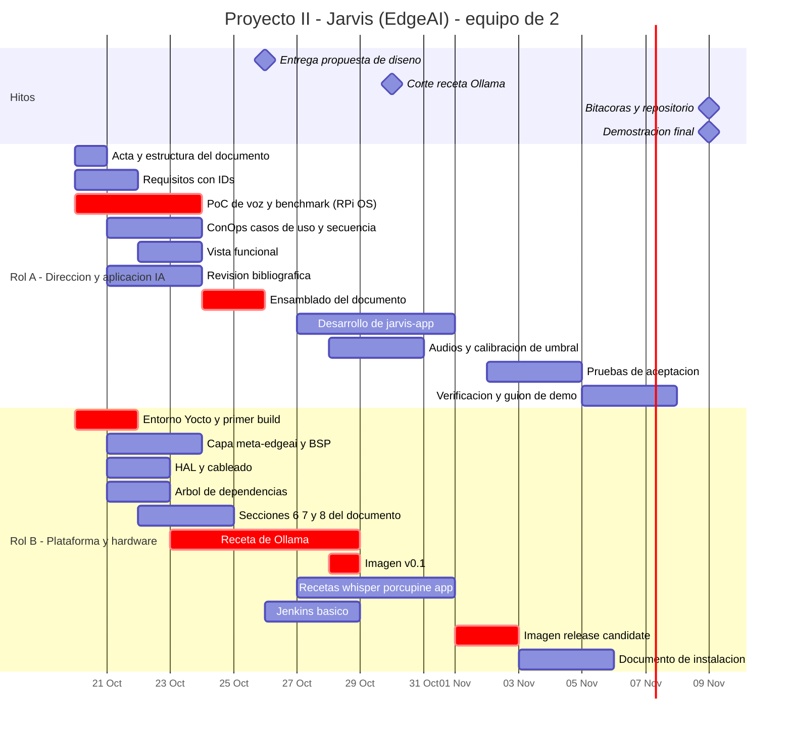

# Proyecto II — Sistema Inteligente de Borde (EdgeAI): "Jarvis"

**Curso:** Sistemas Embebidos · TEC — Escuela de Ingeniería Electrónica
**Facilitador:** Dr. Ing. Johan Carvajal Godínez
**Equipo:** 2 personas (Rol A y Rol B)
**Plataforma:** Raspberry Pi 4 (8 GB) · MicroSD
**Repositorio público:** GitHub · **CI/CD:** Jenkins · **Build de imagen:** Yocto Project · **Inferencia local:** Ollama ≥ 0.35 (API System One / Jev)

---

## 0. Cómo leer este documento

Este README es el **plan de trabajo**, no la propuesta de diseño. Su propósito es que los dos integrantes sepan, desde hoy (martes 20 de octubre), qué les toca, qué necesitan del otro y en qué fecha. Las secciones 5, 6 y 7 son las que se revisan en cada reunión.

| Sección | Para qué sirve |
|---|---|
| 1–3 | Decisiones pendientes, objetivo del sistema y restricciones técnicas reales |
| 4 | Arquitectura del pipeline de voz y presupuesto de latencia |
| 5 | **División del trabajo entre Rol A y Rol B** |
| 6 | **Matriz de dependencias (entregas internas)** |
| 7 | **Ruta crítica y estrategias de desacople** |
| 8 | Cronograma y Gantt |
| 9 | Estrategia Jenkins |
| 10–11 | Repositorio, convenciones y escalabilidad |
| 12–14 | Definition of Done, trazabilidad con la rúbrica y riesgos |
| 15 | Primeras acciones |

---

## 1. Decisiones pendientes

Se aclaran con el profesor en consulta (M 13:00–14:00 / V 11:00–12:00). **Mientras no haya respuesta, se trabaja con la propuesta del equipo**; ninguna de estas decisiones detiene el arranque.

| # | Punto | Propuesta del equipo mientras tanto |
|---|---|---|
| D1 | El objetivo específico 3 menciona **JETSON NANO**; el resto del instructivo dice **Raspberry Pi** | Raspberry Pi 4 (8 GB). El diseño de capas (§11.1) permite migrar cambiando `MACHINE` y agregando la capa BSP |
| D2 | El instructivo define **4 roles** y **una bitácora por rol**; el equipo es de **2 personas** | Rol A = Director + Investigador · Rol B = Líder técnico · Auditoría rotativa (§5.4). Cuatro bitácoras en total |
| D3 | Motor de *wake word*: Porcupine requiere AccessKey y validación periódica en línea | Porcupine como primario (trae "jarvis" integrado); **openWakeWord** como plan B 100 % offline (R-03) |

---

## 2. Objetivo del sistema

Diseñar, sintetizar y demostrar un **asistente de voz embebido, totalmente local**, que:

1. despierta con la palabra clave **"Jarvis"**,
2. transcribe la orden hablada en el propio dispositivo (Whisper.cpp),
3. **decide la intención con un modelo de decisión System One (Jev)** servido por Ollama en `/v1/systemone`, con probabilidades y confianza,
4. actúa sobre hardware real (sensor DHT22, LED) mediante un despachador en Python con arquitectura SOLID, y
5. responde por voz concatenando audios pregrabados,

todo sobre una imagen Linux generada con **Yocto Project**, con build y pruebas automatizadas en **Jenkins**.

### 2.1 Regla de oro de la plataforma

> **Después del arranque, ningún modelo se lee ni se escribe en la MicroSD.** Todos los modelos se cargan una sola vez en RAM al encender y permanecen ahí. Esta regla se verifica con medición (REQ-OPE-001), no se asume.

### 2.2 Por qué un modelo de decisión y no un LLM de chat

La tarea central de Jarvis es **clasificar una frase en una intención acotada**: exactamente lo que hacen los modelos de decisión. No generan texto, sino que eligen entre opciones y reportan la probabilidad de cada una. Eso da tres ventajas que se defienden en la propuesta:

- **Salida tipada por construcción**: no hay JSON mal formado que parsear.
- **Confianza explícita**: si la confianza no supera el umbral, Jarvis responde "no entendí" en lugar de ejecutar una acción equivocada.
- **Una sola solicitud resuelve varias preguntas** (intención, dispositivo destino, si es una orden o una consulta), que es justo lo que describe el instructivo.

### 2.3 Casos de uso de la demostración (mínimo tres)

| # | El usuario dice | Decisión esperada | Acción | Respuesta |
|---|---|---|---|---|
| CU-01 | "Jarvis… hace mucho calor, ¿a cuánto estamos?" | `intent = READ_TEMP` | Lectura del DHT22 | "La temperatura es · 24 · grados" |
| CU-02 | "Jarvis… ¿qué tan húmedo está?" | `intent = READ_HUM` | Lectura del DHT22 | "La humedad es · 61 · por ciento" |
| CU-03 | "Jarvis… prende la luz" / "apágala" | `intent = LED_ON / LED_OFF` | GPIO del LED | "Luz encendida" / "Luz apagada" |
| CU-04 | "Jarvis… cuéntame un chiste" | `intent = UNKNOWN` **o** confianza < umbral | Ninguna | "No entendí, jefe" |

CU-04 es tan importante como los otros: demuestra que el sistema **sabe cuándo no confiar en la IA**.

---

## 3. Restricciones técnicas reales (verificadas)

| Hecho | Consecuencia para el proyecto |
|---|---|
| `POST /v1/systemone` existe desde **Ollama 0.35** (28 sep 2026). La versión estable actual es la 0.40.x | La receta de Yocto fija versión **≥ 0.35**; se recomienda la 0.40.x más reciente al momento del build |
| Los modelos de decisión devuelven **elecciones, probabilidades y puntajes**, no texto. Tipos de pregunta: `choice`, `noul` (sí/no), `score` | El diseño funcional se expresa en esos tres tipos. Insumo directo para la vista funcional |
| `/v1/systemone` sirve solo modelos de decisión (`tev1`, `tev1:0.8b`, `nimble`, …), no modelos de chat como Llama | **No se usa Llama 3.2** en el carril de decisión |
| Una pregunta `choice` de Tev1 admite **máximo 24 opciones**, cada una con descripción no vacía | Límite de diseño explícito → REQ-INT-001 |
| Precisión publicada en 13 datasets: Tev1 4B 73.3 %, **Tev1 0.8B 63.5 %** | El **umbral de confianza es obligatorio**, no opcional. Se calibra con frases reales del equipo |
| Solo `tev1:0.8b` es realista en la Pi 4 (Nimble 9B queda descartado por memoria y latencia) | Modelo de decisión: `tev1:0.8b`, seleccionable por configuración |
| Desde Ollama 0.40.4 el CLI soporta decisiones con `ollama run <modelo> --ask` | Útil para pruebas manuales; **la aplicación habla HTTP crudo** contra el endpoint |
| El tarball oficial `ollama-linux-arm64` pesa **~1.45 GB** | Receta binaria posible, pero pesada. Se evalúa contra compilar desde fuente (R-01) |
| Porcupine requiere **AccessKey** y la valida **en línea cada cierto tiempo** | Riesgo en la demo si no hay red (R-03) |
| La Pi 4 **no tiene entrada de micrófono** y no tiene GPU utilizable por Ollama | Micrófono USB o tarjeta de sonido USB. Inferencia solo en CPU |
| No hay capa Yocto pública y mantenida para Ollama | Receta propia en `meta-edgeai` (R-01) |

---

## 4. Arquitectura de referencia

### 4.1 Pipeline

```
┌──────────────────────── Raspberry Pi 4 · 8 GB (todo en RAM tras el arranque) ────────────────────────┐
│                                                                                                       │
│  Micrófono USB                                                                                        │
│      │ PCM 16 kHz                                                                                     │
│      ▼                                                                                                │
│  ┌──────────────────┐  "jarvis"  ┌────────────────────┐  audio en memoria  ┌──────────────────────┐   │
│  │ 1. Wake word     │ ─────────► │ 2. Captura + VAD   │ ─────────────────► │ 3. STT               │   │
│  │ Porcupine ~20 MB │   pitido   │ corta al silencio  │                    │ whisper-server       │   │
│  └──────────────────┘            └────────────────────┘                    │ (persistente)        │   │
│                                                                            └──────────┬───────────┘   │
│                                                                                       │ texto          │
│                                                                                       ▼                │
│  ┌──────────────────────────────┐  POST /v1/systemone   ┌───────────────────────────────────────┐    │
│  │ 4. Decisión (Jev)            │ ◄──────────────────── │ Orquestador (jarvis-app)              │    │
│  │ ollama.service · tev1:0.8b   │ ────────────────────► │  - construye el state y las preguntas │    │
│  │ keep_alive = -1              │  choice + confianza   │  - aplica el umbral de confianza      │    │
│  └──────────────────────────────┘                       └──────────────────┬────────────────────┘    │
│                                                                            │ intención                │
│                                                                            ▼                          │
│                                     ┌──────────────────────────────────────────────────────┐          │
│                                     │ 5. Despachador (SOLID)                               │          │
│                                     │  registro intención → handler                        │          │
│                                     │  HAL: TempHumSensor (DHT22 vía IIO) · Led (gpiod)    │          │
│                                     └───────────────────────┬──────────────────────────────┘          │
│                                                             │ resultado (ej. 24.5 °C)                 │
│                                                             ▼                                         │
│                                     ┌──────────────────────────────────────────────────────┐          │
│                                     │ 6. Motor de plantillas de audio                      │          │
│                                     │  la_temperatura_es.wav + 24.wav + grados.wav → ALSA  │ ─► Parlante│
│                                     └──────────────────────────────────────────────────────┘          │
│                                                                                                       │
│  systemd: ollama.service → jarvis-warmup.service → whisper-server.service → jarvis.service            │
│  Config: /etc/jarvis/config.yaml · journald volátil · /tmp en tmpfs                                   │
└───────────────────────────────────────────────────────────────────────────────────────────────────────┘
```

### 4.2 Ejemplo de solicitud al carril de decisión

```json
POST http://localhost:11434/v1/systemone
{
  "model": "tev1:0.8b",
  "state": "hace mucho calor, dime a cuánto estamos",
  "questions": {
    "intent": {
      "type": "choice",
      "instructions": "¿Qué acción pide el usuario?",
      "criteria": {
        "READ_TEMP": "Consultar la temperatura",
        "READ_HUM":  "Consultar la humedad",
        "LED_ON":    "Encender una luz",
        "LED_OFF":   "Apagar una luz",
        "UNKNOWN":   "Ninguna de las anteriores"
      }
    }
  }
}
```

El catálogo de intenciones **no vive en el código**: vive en `contracts/intents.yaml` (§7.2).

### 4.3 Decisiones de diseño clave

| Decisión | Justificación |
|---|---|
| `whisper-server` como servicio persistente, no `whisper-cli` por comando | Invocar el CLI recarga el modelo desde la SD en cada orden y viola la regla de oro |
| VAD en lugar de grabación de duración fija | Menos latencia y sin frases cortadas |
| DHT22 por el driver del kernel (`dtoverlay=dht11,gpiopin=4`, compatible con DHT22) leído por IIO en `/sys/bus/iio/` | El *bit-banging* desde Python es inestable en Linux |
| Hilo de muestreo del sensor cada 2 s que mantiene el último valor válido | El DHT22 no admite lecturas más frecuentes y falla esporádicamente; la respuesta no espera al sensor |
| LED con `libgpiod` (`python3-gpiod`) | RPi.GPIO y la interfaz sysfs están en desuso |
| Respuestas por concatenación de WAV pregrabados (mismo formato para todos) | Latencia y consumo de CPU casi nulos frente a TTS en tiempo real |
| `OLLAMA_KEEP_ALIVE=-1` + servicio de calentamiento al arranque | El modelo queda residente desde que el sistema enciende |

### 4.4 Presupuesto de latencia (estimación inicial; Rol A la reemplaza con datos el viernes 23)

| Etapa | Estimado |
|---|---|
| Detección de wake word | < 0.1 s |
| Fin de habla detectado por VAD | 0.5–1 s después de callar |
| Transcripción (Whisper tiny/base) | 1–4 s |
| Decisión (`tev1:0.8b`, CPU) | 2–6 s |
| Despacho + lectura en caché del sensor | < 0.1 s |
| Inicio de la respuesta de audio | < 0.2 s |
| **Total desde que el usuario calla** | **≈ 4–10 s** → objetivo a fijar en REQ-PER-001 |

Mientras procesa, Jarvis reproduce un sonido corto de "procesando" para que la espera no se perciba como falla.

---

## 5. División del trabajo

### 5.1 Roles

| Rol | Persona | Roles del instructivo que cubre | Responsabilidad nuclear |
|---|---|---|---|
| **Rol A — Director de Proyecto e Ingeniero de Aplicación de IA** | _(asignar)_ | Director(a) de proyecto + Investigador(a) | Documento de propuesta, pipeline de voz e IA, benchmark y verificación |
| **Rol B — Líder Técnico / Arquitecto de Plataforma** | _(asignar)_ | Líder técnico | Yocto, recetas, imagen, capa de hardware (HAL), Jenkins e instalación |

El rol de **auditor(a) de calidad** rota semanalmente entre A y B (§5.4).

**Criterio de la división:** cada persona es dueña de un lado de una interfaz bien definida. A trabaja *por encima* de la HAL y del endpoint de Ollama; B trabaja *por debajo* (sistema operativo, servicios, drivers y hardware). La frontera son los contratos de §7.2.

### 5.2 Desglose detallado

#### Rol A — Director de Proyecto e Ingeniero de Aplicación de IA

**Gestión**
- Convocar reuniones, llevar actas y ser el punto de contacto con el profesor.
- Mantener el tablero de *issues* `handoff` (§6) y el control de avance.

**Propuesta de diseño (autor principal)**
- Introducción y justificación con **10 referencias adicionales** a las del instructivo (ítem 1).
- Síntesis del problema **con palabras propias** (ítem 2).
- Gestión de requerimientos: descomposición con IDs trazables (ítem 3, §5.5).
- **Concepto de operaciones**, diagrama de casos de uso y diagramas de secuencia por etapa del pipeline (ítem 4, 15 %).
- Vista funcional: descomposición funcional y asignación función → componente (ítem 5).
- Gantt, hitos y conclusiones (ítems 9 y 10).
- Ensamblado y edición final del PDF.

**Aplicación**
- Investigación de Ollama/Jev: tipos de pregunta, límites, formato de respuesta, comportamiento de la confianza en español.
- Prueba de concepto en **Raspberry Pi OS** (tarjeta SD de desarrollo) con el pipeline completo.
- Módulos `wakeword`, `capture` (con VAD), `stt` (cliente de `whisper-server`), `decision` (cliente de `/v1/systemone`), `orchestrator` y `voice` (motor de plantillas).
- Catálogo de intenciones `contracts/intents.yaml` y **calibración del umbral de confianza**.
- Grabación y normalización de los audios de respuesta (mismo *sample rate*, canales y profundidad).
- **Mock de `/v1/systemone`** para pruebas sin hardware.

**Verificación**
- Benchmark en el borde: latencia por etapa (p50/p95), RAM residente, temperatura, tasa de aciertos de intención y falsas activaciones del wake word.
- Plan de pruebas, pruebas unitarias (contra el mock y una HAL falsa) y pruebas de aceptación de CU-01 a CU-04.
- En Jenkins: etapas `lint`, `unit-test`, `package-app` y `docs`.

#### Rol B — Líder Técnico / Arquitecto de Plataforma

**Plataforma Yocto**
- Entorno: *poky* + `meta-openembedded` (`meta-oe`, `meta-python`, `meta-multimedia`) + `meta-raspberrypi`, con revisiones **fijadas**. `MACHINE = "raspberrypi4-64"`.
- Capa propia **`meta-edgeai`**:
  - receta de **Ollama** (≥ 0.35) y su unidad systemd,
  - receta de modelos (`tev1:0.8b` horneado en la imagen, `OLLAMA_MODELS` apuntando a él),
  - receta de **whisper.cpp** + modelo + unidad `whisper-server.service`,
  - receta de **pvporcupine** (o openWakeWord en plan B),
  - receta de la aplicación `jarvis-app`, los audios y `jarvis.service`,
  - receta de imagen `jarvis-image.bb`.
- Configuración del BSP: `RPI_EXTRA_CONFIG` con el *overlay* del DHT22, audio ALSA USB, journald volátil, `/tmp` en tmpfs y, si da tiempo, rootfs de solo lectura.
- Construir, flashear e instalar la imagen; **documento paso a paso** de generación e instalación.

**Hardware y HAL**
- Cableado y validación del DHT22, LED, micrófono USB y parlante; disipador o ventilador; fuente 5 V / 3 A.
- Implementación de la HAL en Python: `Dht22IioSensor` y `GpiodLed` sobre las interfaces abstractas de `contracts/hal.py`.

**Propuesta de diseño (autor de las secciones técnicas)**
- Arquitectura del sistema: mapeo función → componente de hardware y software (ítem 6, coautor con A).
- **Árbol de dependencias** graficado con relaciones entre paquetes (ítem 7).
- **Estrategia de integración** de hardware y software (ítem 8, 15 %).

**CI/CD**
- Jenkins: controlador en Docker, agente de build con `SSTATE_DIR` y `DL_DIR` persistentes, etapas `build-image`, `artifacts`, `hil-test` y `release`.

### 5.3 Balance de carga estimado (horas)

| Fase | A | B |
|---|---:|---:|
| Investigación y prueba de concepto (20–23 oct) | 8 | 6 |
| Propuesta de diseño (20–26 oct) | 22 | 12 |
| Plataforma Yocto y Jenkins (20 oct–1 nov) | 0 | 20 |
| Aplicación y HAL (26 oct–1 nov) | 16 | 6 |
| Integración y verificación (2–8 nov) | 10 | 10 |
| Bitácoras, repositorio y demo | 6 | 6 |
| **Total** | **62** | **60** |

A concentra la carga documental en la semana de la propuesta, mientras B deja corriendo los builds de Yocto, que avanzan solos durante horas. En la semana 2 la carga se invierte: B entra en la parte más pesada de recetas y A en la aplicación.

### 5.4 Rotación del rol de auditoría

Con dos personas, **toda PR la aprueba la otra persona**. Además, cada semana una de las dos hace una auditoría formal:

| Semana | Auditor(a) | Qué audita |
|---|---|---|
| S1 (20–25 oct) | **B** | Documento de propuesta contra la rúbrica, ítem por ítem |
| S2 (26 oct–1 nov) | **A** | Recetas, árbol de dependencias, cumplimiento de la regla de oro en la imagen |
| S3 (2–8 nov) | **B** | Aplicación, cobertura de pruebas, reporte de verificación |
| Cierre (8 nov) | **A** | Reproducibilidad del build desde cero y documento de instalación |

Cada auditoría deja una entrada fechada y firmada en `docs/bitacoras/bitacora-auditoria.md` con hallazgos, severidad, responsable y fecha de cierre.

### 5.5 Formato de requisitos (lo define A el día 1)

```
REQ-<CAT>-<nnn> | El <sujeto> deberá <acción> <objeto> <condición> <criterio medible>
CAT: FUN (funcional) · PER (desempeño) · INT (interfaz) · ESC (escalabilidad) · OPE (operación)
Campos: ID · enunciado · origen (instructivo / derivado) · verificación (I/A/D/T) · prioridad
```

Semilla (A la descompone y amplía):

| ID | Enunciado | Verificación |
|---|---|---|
| REQ-FUN-001 | El sistema deberá activarse únicamente al detectar la palabra clave "Jarvis" | Prueba |
| REQ-FUN-002 | El sistema deberá transcribir la orden hablada sin acceso a red externa | Demostración |
| REQ-FUN-003 | El sistema deberá clasificar la intención mediante un modelo de decisión en `/v1/systemone` | Inspección |
| REQ-FUN-004 | El sistema deberá responder "no entendí" cuando la confianza de la decisión sea menor a _U_ | Prueba |
| REQ-FUN-005 | El sistema deberá informar por voz la temperatura y humedad medidas por el DHT22 | Demostración |
| REQ-FUN-006 | El sistema deberá encender y apagar el LED por orden de voz | Demostración |
| REQ-PER-001 | La latencia p95 entre el fin del habla y el inicio de la respuesta no deberá exceder _X_ s | Prueba |
| REQ-PER-002 | El consumo total de RAM con todos los modelos cargados deberá ser menor a _Y_ GB | Prueba |
| REQ-PER-003 | La tasa de aciertos de intención sobre el conjunto de frases de prueba deberá ser al menos _Z_ % | Prueba |
| REQ-INT-001 | Cada pregunta `choice` deberá tener como máximo 24 opciones con descripción no vacía | Análisis |
| REQ-OPE-001 | Tras el arranque, el sistema no deberá leer archivos de modelo de la MicroSD durante 10 órdenes consecutivas (medido en `/proc/diskstats`) | Prueba |
| REQ-OPE-002 | Los servicios deberán arrancar automáticamente y reiniciarse ante fallo | Prueba |
| REQ-ESC-001 | Agregar una intención nueva deberá requerir solo una entrada en `intents.yaml` y un *handler*, sin modificar el orquestador | Inspección |
| REQ-ESC-002 | El modelo de decisión deberá ser sustituible por configuración, sin reconstruir la imagen | Demostración |

Los valores _U_, _X_, _Y_ y _Z_ los fija A con el benchmark del viernes 23. **Un requisito sin número no es un requisito.**

---

## 6. Matriz de dependencias entre roles

Cada fila es una **entrega interna** con fecha límite y consecuencia de incumplimiento.

| # | De → Para | Artefacto | Fecha límite | Qué desbloquea | Si se atrasa |
|---|---|---|---|---|---|
| H1 | **A → B** | Catálogo de intenciones v0 + lista preliminar de dependencias de la app (paquetes, modelos y tamaños) | **mié 21 oct** | Diseño de recetas y árbol de dependencias | B escribe recetas contra supuestos |
| H2 | **B → A** | `contracts/hal.py` (interfaces) + pinout y cableado validados en Raspberry Pi OS | **mié 21 oct** | Despachador y pruebas con HAL falsa | A no puede cerrar el despachador |
| H3 | **B → A** | Árbol de dependencias + diagrama de capas Yocto (borrador) | **jue 22 oct** | Ítems 7 y 8 de la propuesta (20 %) | A no puede cerrar el documento |
| H4 | **A → B** | Resultados del benchmark en Raspberry Pi OS (latencia por etapa, RAM, aciertos) | **vie 23 oct** | Requisitos de desempeño, elección tiny/base de Whisper | Requisitos sin número; documento sin evidencia |
| H5 | **B → A** | Secciones de arquitectura, dependencias e integración redactadas | **sáb 24 oct** | Ensamblado final | Entrega apurada el domingo |
| H6 | **B → A** | Revisión de auditoría de la propuesta | **dom 25 oct** | Versión final | Errores llegan al profesor |
| — | **A → profesor** | **Propuesta de diseño en PDF** | **lun 26 oct, 12:00 md** | — | Pérdida del 10 % |
| H7 | **B → A** | Imagen v0.1 que arranca con `ollama.service` y `tev1:0.8b` residente | **mié 28 oct** | Pruebas de la app sobre Yocto | Se sigue probando solo en Raspberry Pi OS (mitigado, §7.2) |
| H8 | **A → B** | Paquete versionado de `jarvis-app` + audios normalizados | **jue 29 oct** | Receta de la aplicación | La imagen no puede integrar la app |
| H9 | **B → A** | Imagen *release candidate* con todo integrado | **lun 2 nov** | Pruebas de aceptación sobre la imagen final | No hay margen para corregir |
| H10 | **A → B** | Reporte de verificación con hallazgos | **mié 4 nov** | Correcciones finales en la imagen | Demo con fallas conocidas |
| H11 | **B → A** | Imagen final + segunda SD flasheada + documento de instalación | **vie 6 nov** | Validación del procedimiento por A y ensayo de la demo | Demo sin respaldo |
| H12 | **ambos** | Bitácoras completas y revisadas | **dom 8 nov** | Entrega del 9 de noviembre | Pérdida del 5 % |

### 6.1 Qué necesita cada quien del otro

```
A necesita de B ──► interfaces HAL, cableado, árbol de dependencias, diagrama de capas,
                     imagen v0.1 / RC, acceso SSH al target, documento de instalación
B necesita de A ──► catálogo de intenciones, lista de dependencias de la app, paquete de la app,
                     audios, números del benchmark, requisitos con número
```

**Regla del equipo:** ninguna dependencia se comunica solo de palabra. Cada entrega es un *issue* de GitHub con etiqueta `handoff`, asignado a quien recibe, y se cierra cuando quien recibe confirma que le sirve.

---

## 7. Ruta crítica y desacople

### 7.1 Ruta crítica

```
[primer bitbake de core-image-base] → [receta de Ollama ≥ 0.35] → [H7 imagen v0.1]
      → [recetas whisper / porcupine / app] → [H9 RC] → [verificación] → [demo]
```

El cuello de botella es **la receta de Ollama en Yocto**, no la aplicación. Por eso **B lanza hoy el build de `core-image-base` para `raspberrypi4-64`**, aunque no exista todavía nada de la aplicación: no depende de ninguna decisión de diseño y deja la `sstate-cache` caliente para todas las iteraciones siguientes.

### 7.2 Estrategias de desacople

1. **Contratos primero (antes del jueves 22 de octubre).** Se congelan en `contracts/`:
   - `intents.yaml`: intenciones, descripciones, *handler* y plantilla de audio de cada una.
   - `hal.py`: interfaces abstractas `TempHumSensor` y `Actuator`.
   - Nombres de las unidades systemd, ruta `/etc/jarvis/config.yaml` y puertos (`11434` Ollama, `8080` whisper-server).
2. **Mock de `/v1/systemone` y HAL falsa.** A entrega un servidor falso (~50 líneas) con la forma exacta del endpoint real y una HAL simulada. Permite desarrollar y probar sin hardware, sin modelo y sin Yocto. Vive en `tools/mock-systemone/`.
3. **Una sola Raspberry, dos tarjetas SD.** SD-1 con Raspberry Pi OS para desarrollo (A); SD-2 con la imagen Yocto (B). El cambio de tarjeta toma un minuto. **Turnos de uso del hardware** acordados en la reunión de los lunes; el build de Yocto corre en la PC, así que la Pi casi siempre está libre para A durante la semana 1.
4. **Audio de prueba inyectable.** El pipeline acepta un archivo WAV en lugar del micrófono (`--input test.wav`). Permite pruebas automáticas y repetibles en Jenkins sin hablarle a la Pi.
5. **Timebox con plan B explícito.** Si la receta de Ollama no funciona al **viernes 30 de octubre**, se aplica el plan B de R-01 y se documenta como hallazgo de ingeniería, no como falla.

---

## 8. Cronograma

### 8.1 Por semana

| Semana | Fechas | Rol A | Rol B | Hito |
|---|---|---|---|---|
| **S1** | mar 20 – dom 25 oct | Requisitos, ConOps, casos de uso, secuencia, vista funcional, referencias, PoC y benchmark en Raspberry Pi OS, **ensamblado del PDF** | **Primer build de Yocto**, capa `meta-edgeai`, HAL y cableado, árbol de dependencias, secciones 6–8, inicio de la receta de Ollama | H1–H6 |
| **S2** | lun 26 oct – dom 1 nov | **Entrega de la propuesta (lun 12:00)**, desarrollo de la app, mock, audios, calibración del umbral | Receta de Ollama, imagen v0.1, recetas de whisper/porcupine/app, Jenkins básico | H7·H8 · **corte Ollama vie 30** |
| **S3** | lun 2 – dom 8 nov | Pruebas de aceptación, reporte de verificación, guion de la demo, validación del documento de instalación | Imagen RC y final, correcciones, documento de instalación, segunda SD | H9–H12 |
| **S4** | desde lun 9 nov | **Entrega de bitácoras y repositorio** · **Demostración en K1-420** | | Entrega final |

### 8.2 Gantt (fuente para el ítem 9 de la rúbrica)



### 8.3 Ritmo de reuniones

| Cuándo | Duración | Agenda |
|---|---|---|
| Lunes y jueves | 30 min | Qué hice, qué sigue, qué me bloquea. Revisión de §6 y turnos de la Raspberry |
| Viernes | 30 min | Revisión del auditor de la semana y planificación de la siguiente |
| Consulta con el profesor | según horario | Al menos una antes del 26 de octubre (puntos de §1) y una antes del 9 de noviembre |

Actas en `docs/actas/YYYY-MM-DD.md`, responsabilidad de A.

---

## 9. Estrategia de CI/CD con Jenkins

Con dos personas, Jenkins se mantiene **pequeño pero real**: automatiza lo lento (el build de Yocto) y lo repetible (las pruebas), y deja evidencia fechada para las bitácoras.

### 9.1 Topología

| Nodo | Etiqueta | Dónde corre | Función |
|---|---|---|---|
| Controlador + agente de build | `yocto-builder` | Docker en la PC de B (x86-64, ≥ 16 GB RAM, ≥ 150 GB libres) | Orquestación, `bitbake`, cachés persistentes |
| Agente de aplicación | `app` | Contenedor Python | Lint, pruebas unitarias, empaquetado |
| Agente de hardware (opcional) | `rpi-target` | La propia Raspberry con la imagen Yocto | Prueba *hardware-in-the-loop* con audio inyectado |

### 9.2 Etapas del pipeline

| # | Etapa | Dueño | Disparador | Qué hace |
|---|---|---|---|---|
| 1 | `checkout` | B | todo | Clona y resuelve submódulos |
| 2 | `lint` | A | todo | `ruff` + `yamllint` + `oelint-adv` sobre las recetas |
| 3 | `unit-test` | A | todo | `pytest` contra el mock de `/v1/systemone` y la HAL falsa |
| 4 | `package-app` | A | todo | Paquete versionado de `jarvis-app` + audios |
| 5 | `build-image` | B | `main` + nocturno | `bitbake jarvis-image`, parametrizado por `MACHINE` |
| 6 | `artifacts` | B | tras 5 | Archiva `.wic.bz2`, manifiesto de licencias y `buildhistory` |
| 7 | `hil-test` | A | manual / nocturno | Despliega, verifica servicios, inyecta WAV de prueba de CU-01 a CU-04, mide latencia y lecturas de SD |
| 8 | `docs` | A | todo | Genera el PDF y valida la trazabilidad de requisitos |
| 9 | `release` | B | tag `v*` | Publica la *release* en GitHub con imagen y documentos |

**Parámetros:** `MACHINE` (`raspberrypi4-64`), `DECISION_MODEL` (`tev1:0.8b`), `WHISPER_MODEL` (`tiny` / `base`), `WAKEWORD_ENGINE` (`porcupine` / `openwakeword`).

### 9.3 Decisiones del pipeline

- `SSTATE_DIR` y `DL_DIR` en volumen persistente: un rebuild incremental baja de horas a minutos.
- Revisiones de capas fijadas en `yocto/conf-templates/bblayers.conf.sample`; el pipeline falla si una capa apunta a una rama móvil.
- Versión `v<major>.<minor>.<build>` con hash del commit en `/etc/jarvis/version`: cada demo es trazable a un commit exacto.

---

## 10. Estructura del repositorio

```
edgeai-jarvis/
├── README.md                      ← este documento
├── Jenkinsfile
├── docs/
│   ├── propuesta/                 fuentes del documento y figuras
│   ├── diagramas/                 PlantUML / Mermaid + exportaciones
│   ├── imagen/                    procedimiento de generación e instalación
│   ├── benchmark/                 resultados crudos y gráficos
│   ├── actas/
│   └── bitacoras/
│       ├── bitacora-director.md       (A)
│       ├── bitacora-investigador.md   (A)
│       ├── bitacora-lider-tecnico.md  (B)
│       └── bitacora-auditoria.md      (rotativa, entradas firmadas)
├── contracts/
│   ├── intents.yaml               catálogo de intenciones
│   └── hal.py                     interfaces abstractas de hardware
├── app/
│   ├── src/jarvis/
│   │   ├── wakeword.py            (A)
│   │   ├── capture.py             captura + VAD (A)
│   │   ├── stt.py                 cliente de whisper-server (A)
│   │   ├── decision.py            cliente de /v1/systemone (A)
│   │   ├── orchestrator.py        estado y umbral de confianza (A)
│   │   ├── dispatcher.py          registro intención → handler (A)
│   │   ├── voice.py               motor de plantillas de audio (A)
│   │   ├── hal/                   Dht22IioSensor, GpiodLed (B)
│   │   └── config.py
│   ├── assets/audio/              WAV normalizados
│   ├── tests/
│   └── pyproject.toml
├── yocto/
│   ├── meta-edgeai/
│   │   ├── conf/layer.conf
│   │   ├── recipes-ai/ollama/
│   │   ├── recipes-ai/models/
│   │   ├── recipes-multimedia/whisper-cpp/
│   │   ├── recipes-python/python3-pvporcupine/
│   │   ├── recipes-jarvis/jarvis-app/
│   │   ├── recipes-bsp/           bbappend de config.txt (overlay DHT22)
│   │   └── recipes-core/images/jarvis-image.bb
│   ├── conf-templates/            local.conf.sample · bblayers.conf.sample
│   └── scripts/setup-env.sh
├── ci/
│   ├── build-image.sh
│   └── hil-smoke-test.sh
└── tools/
    ├── mock-systemone/
    └── test-audio/                WAV de prueba para CU-01 a CU-04
```

### 10.1 Convenciones

- **Ramas:** `main` protegida · ramas cortas `feat/`, `fix/`, `docs/`, `yocto/`.
- **Pull requests:** obligatorias, aprobadas por la otra persona; enlazan el requisito o *issue* que atienden.
- **Commits:** *conventional commits* (`feat:`, `fix:`, `docs:`, `ci:`, `build:`).
- **Issues:** etiquetas `handoff`, `blocker`, `rubrica-<n>`.
- **Bitácoras:** una entrada por sesión con fecha, actividades, productos obtenidos, problemas encontrados y referencias consultadas. **Se escriben el mismo día.**

---

## 11. Escalabilidad

### 11.1 De plataforma

- `meta-edgeai` es **agnóstica de máquina**: ninguna receta de aplicación referencia `raspberrypi`; lo específico vive en *bbappends* de `recipes-bsp/`.
- Migrar de plataforma = cambiar `MACHINE` y agregar la capa BSP (REQ-ESC-002 aplica también al modelo).

### 11.2 De modelo

- Interfaces `DecisionEngine` y `SpeechToText` en la app: Ollama y whisper.cpp son *una* implementación cada uno.
- Modelo seleccionable en `/etc/jarvis/config.yaml`: pasar de `tev1:0.8b` a `tev1` 4B en un hardware con más memoria es editar una línea y reiniciar el servicio (REQ-ESC-002).

### 11.3 De funcionalidad

- **Principio abierto/cerrado:** una intención nueva es una entrada en `intents.yaml`, un *handler* registrado y sus audios. El orquestador no cambia (REQ-ESC-001).
- Un sensor o actuador nuevo es una clase más que implementa la interfaz de `contracts/hal.py`.
- Varias preguntas en una sola solicitud a `/v1/systemone` (intención + dispositivo destino): agregar una dimensión de decisión no agrega una llamada.

### 11.4 Horizontal (fuera de alcance, pero diseñado)

- Interfaz de publicación de eventos (MQTT) para que varios nodos Jarvis reporten a un concentrador.
- Actualizaciones OTA con partición A/B (RAUC o swupdate) contempladas en el diseño de la imagen.

Declararlo como trabajo futuro con la interfaz ya pensada es honesto y demuestra criterio de diseño.

---

## 12. Definition of Done

### Propuesta de diseño (lun 26 oct, 12:00 md)

- [ ] Los 10 ítems de la rúbrica al nivel *esperado*
- [ ] Introducción con **10 referencias adicionales** a las del instructivo
- [ ] Problema sintetizado **con palabras propias**
- [ ] Requisitos derivados con IDs y números del benchmark
- [ ] ConOps + diagrama de casos de uso + diagramas de secuencia por etapa, **descritos en detalle**
- [ ] Descomposición funcional trazada a requisitos
- [ ] Diagrama de arquitectura con mapeo función → componente de hardware y software
- [ ] Árbol de dependencias graficado con relaciones entre paquetes
- [ ] Arquitectura integrada de hardware y software ilustrada y descrita
- [ ] Gantt + lista de actividades e hitos
- [ ] Conclusiones con aspectos concretos para la implementación
- [ ] Auditoría de B completada **antes** del domingo 25

### Bitácoras y repositorio (lun 9 nov)

- [ ] Cuatro bitácoras en PDF con todos los campos por entrada
- [ ] Repositorio público con build reproducible desde cero documentado
- [ ] Historial de Jenkins con artefactos conservados
- [ ] Procedimiento de instalación **validado por A**, que no lo escribió

### Demostración (semana del 9 nov, K1-420)

- [ ] Imagen final arrancando desde cero y escuchando sin intervención
- [ ] CU-01 a CU-04 en vivo
- [ ] Flujo de síntesis del sistema operativo explicado con las recetas a la vista
- [ ] Medición en vivo de la regla de oro (`/proc/diskstats` antes y después de varias órdenes)
- [ ] Ensayo completo cronometrado al menos 48 h antes
- [ ] Contingencia: video de respaldo, segunda SD y, si se usa Porcupine, red disponible confirmada

---

## 13. Trazabilidad con la rúbrica

| Ítem de la rúbrica | Peso | Responsable | Insumos de |
|---|---:|---|---|
| 1. Justificación y revisión bibliográfica | 10 % | A | — |
| 2. Descripción y síntesis del problema | 10 % | A | — |
| 3. Gestión de requerimientos | 10 % | A | B (restricciones de plataforma) |
| 4. Vista operacional | 15 % | A | B (secuencia de arranque de servicios) |
| 5. Vista funcional | 10 % | A | — |
| 6. Arquitectura del sistema | 10 % | A + B | — |
| 7. Análisis de dependencias | 5 % | **B** | A (dependencias de la app) |
| 8. Estrategia de integración | 15 % | **B** | A (pipeline y servicios de la app) |
| 9. Planeamiento de la ejecución | 5 % | A | este README |
| 10. Conclusiones | 10 % | A | B (hallazgos de Yocto) |

Los ítems 4 y 8 suman el 30 % de la propuesta y quedan **uno en cada rol**, lo que equilibra la responsabilidad sobre la nota.

---

## 14. Riesgos

| ID | Riesgo | Prob. | Impacto | Mitigación / Plan B |
|---|---|---|---|---|
| **R-01** | La receta de Ollama ≥ 0.35 para `arm64` no compila o no arranca | **Alta** | **Alto** | Vía A: receta que empaquete el binario oficial `arm64` (~1.45 GB). Vía B: compilar desde fuente solo para CPU. **Corte: vie 30 oct**. Si ninguna funciona: contenedor (`meta-virtualization` + Podman) ejecutando Ollama, documentado como hallazgo |
| **R-02** | `tev1:0.8b` clasifica mal las frases en español | Media | **Alto** | Descripciones de opciones cortas y claras; umbral de confianza; plan B: Whisper en modo `translate` (inglés) hacia el modelo de decisión. Se evalúa en el benchmark del 23 |
| **R-03** | Porcupine no valida la AccessKey sin internet durante la demo | Media | **Alto** | Confirmar red en K1-420; plan B openWakeWord ("hey jarvis") seleccionable por `WAKEWORD_ENGINE` |
| **R-04** | Whisper tiny transcribe mal en español | Media | Medio | Comparar tiny vs base en el benchmark; parámetro `WHISPER_MODEL` |
| **R-05** | Latencia total percibida como excesiva | Media | Medio | Sonido de "procesando", VAD, preguntas cortas, `keep_alive = -1`, prompts mínimos |
| **R-06** | El DHT22 devuelve errores de lectura | **Alta** | Bajo | Driver IIO del kernel, reintentos y caché del último valor válido |
| **R-07** | Escrituras residuales en la SD (logs, temporales) | Media | Medio | journald volátil, `/tmp` en tmpfs, medición con `/proc/diskstats` (REQ-OPE-001) |
| **R-08** | Estrangulamiento térmico bajo inferencia | Media | Medio | Disipador o ventilador; registrar temperatura en el benchmark |
| **R-09** | Una sola Raspberry compartida entre dos personas | **Alta** | Medio | Dos SD, turnos acordados, mock y HAL falsa para trabajar sin hardware |
| **R-10** | Con dos personas, la ausencia de una detiene su mitad del proyecto | Media | **Alto** | Contratos escritos, documentación en el repositorio y una sesión semanal de 20 min donde cada quien le muestra al otro cómo correr su parte |
| **R-11** | Falla de hardware o de SD en la demo | Baja | **Alto** | Segunda SD flasheada, video de respaldo, ensayo 48 h antes |

---

## 15. Primeras acciones (hoy y mañana)

| Quién | Qué | Cuándo |
|---|---|---|
| Ambos | Reunión de arranque: asignar A y B, aprobar este plan y el catálogo de intenciones preliminar | Hoy, mar 20 |
| **B** | **Lanzar `bitbake core-image-base` para `raspberrypi4-64`.** No esperar nada | Hoy, mar 20 |
| A | Crear el repositorio con la estructura de §10 y abrir los *issues* `handoff` de §6 | Hoy, mar 20 |
| A | En Raspberry Pi OS (SD-1): instalar Ollama, `ollama pull tev1:0.8b` y primera llamada a `/v1/systemone` con frases en español | Hoy, mar 20 |
| B | Cablear DHT22 y LED, validar el *overlay* IIO y escribir `contracts/hal.py` | Mié 21 |
| A | Requisitos v0.1 con IDs y lista preliminar de dependencias de la app (H1) | Mié 21 |
| A | Redactar la consulta al profesor con los puntos de §1 | Mié 21 |

---

## Referencias técnicas consultadas

- Ollama — notas de versión 0.35 a 0.40.x: endpoint `/v1/systemone`, modelos de decisión y `--ask` en el CLI
- Documentación de TypeSafe sobre Jev / System One y los tipos `choice`, `noul` y `score`
- LocalAI — Decisions API: límites de opciones de Tev1
- Together AI — ficha del modelo Tev1-0.8B-experimental
- Picovoice — documentación de Porcupine y AccessKey
- whisper.cpp — `whisper-server` y modelos ggml
- Yocto Project Reference Manual y `meta-raspberrypi`
- Jenkins Pipeline — sintaxis declarativa

> A amplía esta lista a las 10 referencias adicionales del ítem 1 de la rúbrica, priorizando artículos arbitrados sobre inferencia en el borde, asistentes de voz embebidos, cuantización y síntesis de sistemas operativos embebidos.
