# Análisis de dependencias — `jarvis-image`

**Ítem 7 de la rúbrica de la propuesta de diseño (5 %)**
Proyecto II · Sistemas Embebidos · TEC — Rol B
Datos obtenidos del build del 23 de octubre de 2026 (`bitbake -g jarvis-image` y manifiesto de la imagen).

---

## 1. Método

El árbol no se elaboró de forma especulativa: se extrajo del propio sistema de build.

| Insumo | Comando | Qué aporta |
|---|---|---|
| Lista de paquetes instalados | manifiesto de `jarvis-image` | Qué queda realmente en la imagen |
| Grafo de dependencias de tareas | `bitbake -g jarvis-image` → `task-depends.dot` | Relaciones entre recetas |
| Tamaño por componente | RPMs en `tmp/deploy/rpm/` | Dimensionamiento y peso relativo |

Se descartaron del análisis los paquetes `-native`, `-cross`, `-dbg`, `-dev`, `-src` y `-ptest`: son herramientas del host y artefactos de depuración que participan en la construcción pero **no se instalan en el dispositivo**.

---

## 2. Árbol de dependencias

```mermaid
graph TD
    IMG["jarvis-image<br/>2.3 GB comprimida"]

    IMG --> BASE["core-image-base<br/>sistema base + systemd"]
    IMG --> AI["Subsistema de inferencia"]
    IMG --> VOZ["Subsistema de voz"]
    IMG --> HW["Acceso a hardware"]
    IMG --> NET["Conectividad"]
    IMG --> CFG["Configuración propia"]

    AI --> OB["ollama-bin 0.40.6<br/>16 MB · binario arm64"]
    AI --> MT["ollama-model-tev1 0.8b<br/>755 MB · OBLIGATORIO"]
    AI --> ML["ollama-model-llama32 1b<br/>1205 MB · OPCIONAL"]

    VOZ --> WC["whisper-cpp 1.9.3<br/>3.2 MB"]
    VOZ --> WM["whisper-models<br/>192 MB · tiny + base"]
    VOZ --> ALSA["alsa-utils 1.2.15<br/>captura y reproducción"]

    HW --> GPIO["libgpiod-tools 2.2.4"]
    HW --> KDHT["kernel-module-dht11<br/>driver IIO del sensor"]
    HW --> KLED["dtoverlay gpio-led<br/>LED por sysfs"]

    NET --> WIFI["wifi-config<br/>wpa_supplicant + networkd"]
    NET --> AV["avahi-daemon<br/>descubrimiento jarvis.local"]
    NET --> SSH["openssh<br/>solo desarrollo"]

    CFG --> RFS["jarvis-rootfs-config<br/>journald volátil, /tmp en tmpfs"]
    CFG --> PY["python3-core 3.14.7<br/>2.8 MB · runtime de la app"]

    MT -.->|requiere en ejecución| OB
    ML -.->|requiere en ejecución| OB
    WM -.->|requiere en ejecución| WC

    classDef obligatorio fill:#1d4ed8,stroke:#1e3a8a,color:#fff
    classDef opcional fill:#92400e,stroke:#78350f,color:#fff
    classDef raiz fill:#065f46,stroke:#064e3b,color:#fff

    class IMG raiz
    class OB,MT obligatorio
    class ML,WC,WM opcional
```

**Azul:** núcleo mínimo — sin estos componentes el sistema no opera.
**Ámbar:** componentes desmontables — su ausencia reduce funcionalidad sin impedir la operación.

---

## 3. Peso de los componentes

Los 15 paquetes más grandes de la imagen, medidos sobre los RPM generados:

| Paquete | Tamaño | Rol |
|---|---:|---|
| `ollama-model-llama32` | 1204.9 MB | Carril generativo (opcional) |
| `ollama-model-tev1` | 755.2 MB | Carril de decisión (obligatorio) |
| `whisper-models` | 192.1 MB | Modelos de voz (iteración futura) |
| `ollama-bin` | 16.0 MB | Servidor de inferencia |
| `libicudata78` | 11.2 MB | Datos de internacionalización |
| `kernel-image-image` | 10.8 MB | Núcleo Linux 6.18.33-v8 |
| `whisper-cpp` | 3.2 MB | Motor de transcripción |
| `python3-core` | 2.8 MB | Runtime de la aplicación |
| `libcrypto3` | 2.5 MB | TLS para Ollama |
| `systemd` | 2.1 MB | Gestor de servicios e init |
| `libpython3.14-1.0` | 1.9 MB | Biblioteca de Python |
| `libglib-2.0-0` | 1.8 MB | Dependencia de avahi y systemd |
| `libsystemd-shared` | 1.7 MB | Soporte de systemd |
| `bluez5` | 1.7 MB | Bluetooth del BSP |
| `python3-ensurepip` | 1.7 MB | Instalador de paquetes de Python |

**Observación central del análisis:** los modelos representan el **97 %** del peso de la imagen (2.15 GB de 2.3 GB). Todo el sistema operativo, el núcleo, los servicios y las herramientas suman menos de 80 MB. Esto justifica que el dimensionamiento del almacenamiento y la estrategia de particionado se gobiernen por la selección de modelos y no por el sistema base.

---

## 4. Dependencias en tiempo de ejecución

Las dependencias de construcción no coinciden con las de ejecución. Las relaciones que importan al operar el sistema son:

| Componente | Depende en ejecución de | Naturaleza |
|---|---|---|
| `ollama-model-tev1` | `ollama-bin` | El modelo es dato inerte sin el servidor |
| `ollama-model-llama32` | `ollama-bin` | Ídem |
| `jarvis-app` | `ollama.service` activo en `127.0.0.1:11434` | Cliente HTTP |
| `jarvis-app` | `python3-core` | Runtime |
| HAL del sensor | `kernel-module-dht11` y `/sys/bus/iio/` | Driver del núcleo |
| HAL del actuador | `dtoverlay=gpio-led` y `/sys/class/leds/` | Driver del núcleo |
| `whisper-models` | `whisper-cpp` | Ídem a los modelos de Ollama |

Las dos HAL **no dependen de bibliotecas de espacio de usuario**: la lectura y escritura ocurren sobre sysfs. Esta decisión eliminó `python3-gpiod` del árbol y reduce la superficie de dependencias de la aplicación.

---

## 5. Decisiones de diseño derivadas del análisis

**Los modelos se hornean en la imagen, no se descargan.** Sin ellos presentes en `/usr/share/ollama/models`, el primer arranque requeriría red y escritura en la MicroSD, violando las dos reglas de oro de la plataforma. El costo es una imagen grande; el beneficio es un sistema que opera sin conexión desde el primer encendido.

**Cada modelo es una receta independiente.** Permite retirar el carril generativo quitando una entrada de `IMAGE_INSTALL`, lo que reduce la imagen 1.2 GB y deja el sistema operando con el catálogo de operaciones de decisión. También evita reconstruir ambos paquetes cuando cambia uno solo.

**La lógica común vive en una clase.** `ollama-model.bbclass` concentra la verificación, la instalación y los permisos; cada receta aporta únicamente el nombre del paquete y su suma SHA-256. Incorporar un tercer modelo son seis líneas.

**La verificación de integridad es explícita.** El fetcher `file://` de BitBake no valida sumas, a diferencia de un `SRC_URI` remoto. Como los paquetes de modelos se mantienen fuera del repositorio por su tamaño, la clase incorpora una tarea `do_verify_model` entre `do_unpack` y `do_install` que aborta el build si el SHA-256 no coincide con el declarado.

**El binario de Ollama se empaqueta precompilado.** Compilar Ollama desde fuente implica una cadena de Go completa y un tiempo de construcción incompatible con el plazo del proyecto. Se empaqueta el tarball oficial de arm64 excluyendo los backends CUDA, que no aplican a la Raspberry Pi 4.

---

## 6. Riesgos identificados

| Riesgo | Evidencia | Mitigación |
|---|---|---|
| `ollama-bin` pesa 16 MB cuando el tarball original son ~1.45 GB | Tamaño del RPM generado | Verificar `/usr/lib/ollama/` en la primera prueba sobre hardware |
| `tev1:0.8b` no verificado sobre ARM64 | El benchmark del 22/10 corrió en el host x86 | Medición en la Pi en la primera sesión de laboratorio |
| Ambos modelos residentes podrían exceder la memoria disponible | Estimación: ~2.7 GB de 8 GB | Medir RSS real; `llama3.2:1b` es desmontable si no cabe |
| Locales de `alsa-utils` sin uso ocupan espacio | 9 subpaquetes de idiomas en el manifiesto | Restringir `IMAGE_LINGUAS` si se requiere optimizar |

---

## 7. Archivos de respaldo

Generados por el build y versionados en `docs/dependencias/`:

- `jarvis-image.manifest` — paquetes instalados con versión y arquitectura
- `task-depends.dot` — grafo completo de dependencias de tareas
- `pn-buildlist` — recetas construidas, incluyendo herramientas del host
