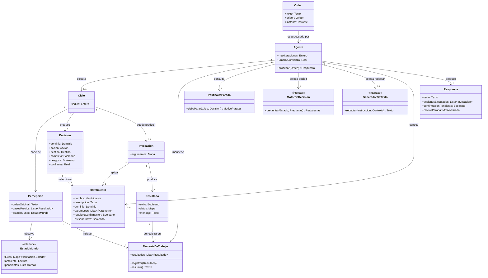
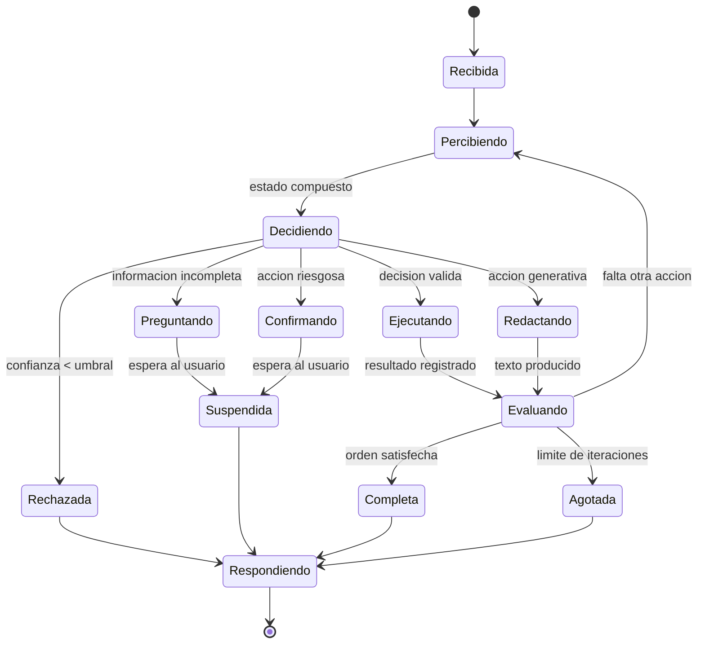
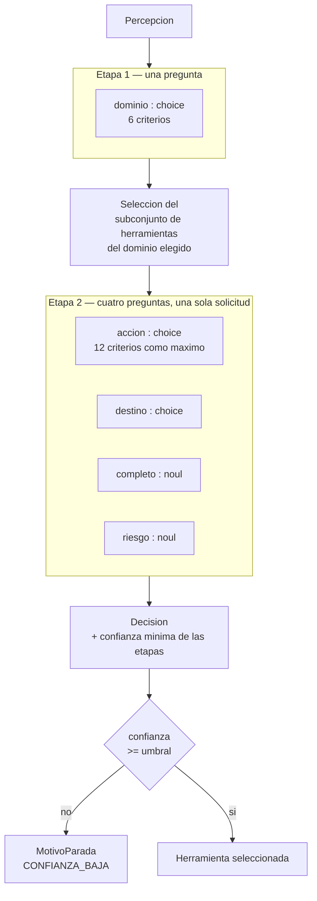

# Meta-modelo del agente coordinador

**Proyecto II · Sistemas Inteligentes de Borde (EdgeAI) · Sistemas Embebidos · TEC**
Propuesta del Rol B para acordar con el Rol A · 26 de octubre de 2026

---

## 0. Qué es este documento y qué no

Este es un **meta-modelo**, no un diagrama de arquitectura. Describe las *clases de entidades* que componen el agente y cómo se relacionan, sin nombrar instancias concretas. No aparecen en él `tev1:0.8b`, `jarvis-app`, la sala ni el cuarto: aparecen `MotorDeDecisión`, `Agente`, `Herramienta` y `Habitación`. Cambiar de modelo, agregar una operación o una habitación no altera este documento, y esa es justamente la propiedad que lo hace útil.

Es una **propuesta para acordar**. La sección 6 marca qué decisiones son firmes por venir de una restricción técnica y cuáles quedan abiertas a criterio del Rol A, que es quien implementa.

---

## 1. El problema que resuelve el agente

El diseño anterior describía un flujo lineal: clasificar la orden, buscar el manejador correspondiente, ejecutarlo, responder. Esa estructura resuelve bien una orden que se traduce en una sola acción, pero falla ante dos situaciones que el propio catálogo del proyecto ya contempla.

La primera es la **orden compuesta**. «Me voy a dormir» no corresponde a ninguna de las 42 operaciones: corresponde a varias, en tres dominios distintos, y el conjunto no está predefinido en ninguna parte. Un flujo lineal exigiría codificar a mano cada combinación posible.

La segunda es la **orden incompleta**. «Apagá la luz» no dice cuál habitación. El sistema debe advertir la ausencia del dato, pedirlo y retomar la orden con la respuesta, lo que supone más de un paso y memoria entre ellos.

Ambas se resuelven con la misma estructura: un ciclo que observa, decide, actúa y vuelve a observar hasta que la orden quede satisfecha o se agote un criterio de parada. Eso es un agente.

---

## 2. Separación de facultades

El sistema monta dos modelos sobre Ollama, y la distinción entre ellos no es de tamaño sino de naturaleza.

| | Facultad | Qué hace | Qué no hace |
|---|---|---|---|
| `MotorDeDecisión` | Decidir | Elige entre opciones tipadas y reporta la probabilidad de cada una | No produce lenguaje |
| `GeneradorDeTexto` | Expresar | Redacta lenguaje natural | No decide ni elige |
| `Agente` | Coordinar | Decide a cuál consultar, con qué, cuántas veces, qué ejecutar y cuándo parar | No clasifica ni redacta por sí mismo |

El agente no contiene inteligencia lingüística propia: su inteligencia es de **control**. Esa es la contribución del diseño, y la razón por la que un sistema que delegara todo a un modelo generativo sería a la vez más lento y menos verificable.

---

## 3. Meta-modelo estructural

### Nota sobre las tres interfaces

`MotorDeDecisión`, `GeneradorDeTexto` y `EstadoMundo` son interfaces, no clases concretas. El agente depende de abstracciones y nunca de implementaciones, lo que permite sustituir el modelo de decisión, el generativo o el acceso al hardware sin tocar el ciclo. Es la misma propiedad que ya se aplicó a la capa de hardware con `RoomLight` y `TempHumSensor`, y lo que hace posible probar el agente completo sin Raspberry Pi y sin modelos.

---

## 4. Meta-modelo de comportamiento

El bucle del agente es el tramo `Percibiendo → Decidiendo → Ejecutando → Evaluando → Percibiendo`. Todo lo demás son salidas.

### Motivos de parada

Cada salida del ciclo produce un `MotivoParada` distinto, y los cuatro son resultados legítimos del sistema, no errores:

| Motivo | Condición | Qué responde el sistema |
|---|---|---|
| `COMPLETA` | La orden quedó satisfecha | Lo que se hizo |
| `CONFIANZA_BAJA` | Alguna etapa quedó bajo el umbral | Que no entendió |
| `REQUIERE_CONFIRMACION` | La acción es destructiva | Pide confirmación y suspende |
| `INFORMACION_INCOMPLETA` | Falta un dato obligatorio | Pregunta por el dato y suspende |
| `ITERACIONES_AGOTADAS` | Se alcanzó el máximo | Lo que alcanzó a hacer, advirtiendo que no terminó |

Que `CONFIANZA_BAJA` sea una salida ordinaria y no una excepción es deliberado: con una precisión publicada de 63.5 % para el modelo de decisión, abstenerse es comportamiento correcto y uno de los casos de uso de la demostración.

---

## 5. La decisión como consulta tipada

Cada ciclo produce una `Decisión` a partir de una consulta al `MotorDeDecisión`. La consulta se resuelve en dos etapas por una restricción del modelo, no por elección de diseño: una pregunta de tipo `choice` admite un máximo de 24 criterios y el catálogo comprende 42 operaciones.

La segunda etapa resuelve cuatro dimensiones en una sola solicitud al modelo. Esa capacidad —varias preguntas tipadas de distinto tipo en una misma consulta— es la que el instructivo del curso señala como propia de los modelos de decisión, y aprovecharla es lo que hace que el costo de la etapa 2 sea el de una sola inferencia.

La confianza de la decisión es el **mínimo** de las confianzas de ambas etapas, no su promedio: una clasificación de dominio dudosa invalida la elección de acción aunque esta última parezca segura, porque el conjunto de acciones candidatas ya era el equivocado.

---

## 6. Qué es firme y qué queda a criterio del Rol A

**Firme, por restricción técnica o por acuerdo ya tomado:**

- La clasificación es jerárquica en dos etapas. Lo impone el límite de 24 criterios.
- El umbral de confianza es obligatorio y su incumplimiento es una salida válida del ciclo.
- Las acciones destructivas requieren confirmación explícita.
- El agente depende de las tres interfaces y nunca de implementaciones concretas.
- La confianza compuesta es el mínimo de las etapas.
- El bucle tiene un límite máximo de iteraciones.

**Abierto, a criterio de quien implementa:**

- El valor del límite de iteraciones. Se propone 5, suficiente para el caso compuesto más largo del catálogo con margen.
- El valor del umbral de confianza. Debe calibrarse con frases reales; el banco de medición del Rol B reporta la distribución de confianza para ese fin.
- Si `MemoriaDeTrabajo` persiste entre órdenes o solo dentro de una. Se propone que persista únicamente la confirmación pendiente, y que el resto sea efímero.
- Cómo se representa una `Herramienta`: declarativamente en `intents.yaml` o como clases registradas en código. La preferencia del diseño es lo primero, por el principio abierto/cerrado ya declarado en la propuesta.
- Si la evaluación de «orden satisfecha» la hace el modelo de decisión con una pregunta de tipo `noul` adicional, o una regla en código. Lo primero es más general y cuesta una inferencia más por ciclo; lo segundo es más rápido y menos flexible.

---

## 7. Verificación del agente

El meta-modelo habilita pruebas que un flujo lineal no permitía, y conviene que figuren en el plan de verificación:

| Propiedad | Cómo se verifica |
|---|---|
| El ciclo siempre termina | Prueba con el motor de decisión simulado devolviendo siempre «falta otra acción»: debe parar por iteraciones agotadas |
| Una orden compuesta produce varias invocaciones | «Me voy a dormir» debe registrar acciones en tres dominios |
| El umbral se respeta | Entrada sin sentido con el motor simulado devolviendo confianza baja: ninguna herramienta debe invocarse |
| Las acciones riesgosas no se ejecutan sin confirmar | Una orden de borrado debe suspender sin tocar la base de datos |
| El agente no depende del hardware | La suite completa corre con las implementaciones simuladas, sin Raspberry Pi |

Las cinco se ejecutan en integración continua, porque ninguna requiere hardware ni modelos.
