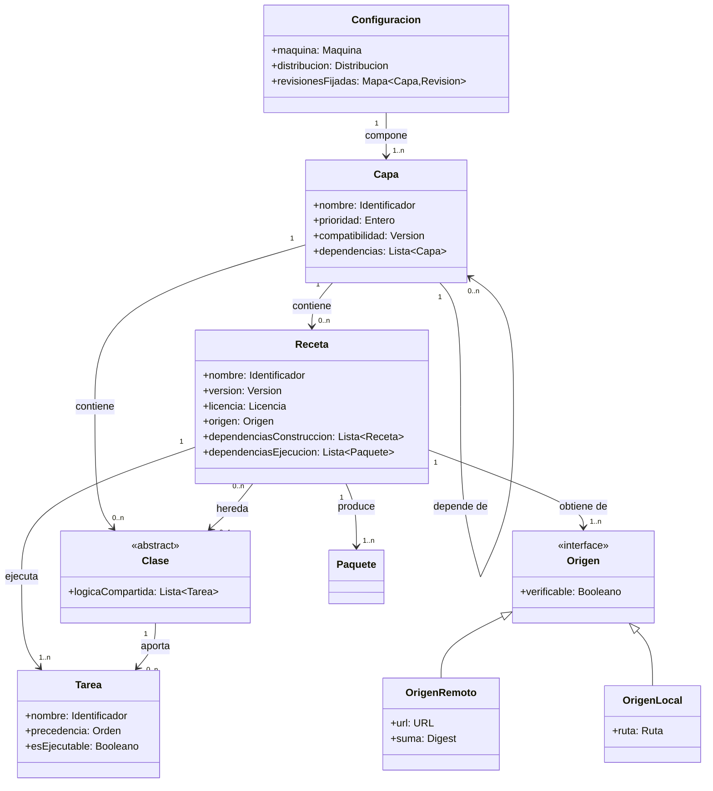
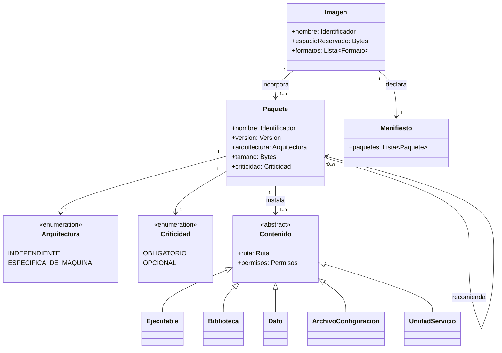
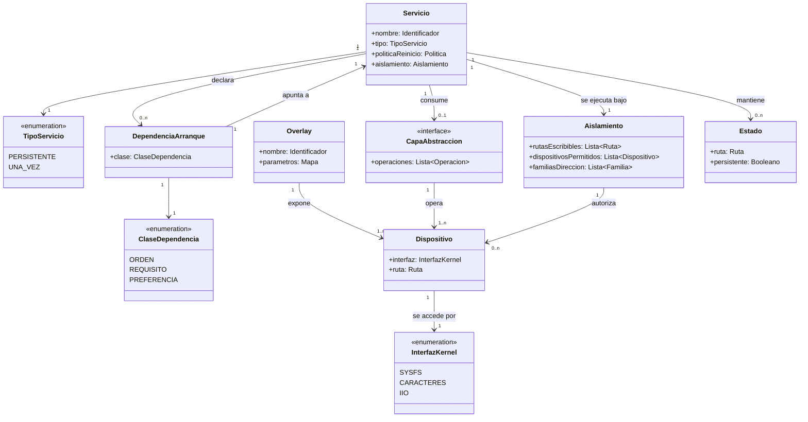
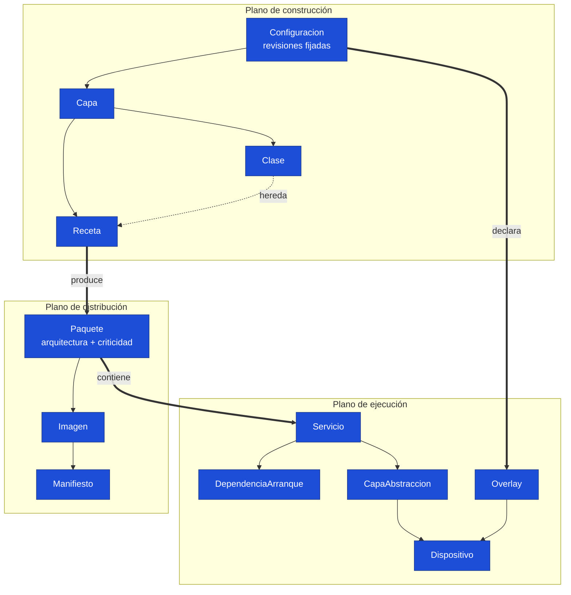

# Meta-modelo de la plataforma

**Proyecto II · Sistemas Inteligentes de Borde (EdgeAI) · Sistemas Embebidos · TEC**
Rol B — Líder Técnico / Arquitecto de Plataforma · 26 de octubre de 2026

---

## 0. Propósito

Este documento describe las **clases de entidades** que componen la plataforma de software del sistema y las reglas de composición que las gobiernan. No enumera los componentes concretos del proyecto: enumera los tipos a los que esos componentes pertenecen.

La distinción importa porque las reglas sobreviven a los cambios. La afirmación «la receta del servidor de inferencia produce un paquete que contiene una unidad de servicio» describe una instancia y caduca si se cambia de servidor; la afirmación «una `Receta` produce uno o más `Paquetes`, y un `Paquete` puede contener un `Servicio`» describe la estructura y sigue siendo válida al agregar recetas, cambiar de motor de inferencia o migrar de placa.

La sección 7 cierra con la **instanciación**: qué componente real del proyecto corresponde a cada clase. Sin esa tabla el meta-modelo sería una abstracción sin anclaje; con ella se puede verificar que describe el sistema construido.

---

## 1. Las tres dimensiones de la plataforma

La plataforma se modela en tres planos que se cruzan en un punto:

- **Plano de construcción.** Cómo se declara y produce el software: capas, recetas, clases, tareas.
- **Plano de distribución.** Qué se produce y qué se instala: paquetes, imagen, sistema de archivos.
- **Plano de ejecución.** Cómo opera el sistema una vez encendido: servicios, dependencias de arranque, dispositivos.

El `Paquete` es la entidad que une los tres: es el producto de una `Receta`, el contenido de una `Imagen` y el portador de un `Servicio`.

---

## 2. Plano de construcción

### Reglas del plano de construcción

**R-C1 — La configuración fija las revisiones.** Una `Configuracion` declara una revisión exacta por cada `Capa`, no una rama. Sin esa fijación, dos construcciones separadas en el tiempo producen artefactos distintos y la reproducibilidad es una afirmación sin respaldo.

**R-C2 — La lógica compartida se delega en una clase.** Cuando varias `Recetas` difieren únicamente en sus datos, la lógica común se extrae a una `Clase` y cada receta aporta solo lo que la distingue. Es el principio abierto/cerrado aplicado al plano de construcción: incorporar una receta más no modifica ninguna existente.

**R-C3 — Todo origen debe ser verificable.** Un `OrigenRemoto` se verifica contra un `Digest` declarado. Un `OrigenLocal` no lo es por construcción, por lo que si el contenido no está bajo control de versiones la receta debe incorporar una `Tarea` de verificación explícita. Sin ella, una sustitución del archivo pasaría inadvertida.

**R-C4 — Las tareas tienen precedencia declarada.** Una `Tarea` añadida se inserta en el grafo mediante una relación de orden respecto de las existentes, nunca modificando otra tarea.

---

## 3. Plano de distribución

### Reglas del plano de distribución

**R-D1 — La arquitectura la determina la naturaleza del contenido.** Un `Paquete` cuyo contenido es exclusivamente `Dato` es independiente de arquitectura; uno que incluye `Ejecutable` o `Biblioteca` es específico de máquina. Clasificarlo mal multiplica construcciones innecesarias o produce un artefacto que no corre.

**R-D2 — Todo paquete declara su criticidad.** Un `Paquete` `OBLIGATORIO` no puede retirarse sin que el sistema deje de operar; uno `OPCIONAL` puede retirarse reduciendo capacidades. La distinción se expresa mediante relaciones distintas —requiere frente a recomienda— y es la que permite definir un núcleo mínimo.

**R-D3 — Un componente opcional es una receta propia.** Para que la regla anterior sea operativa, cada componente retirable debe empaquetarse por separado. Agrupar en un mismo paquete lo obligatorio y lo opcional hace imposible retirar lo segundo.

**R-D4 — El espacio reservado se dimensiona por el contenido dominante.** Cuando una clase de `Contenido` concentra la mayor parte del tamaño, es esa clase la que gobierna el dimensionamiento del sistema de archivos, no el número de paquetes.

---

## 4. Plano de ejecución

### Reglas del plano de ejecución

**R-E1 — El hardware se opera por drivers del núcleo.** Un `Dispositivo` se expone mediante un `Overlay` y se accede a través de una `InterfazKernel`. No se accede al hardware desde espacio de usuario mediante temporización propia: Linux no ofrece garantías de tiempo real y los resultados son inestables bajo carga.

**R-E2 — Se prefiere la interfaz de núcleo vigente.** Cuando el núcleo expone un `Dispositivo` por más de una `InterfazKernel` y una de ellas está en desuso, se usa la vigente aunque la obsoleta sea más simple. Una interfaz obsoleta puede no estar compilada en el núcleo objetivo, y el fallo se manifiesta solo en ejecución.

**R-E3 — La precondición se expresa como servicio.** Cuando un `Servicio` requiere que una condición se cumpla antes de iniciar, esa condición se modela como un `Servicio` de tipo `UNA_VEZ` que permanece activo tras completarse, y el dependiente declara una `DependenciaArranque` sobre él. Codificar la espera dentro del servicio dependiente oculta la precondición al gestor de arranque y la vuelve invisible al diagnóstico.

**R-E4 — El aislamiento se declara, no se asume.** Un `Servicio` se ejecuta bajo un `Aislamiento` que enumera explícitamente las rutas escribibles, los dispositivos autorizados y las familias de direcciones permitidas. Todo lo no enumerado queda prohibido.

**R-E5 — El estado efímero no toca el almacenamiento.** Un `Estado` no persistente reside en memoria. La regla gobierna el registro del sistema, los directorios temporales y los datos de trabajo de los servicios, y es lo que hace verificable la afirmación de que el sistema no escribe en el medio de arranque durante la operación.

---

## 5. Vista integrada

Las tres flechas gruesas son las uniones entre planos y resumen el modelo: una receta produce un paquete, un paquete puede contener un servicio, y la configuración de la máquina declara los overlays que exponen el hardware que ese servicio consume.

---

## 6. Trazabilidad entre planos

Una propiedad del sistema solo es verificable si puede seguirse a través de los tres planos. El modelo lo permite:

| Propiedad afirmada | Construcción | Distribución | Ejecución |
|---|---|---|---|
| El sistema opera sin conexión | `Origen` resuelto en tiempo de construcción | `Dato` incorporado a la `Imagen` | Ningún `Servicio` requiere red |
| El medio de arranque no se escribe | — | `Estado` declarado no persistente | `Aislamiento` restringe rutas escribibles |
| Un componente es desmontable | `Receta` independiente | `Criticidad` `OPCIONAL`, relación recomienda | El `Servicio` degrada sin fallar |
| La construcción es reproducible | Revisiones fijadas y orígenes verificados | `Manifiesto` comparable entre construcciones | — |
| El hardware es sustituible | — | — | `CapaAbstraccion` desacopla `Servicio` de `Dispositivo` |

---

## 7. Instanciación en este proyecto

El meta-modelo describe tipos; esta tabla registra qué componente real del sistema instancia cada uno. Es lo que permite verificar que el modelo corresponde al sistema construido y no a uno imaginado.

| Clase del meta-modelo | Instancias en el proyecto |
|---|---|
| `Configuracion` | Archivo kas con máquina, distribución y revisiones fijadas de las cinco capas |
| `Capa` | Capa propia del proyecto, más las capas base, de utilidades, de Python y del BSP |
| `Clase` | Clase de empaquetado de modelos de inferencia, heredada por las recetas de modelo |
| `Receta` con `OrigenRemoto` | Servidor de inferencia y motor de transcripción, verificados por digest |
| `Receta` con `OrigenLocal` | Aplicación, configuración de red, configuración del sistema de archivos y modelos |
| `Tarea` añadida | Verificación de integridad de los paquetes de modelo, insertada entre desempaquetado e instalación |
| `Paquete` `INDEPENDIENTE` | Modelos de inferencia y de transcripción, aplicación, archivos de configuración |
| `Paquete` `ESPECIFICA_DE_MAQUINA` | Servidor de inferencia, motor de transcripción, utilidades de hardware |
| `Paquete` `OBLIGATORIO` | Servidor de inferencia, modelo de decisión, aplicación |
| `Paquete` `OPCIONAL` | Modelo generativo, modelos de transcripción, utilidades de diagnóstico |
| `Servicio` `PERSISTENTE` | Servidor de inferencia, agente coordinador |
| `Servicio` `UNA_VEZ` | Calentamiento de modelos |
| `DependenciaArranque` `REQUISITO` | El agente sobre el servidor de inferencia |
| `DependenciaArranque` `ORDEN` | El agente después del calentamiento |
| `Overlay` | Sensor ambiental, canales de modulación por ancho de pulso, bus serie de dos hilos |
| `Dispositivo` por `IIO` | Sensor de temperatura y humedad |
| `Dispositivo` por `SYSFS` | Canales de modulación por ancho de pulso |
| `Dispositivo` por `CARACTERES` | Líneas de entrada y salida de propósito general |
| `CapaAbstraccion` | Interfaces de sensor y de iluminación, con implementación real y simulada |
| `Estado` persistente | Base de datos del agente |
| `Estado` no persistente | Registro del sistema, directorio temporal, directorio de trabajo del servidor de inferencia |

---

## 8. Conformidad

Las reglas enunciadas no son descriptivas sino normativas: una incorporación futura a la plataforma debe cumplirlas. Dos de ellas surgieron de defectos detectados durante el desarrollo y se incorporaron al modelo precisamente para que no se repitan.

La regla R-C3 proviene de constatar que el mecanismo de obtención de archivos locales no verifica sumas, a diferencia del remoto, lo que dejaba sin control los paquetes de modelo que por su tamaño se mantienen fuera del repositorio.

La regla R-E2 proviene de haber implementado inicialmente el acceso a las líneas de entrada y salida sobre una interfaz del núcleo en desuso, que podía no estar disponible en el núcleo objetivo.

Ambas se descubrieron por revisión, no por fallo en ejecución. Registrarlas como reglas del modelo es lo que convierte un hallazgo puntual en una restricción de diseño.
