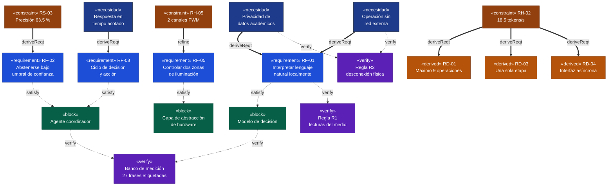
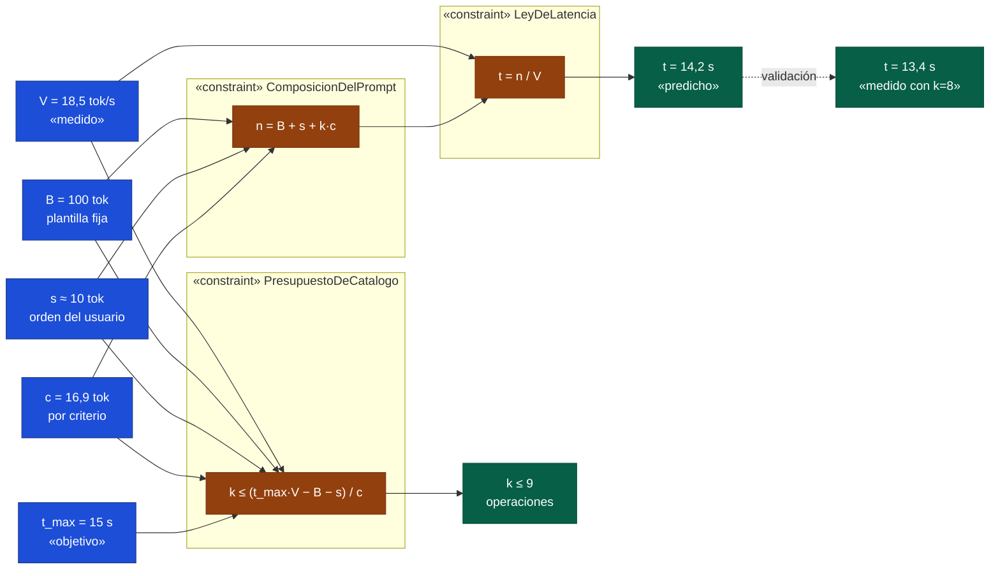
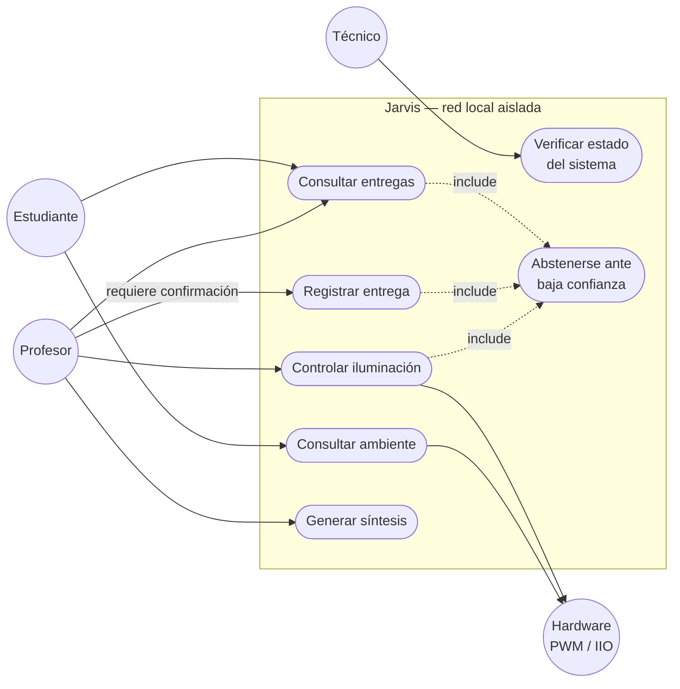
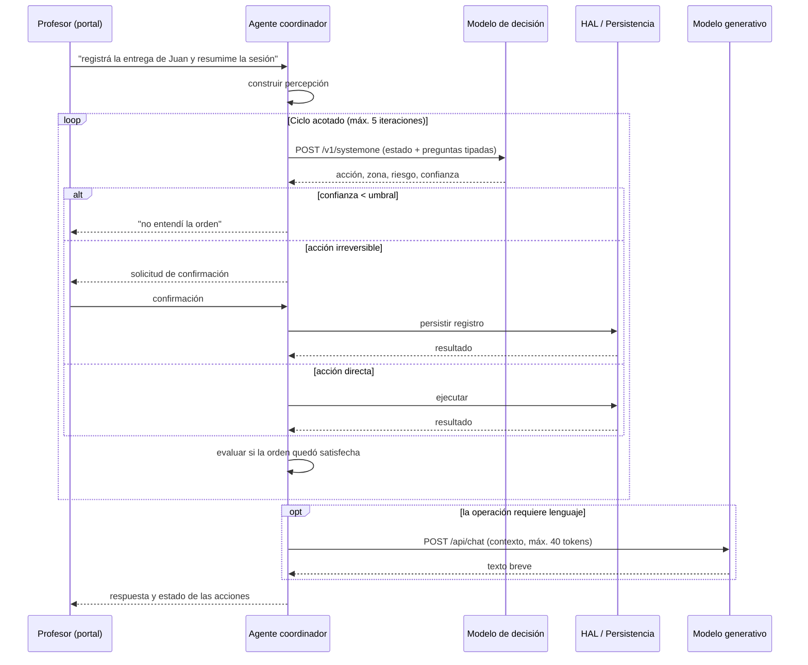
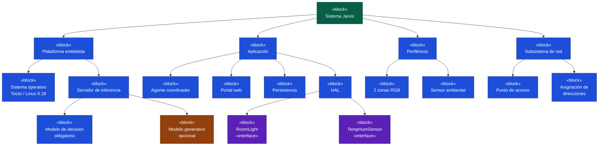
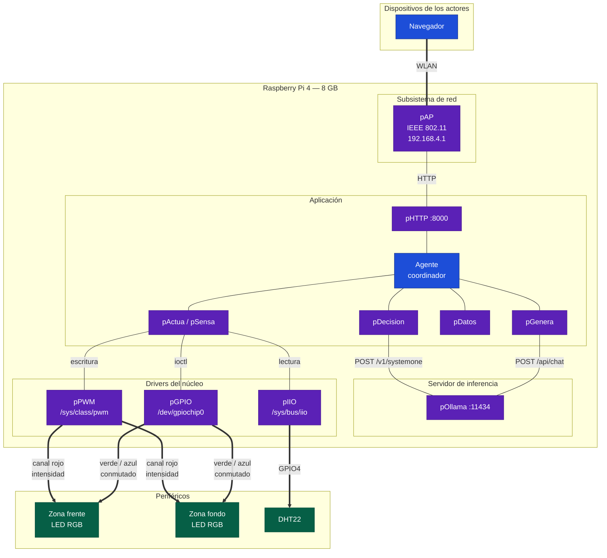
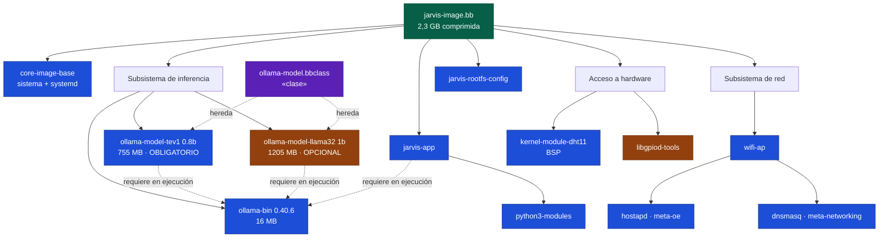
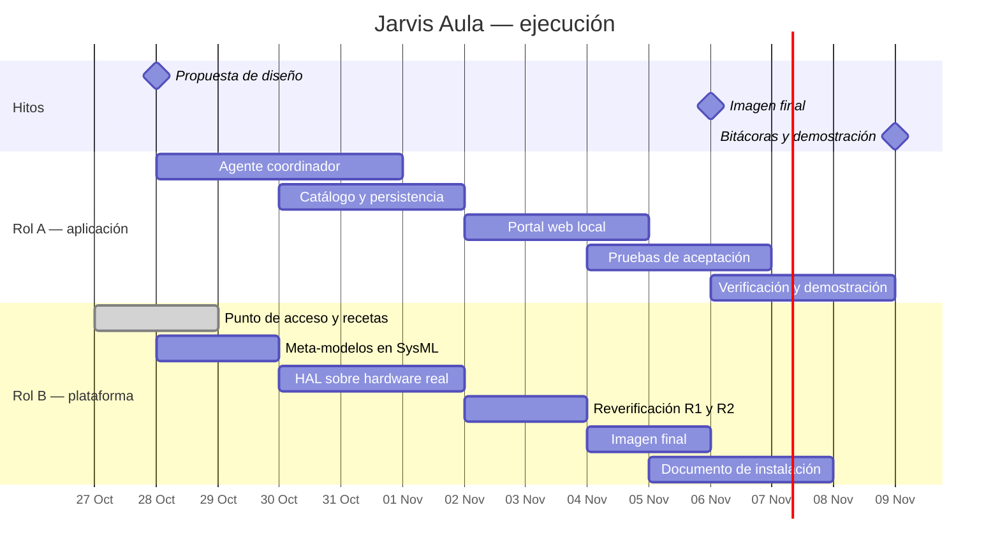

# Propuesta de Diseño — Sistema Inteligente de Borde "Jarvis" (Asistente de Aula)

**Curso:** Sistemas Embebidos — Escuela de Ingeniería Electrónica, TEC
**Facilitador:** Dr. Ing. Johan Carvajal Godínez
**Equipo:** Saúl Quesada (Rol A) · Daniel Chavarría (Rol B)
**Plataforma:** Raspberry Pi 4 (8 GB) · Yocto Project 6.0 "Wrynose" · núcleo Linux 6.18.33

---

## 1. Justificación del proyecto y revisión bibliográfica

El entorno académico genera de forma continua información institucional y personal: entregas de los estudiantes, estado de avance del curso y condiciones ambientales del espacio de trabajo. Las herramientas comerciales capaces de gestionar esa información exigen procesarla en servidores de terceros, lo que traslada un problema de cumplimiento normativo a una entidad externa y crea una dependencia crítica respecto de la conectividad del campus.

Este proyecto desarrolla un **sistema inteligente de borde** que sostiene tres propiedades simultáneas:

**Privacidad.** La información académica de estudiantes identificables no abandona el aula. No se trata de cifrar un tránsito, sino de eliminarlo: no existe tránsito hacia el exterior.

**Independencia de red.** El sistema emite su propia red inalámbrica y opera sin enlace externo. Un sistema de gestión que depende de internet resulta inutilizable precisamente cuando la red falla.

**Latencia determinista.** El tiempo de respuesta depende solo del dispositivo, no de la carga de un servicio remoto ni de la congestión de la red institucional.

Para lograrlo, la totalidad de la inferencia se traslada a una Raspberry Pi 4, que combina un modelo de decisión (`tev1:0.8b`, servido mediante la API System One) para clasificación tipada con probabilidad asociada, y un modelo generativo pequeño (`llama3.2:1b`) para la redacción de síntesis en lenguaje natural.

La revisión bibliográfica abarcó cuatro frentes: la documentación de la API de decisión y sus tipos de pregunta; las fichas técnicas de los modelos candidatos y sus límites publicados de precisión y de número de criterios; la documentación de síntesis de sistemas operativos embebidos con Yocto Project y la gestión de capas con kas; y mediciones publicadas de inferencia sobre plataformas de placa única, que resultaron discrepantes entre sí en un orden de magnitud y motivaron la campaña de medición propia descrita en el punto 8.

---

## 2. Descripción y síntesis del problema

**Problema.** La gestión de las operaciones del aula —registro de entregas, control de la iluminación por zonas según la actividad y lectura de las condiciones ambientales— se realiza hoy de forma dispersa, con herramientas desconectadas entre sí. Centralizarla mediante asistentes comerciales de inteligencia artificial resuelve la dispersión pero introduce dos problemas nuevos: la información personal de los estudiantes se procesa fuera de la institución, y el sistema deja de funcionar cuando falla la conectividad.

**Síntesis de la solución.** Se sintetiza un sistema operativo embebido mediante Yocto Project que emite su propia red inalámbrica local. El equipo aloja un **agente coordinador** que recibe órdenes en lenguaje natural desde un portal web servido en esa red, clasifica la intención mediante un modelo de decisión local, consulta o modifica una base de datos local, y acciona el entorno físico —iluminación mediante modulación por ancho de pulso y sensado mediante el subsistema de instrumentación del núcleo—. Ningún dato abandona el aula, y la propiedad es verificable desconectando físicamente cualquier enlace externo durante la operación.

---

## 3. Gestión de los requerimientos

Los requerimientos se derivan de dos fuentes distintas. Las **necesidades** de los actores producen funciones; las **restricciones** de la plataforma producen límites de diseño. Las restricciones marcadas como medidas provienen de la campaña experimental del 27 de octubre de 2026 sobre el hardware objetivo.

### 3.1 Actores

| Actor | Rol | Necesidad |
|---|---|---|
| Estudiante | Usuario | Consultar su estado de entregas y la agenda del curso |
| Profesor | Operador | Registrar entregas y adecuar el aula sin interrumpir la sesión |
| Técnico | Mantenedor | Verificar el estado del sistema y de los servicios |
| Coordinador | Responsable institucional | Garantizar que la información no salga de la institución |

El coordinador es un **actor de restricción**: no opera el sistema, pero su necesidad condiciona la arquitectura completa.

### 3.2 Requerimientos funcionales

| ID | Enunciado | Origen |
|---|---|---|
| **RF-01** | El sistema interpretará órdenes escritas en lenguaje natural y determinará la operación solicitada mediante el modelo de decisión sobre el endpoint `/v1/systemone`. | Necesidad de todos los actores |
| **RF-02** | El sistema reportará la confianza de cada decisión y se abstendrá de actuar cuando no supere el umbral configurado. | Necesidad de operación segura |
| **RF-03** | El sistema persistirá registros académicos localmente, con durabilidad entre reinicios. | Profesor, estudiante |
| **RF-04** | El sistema recuperará y presentará registros filtrados según el actor que consulta. | Estudiante |
| **RF-05** | El sistema controlará dos zonas de iluminación con color e intensidad. | Profesor |
| **RF-06** | El sistema medirá y registrará temperatura y humedad del espacio. | Todos |
| **RF-07** | El sistema generará síntesis breves en lenguaje natural a partir de su estado. | Profesor |
| **RF-08** | El agente ejecutará un ciclo de decisión y acción hasta satisfacer la orden o alcanzar un criterio de parada. | Órdenes compuestas |
| **RF-09** | El sistema exigirá confirmación explícita antes de ejecutar acciones irreversibles. | Integridad de los registros |
| **RF-10** | El sistema indicará visualmente su estado de procesamiento. | Latencia perceptible |

### 3.3 Requerimientos de restricción — hardware

| ID | Restricción | Valor | Origen |
|---|---|---|---|
| **RH-01** | Inferencia exclusivamente sobre CPU; el SoC no expone aceleración utilizable por el servidor de inferencia | — | Plataforma |
| **RH-02** | Velocidad de procesamiento de prompt | **18,5 tokens/s** | Medido |
| **RH-03** | Velocidad de generación de texto | **2,6 tokens/s** | Medido |
| **RH-04** | Memoria consumida por ambos modelos residentes | **1486 MiB de 7806 MiB** | Medido |
| **RH-05** | Canales de modulación por ancho de pulso por hardware | **2** | Documentación del SoC |
| **RH-06** | Temperatura del SoC bajo inferencia sostenida | **70,1 °C** desde 38,9 °C en reposo | Medido |

### 3.4 Requerimientos de restricción — software

| ID | Restricción | Consecuencia |
|---|---|---|
| **RS-01** | El endpoint de decisión existe desde la versión 0.35 del servidor de inferencia | La receta fija versión mínima; se integra 0.40.6 |
| **RS-02** | Una pregunta de tipo `choice` admite un máximo de 24 criterios | Límite superior absoluto del catálogo |
| **RS-03** | Precisión publicada del modelo de decisión: **63,5 %** | El umbral de confianza es obligatorio, no opcional |
| **RS-04** | El modelo de decisión solo está publicado en cuantización **Q8_0** | No existe margen de optimización por cuantización (verificado) |
| **RS-05** | El endpoint de decisión no sirve modelos de chat | Se requieren dos modelos distintos y un coordinador entre ellos |
| **RS-06** | No existe capa pública mantenida para el servidor de inferencia | Receta propia en la capa del proyecto |
| **RS-07** | La plataforma ejecuta Linux sin garantías de tiempo real | El hardware se opera mediante drivers del núcleo, nunca por temporización en espacio de usuario |

### 3.5 Requerimientos derivados de la medición

| ID | Enunciado | Derivado de |
|---|---|---|
| **RD-01** | El catálogo de operaciones no excederá **nueve entradas** con descripciones de dos palabras, para mantener el prompt por debajo de 277 tokens. | RH-02 |
| **RD-02** | Las respuestas generativas se limitarán a **40 tokens** de salida. | RH-03 |
| **RD-03** | La clasificación se resolverá en **una sola etapa**; se descarta el enrutamiento jerárquico. | RH-02 |
| **RD-04** | El sistema se presentará como asistente **asíncrono** sobre portal web, no como interfaz conversacional. | RH-02, RH-03 |

### 3.6 Reglas de verificación de la plataforma

> **R1.** Después del arranque, ningún modelo se lee de la MicroSD. Se verifica comparando `/proc/diskstats` antes y después de varias órdenes.
>
> **R2.** Ninguna operación requiere conexión externa. Se verifica desconectando el equipo durante la demostración.

**Estado de R1 al momento de esta propuesta:** la medición del 27 de octubre detectó 1254 MiB leídos del medio de arranque durante la corrida. Se identificó la causa —el servidor descargaba un modelo para cargar el otro— y se aplicó la corrección correspondiente en la configuración del servicio. **La regla queda pendiente de reverificación** en la próxima sesión con hardware.

### 3.7 Diagrama de requisitos (SysML)

El diagrama hace explícito que **tres de los cuatro requisitos derivados provienen de una sola restricción medida**, RH-02. Esa trazabilidad es el argumento central del diseño: la velocidad de procesamiento del prompt no es un detalle de implementación sino el parámetro que gobierna el alcance funcional del sistema.

### 3.8 Diagrama paramétrico (SysML)

**Interpretación.** El tiempo de respuesta es el cociente entre el número de tokens del prompt y la velocidad de procesamiento de la plataforma. El prompt se compone de una plantilla fija, la orden del usuario y el producto del número de operaciones por el costo de cada criterio. Despejando el número de operaciones para un tiempo objetivo de quince segundos resulta un máximo de nueve, lo que predice un tiempo de 14,2 segundos. La predicción se validó contra una medición independiente con ocho operaciones, que arrojó 13,4 segundos.

---

## 4. Vista operacional del sistema

El equipo opera como **nodo aislado**: emite su propia red inalámbrica y no mantiene enlace con el exterior. Los actores se conectan a esa red desde sus propios dispositivos y acceden a un portal web. No hay cliente que instalar.

La interacción es **asíncrona**: el usuario envía una orden, el portal indica que el sistema está procesando, y la respuesta llega en el orden de los quince segundos. Esta decisión no es una concesión sino una consecuencia directa de RH-02, y determina la forma de la interfaz.

### 4.1 Casos de uso

| Caso | Actor | Descripción | Carril |
|---|---|---|---|
| Actuación física | Profesor | «encendé la iluminación del frente» → el agente clasifica, verifica la confianza y acciona el canal correspondiente | Decisión |
| Persistencia académica | Profesor | «registrá la entrega de Juan» → el agente clasifica, detecta que la acción modifica registros, solicita confirmación y persiste | Decisión + confirmación |
| Consulta de estado | Estudiante | «¿quién ya entregó?» → el agente recupera y presenta el registro | Decisión |
| Lectura ambiental | Todos | «¿a cuánto estamos?» → el agente consulta el valor en caché del sensor | Decisión |
| Síntesis | Profesor | «resumime la sesión» → el agente compone el estado y lo entrega al modelo generativo | Generativo |
| Abstención | Cualquiera | Entrada incomprensible → la confianza no supera el umbral y el sistema no ejecuta nada | Decisión |

La abstención es un caso de uso de pleno derecho, no un manejo de error: con una precisión base de 63,5 %, que el sistema reconozca cuándo no debe confiar en su propio modelo es un requisito funcional.

### 4.2 Diagrama de casos de uso

---

## 5. Vista funcional del sistema

El sistema implementa el patrón de **agente coordinador**, cuyo ciclo es *percibir → decidir → actuar → evaluar*.

**Portal web.** Interfaz servida en la red local del equipo. No contiene lógica de decisión: transporta la orden e indica el estado del procesamiento.

**Agente coordinador.** Módulo que no clasifica ni redacta por sí mismo. Su función es de control: determina a cuál modelo consultar, con qué preguntas, cuántas iteraciones ejecutar, qué herramienta invocar y cuándo detenerse. Esta separación es la contribución central del diseño.

**Módulo de decisión.** Consulta al modelo `tev1:0.8b` con preguntas tipadas y recibe opciones elegidas con su probabilidad asociada. No genera texto.

**Módulo generativo.** Consulta al modelo `llama3.2:1b` únicamente cuando la operación seleccionada requiere redactar lenguaje natural, con la salida acotada según RD-02.

**Política de parada.** El ciclo termina por una de cinco razones, todas ellas resultados legítimos: la orden se cumplió, la confianza quedó bajo el umbral, falta información, la acción requiere confirmación, o se agotó el número máximo de iteraciones.

**Capa de abstracción de hardware.** Aísla a la aplicación de los drivers del núcleo. Define interfaces abstractas con dos implementaciones: una real sobre el hardware y otra simulada que permite desarrollar y probar sin la plataforma.

**Persistencia.** Base de datos local para registros académicos, histórico ambiental y estado de las zonas de iluminación.

### 5.1 Diagrama de secuencia del agente

---

## 6. Arquitectura del sistema propuesto

La arquitectura consolida el aislamiento de red mediante el punto de acceso propio y restringe la actuación física a los límites del SoC. Toda la orquestación se comunica con los modelos por HTTP sobre la interfaz de bucle local, de modo que la regla R2 se cumple de forma estructural y no por configuración.

### 6.1 Diagrama de definición de bloques (BDD)

### 6.2 Diagrama de bloques internos (IBD)

El diagrama de bloques internos expone una restricción que el diagrama de definición oculta: **el canal rojo de cada zona se conecta al puerto de modulación por hardware, mientras que los canales verde y azul se conectan al puerto de entrada y salida conmutada**. La causa es RH-05: el SoC expone dos canales de modulación y dos zonas en color requieren seis. La consecuencia es que cada zona admite intensidad continua sobre el rojo y ocho combinaciones de color, en lugar de una paleta completa.

Se evaluó generar los cuatro canales restantes por software y se descartó: la temporización en espacio de usuario depende del planificador del sistema operativo y produce parpadeo perceptible precisamente bajo la carga de CPU de una inferencia. Se prefirió una paleta reducida y estable a una completa e inestable. La vía de escalamiento identificada es un controlador externo de dieciséis canales sobre el bus serie de dos hilos, ya habilitado en la configuración del BSP.

### 6.3 Configuración de la plataforma

| Parámetro | Valor | Propósito |
|---|---|---|
| Máquina objetivo | `raspberrypi4-64` | Compilación cruzada |
| Gestor de servicios | systemd | Orden de arranque y dependencias |
| Overlay del sensor | `dtoverlay=dht11,gpiopin=4` | Expone el sensor por el subsistema de instrumentación |
| Overlay de modulación | `dtoverlay=pwm-2chan,pin=12,pin2=13` | Dos canales por hardware |
| Bus serie de dos hilos | `dtparam=i2c_arm=on` | Habilitado para escalamiento |
| Permanencia de modelos | `OLLAMA_KEEP_ALIVE=-1` | Los modelos no se descargan por inactividad |
| Modelos simultáneos | `OLLAMA_MAX_LOADED_MODELS=2` | Evita el intercambio de modelos que viola R1 |
| Directorio de trabajo del servidor | `/run/ollama` en memoria | La llave de sesión no se escribe en el medio |

---

## 7. Análisis de dependencias

La imagen se sintetiza con la herramienta kas a partir de un archivo declarativo que fija las capas, sus revisiones exactas, la máquina objetivo y la imagen. Las revisiones fijadas son lo que hace reproducible la construcción: sin ellas, dos síntesis separadas en el tiempo producen artefactos distintos.

### 7.1 Composición por capas

| Repositorio | Capas utilizadas | Aporte |
|---|---|---|
| `bitbake` 2.18 | — | Motor de construcción |
| `openembedded-core` | `meta` | Sistema base y herramientas |
| `meta-yocto` | `meta-poky` | Distribución |
| `meta-openembedded` | `meta-oe`, `meta-python`, `meta-multimedia`, `meta-networking` | Servidor de red inalámbrica, asignación de direcciones, utilidades |
| `meta-raspberrypi` | — | BSP: núcleo, overlays, cargador de arranque |
| `meta-edgeai` | — | Capa propia del proyecto |

En la versión 6.0 de Yocto el repositorio combinado quedó obsoleto: las capas base se obtienen por separado, lo que constituyó el primer hallazgo de la síntesis de plataforma.

### 7.2 Recetas de la capa propia

| Receta | Produce | Criticidad |
|---|---|---|
| `ollama-bin_0.40.6.bb` | Servidor de inferencia, binario de arquitectura ARM64 | Obligatorio |
| `ollama-model-tev1_0.8b.bb` | Modelo de decisión horneado en la imagen | Obligatorio |
| `ollama-model-llama32_1b.bb` | Modelo generativo horneado en la imagen | Opcional |
| `jarvis-app.bb` | Agente, portal, configuración y unidades de servicio | Obligatorio |
| `wifi-ap.bb` | Punto de acceso y asignación de direcciones | Obligatorio |
| `jarvis-rootfs-config.bb` | Registro volátil, directorios temporales en memoria | Obligatorio |
| `jarvis-image.bb` | Imagen completa | — |

La lógica común de empaquetado de modelos reside en una **clase propia** heredada por ambas recetas de modelo: cada una aporta únicamente el nombre del paquete y su suma de verificación. Incorporar un tercer modelo son seis líneas.

Los modelos se incorporan como **dos recetas independientes y no como una sola**, lo que permite retirar el carril generativo quitando una entrada de la lista de instalación, reduciendo la imagen 1,2 GB sin reconstruir el carril de decisión.

### 7.3 Árbol de dependencias

### 7.4 Observación sobre el dimensionamiento

Los modelos de inferencia representan el **97 % del peso de la imagen**: 1960 MB de los 2,3 GB comprimidos. El sistema operativo completo, el núcleo, los servicios y las herramientas de diagnóstico suman menos de 80 MB.

La consecuencia de diseño es que el dimensionamiento del almacenamiento se gobierna por la selección de modelos y no por la composición del sistema base. Optimizar el sistema operativo sería irrelevante frente al peso de los modelos.

**El binario del servidor de inferencia se empaqueta precompilado, no se compila desde fuente.** Construirlo exigiría una cadena de herramientas de Go completa y un tiempo de síntesis incompatible con el plazo del proyecto, sin beneficio funcional. La receta excluye los componentes de aceleración por GPU, inaplicables en esta plataforma: el archivo original de 1,5 GB se reduce a un paquete de 16 MB que contiene el ejecutable y sus bibliotecas de inferencia, verificado por inspección del paquete generado.

**Los modelos se incorporan en el formato nativo del servidor** —un manifiesto que referencia objetos direccionados por contenido—, empaquetado por un script del host que extrae del manifiesto los objetos que cada modelo referencia. No se manipulan archivos de pesos sueltos.

---

## 8. Estrategia de integración

La integración adoptó un modelo **guiado por medición**: las decisiones de alcance se tomaron después de caracterizar la plataforma, no antes.

### 8.1 Secuencia

**Primero, síntesis de la plataforma base.** Construcción del sistema operativo e integración del servidor de inferencia, identificada desde el inicio como el componente de mayor riesgo por no existir capa pública mantenida. Se fijó una fecha de corte y una alternativa explícita —ejecución en contenedor— que no fue necesaria.

**Segundo, incorporación de los modelos.** Horneado en la imagen en lugar de descarga en el primer arranque, con verificación de integridad explícita. El mecanismo de obtención de archivos locales no valida sumas de verificación, a diferencia del remoto, por lo que la clase incorpora una tarea de verificación que aborta la construcción ante cualquier discrepancia.

**Tercero, caracterización empírica (ejecutada el 27 de octubre).** Se perfilaron ambos carriles de inferencia sobre el hardware objetivo con veintiocho casos etiquetados y cuatro pruebas controladas de tamaño de prompt creciente. El resultado determinó el alcance funcional del sistema y se describe en 8.3.

**Cuarto, desarrollo desacoplado.** El agente se desarrolla contra implementaciones simuladas de la capa de hardware y del servidor de inferencia, lo que permite trabajar sin la plataforma y ejecutar las pruebas en integración continua.

**Quinto, verificación de restricciones.** Comprobación de las reglas R1 y R2 sobre el sistema integrado.

### 8.2 Desacople entre roles

Cada integrante es dueño de un lado de una interfaz definida. El Rol A trabaja por encima de la capa de abstracción y de los endpoints de inferencia; el Rol B por debajo. Las interfaces congeladas son las clases abstractas de la capa de hardware, el contrato del portal y los nombres de servicios y rutas de configuración. Las implementaciones simuladas de todo lo que cruza esa frontera permitieron que ninguno dependiera del avance del otro.

### 8.3 Resultado de la caracterización

La medición estableció que **el tiempo de respuesta del carril de decisión es lineal en el tamaño del prompt**, con una velocidad de 18,5 tokens por segundo. El doble de tokens produce exactamente el doble de tiempo, y el modelo predice los casos del banco con menos del 1 % de error.

| Configuración | Tokens | Tiempo |
|---|---:|---:|
| Enrutamiento jerárquico, descripciones extensas (42 operaciones) | 659 | 35,6 s |
| Etapa única, descripciones breves (8 operaciones) | 243 | 13,4 s |
| Carril generativo, 35 tokens de salida | 79 | 17,1 s |

Este resultado **obligó a revisar la hipótesis original del proyecto**, que afirmaba que separar el carril de decisión del generativo reduciría la latencia de segundos a décimas. Con el diseño inicial, la decisión resultó más lenta que la generación: 35,6 contra 30,7 segundos.

La causa es estructural. El modelo de decisión no genera tokens, pero debe procesar un prompt que contiene todos los criterios con sus descripciones, y el enrutamiento jerárquico pagaba ese costo dos veces. El carril generativo, en cambio, recibe un prompt breve.

La hipótesis reformulada, que sí sostienen los datos, es:

> En inferencia de decisión sobre CPU restringida, la latencia es lineal en el tamaño del prompt. El diseño del catálogo de intenciones es, por lo tanto, el diseño de la latencia.

El valor del resultado no reside en que el sistema sea rápido, sino en que **el costo de cualquier configuración puede predecirse antes de implementarla**.

### 8.4 Matriz de verificación

| Propiedad | Método | Estado |
|---|---|---|
| Los modelos están en la imagen | Manifiesto y contenido de los paquetes | Verificado |
| El binario incluye sus bibliotecas | Inspección del paquete generado | Verificado |
| La construcción es reproducible | Revisiones fijadas y síntesis desde cero | Verificado |
| La integridad de los modelos es comprobable | Tarea de verificación que aborta ante discrepancia | Verificado |
| La latencia es predecible | 28 casos etiquetados y 4 pruebas controladas | Verificado |
| Ningún modelo se lee del medio tras el arranque (R1) | Comparación de contadores del dispositivo | **Pendiente de reverificación** |
| El sistema opera sin enlace externo (R2) | Desconexión física durante la demostración | Pendiente |
| El sensor y la iluminación responden | Prueba de la capa de abstracción sobre hardware | Pendiente |

---

## 9. Planeamiento de la ejecución

**Rol A — Saúl Quesada.** Dirección del proyecto y capa de aplicación: concepto de operaciones, casos de uso y diagramas de secuencia, agente coordinador, catálogo de operaciones, persistencia, portal web, y verificación del desempeño de clasificación.

**Rol B — Daniel Chavarría.** Plataforma y hardware: síntesis con Yocto Project, capa propia y sus recetas, capa de abstracción de hardware, configuración del punto de acceso, meta-modelos de estructura y de plataforma, campaña de medición sobre el hardware objetivo, e instalación.

El rol de auditoría de calidad rota semanalmente: toda incorporación al repositorio la aprueba el otro integrante, y cada semana uno audita formalmente el trabajo del otro, dejando constancia fechada en su bitácora.

### 9.1 Cronograma

---

## 10. Conclusiones y aspectos a resaltar

**El diseño sustituyó supuestos por evidencia.** El presupuesto de latencia original —menos de un segundo y medio para una orden de decisión— se basaba en extrapolaciones de mediciones ajenas realizadas sobre arquitecturas distintas. La caracterización sobre el hardware objetivo lo desmintió por un factor superior a veinte y obligó a rediseñar el catálogo de intenciones, reduciéndolo de cuarenta y dos operaciones a nueve.

**La hipótesis central del proyecto fue refutada y reemplazada por una mejor.** La afirmación de que separar los carriles de inferencia reduce la latencia resultó falsa con el diseño implementado. La ley de latencia que la sustituye es cuantitativa, está validada en treinta y una mediciones y permite predecir el costo de una configuración antes de construirla. Documentar la refutación, en lugar de omitirla, es parte del resultado.

**El aislamiento es estructural, no declarativo.** El equipo emite su propia red y no mantiene enlace externo. La propiedad no se afirma en un documento: se demuestra desconectando cualquier cable durante la operación del sistema.

**La abstención es una función, no un error.** Con una precisión base de 63,5 %, que el sistema reconozca cuándo no debe confiar en su propio modelo constituye un requisito funcional verificable, y uno de los casos de uso de la demostración.

**Los riesgos vigentes están identificados.** La regla R1 requiere reverificación tras la corrección aplicada al servicio de inferencia; la capa de abstracción de hardware no ha sido ejercitada sobre los periféricos reales; y el límite inferior de latencia de la plataforma, del orden de diez a trece segundos por consulta, no admite reducción por configuración, ya que el modelo de decisión solo está publicado en una cuantización.

---

## 11. Referencias bibliográficas

1. Ollama. *Release notes, versiones 0.35 a 0.40.x: endpoint System One y modelos de decisión.* https://github.com/ollama/ollama/releases
2. Ollama. *Documentación de la API: endpoints de decisión y de chat.* https://docs.ollama.com/
3. Ollama. *Biblioteca de modelos: ficha del modelo de decisión y cuantizaciones publicadas.* https://ollama.com/library/tev1:0.8b
4. TypeSafe. *System One API: tipos de pregunta `choice`, `noul` y `score`, y límites de criterios.* https://docs.typesafe.ai/
5. Yocto Project. *Reference Manual, release 6.0 "Wrynose": variables, clases y tareas.* https://docs.yoctoproject.org/ref-manual/variables.html
6. Yocto Project. *Development Tasks Manual: creación de capas y clases propias.* https://docs.yoctoproject.org/dev-manual/index.html
7. Yocto Project. *Anuncio de la versión 6.0 "Wrynose" y separación de las capas base.* https://www.yoctoproject.org/blog/2026/05/13/yocto-project-6-0-wrynose-is-here/
8. kas. *User Guide: configuración declarativa y fijación de revisiones.* https://kas.readthedocs.io/
9. Agherzan, A. *meta-raspberrypi: capa de soporte de placa para Raspberry Pi.* https://github.com/agherzan/meta-raspberrypi
10. Linux Kernel Organization. *PWM subsystem: interfaz de espacio de usuario.* https://docs.kernel.org/driver-api/pwm.html
11. Linux Kernel Organization. *GPIO character device: interfaz vigente y obsolescencia de sysfs.* https://docs.kernel.org/userspace-api/gpio/chardev.html
12. Linux Kernel Organization. *Industrial I/O subsystem: exposición de sensores.* https://docs.kernel.org/driver-api/iio/
13. Denham, Y. *pi-llm-bench: caracterización de inferencia con llama.cpp sobre Raspberry Pi 4.* https://github.com/yosefdenham/pi-llm-bench
14. hostapd. *Documentación de configuración del punto de acceso IEEE 802.11.* https://w1.fi/hostapd/
15. Freedesktop. *systemd: unidades de servicio, dependencias de arranque y aislamiento de procesos.* https://www.freedesktop.org/software/systemd/man/

---

## Anexo — Documentación complementaria en el repositorio

| Documento | Contenido |
|---|---|
| `docs/propuesta/metamodelo-agente.md` | Meta-modelo estructural y de comportamiento del agente coordinador |
| `docs/propuesta/metamodelo-plataforma.md` | Meta-modelo de la plataforma en tres planos, con catorce reglas de composición |
| `docs/dependencias/analisis.md` | Análisis de dependencias con peso por componente y dependencias en ejecución |
| `docs/benchmark/borde-pi4-2026-10-27.txt` | Reporte completo de la campaña de medición |
| `bitacoras/` | Bitácora por rol |
