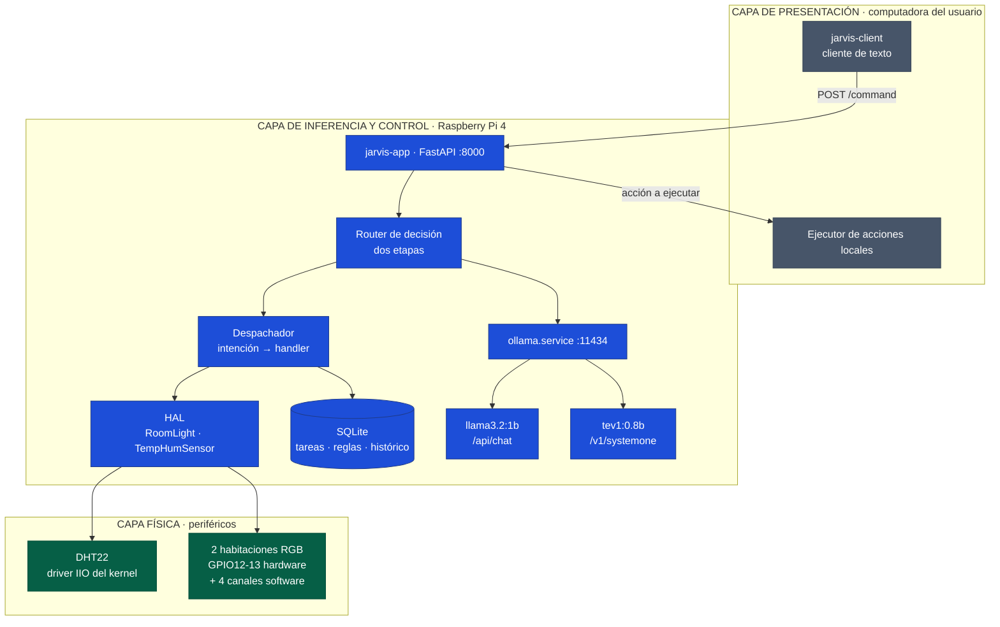
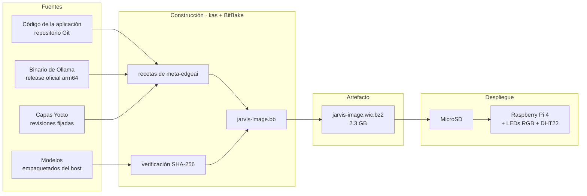

# Propuesta de diseño — Secciones del Rol B

**Proyecto II · Sistemas Inteligentes de Borde (EdgeAI) · Sistemas Embebidos · TEC**
Autor: Daniel — Líder Técnico / Arquitecto de Plataforma
Ítems 6, 7 y 8 de la rúbrica (35 % de la propuesta)

---

# 6. Arquitectura del sistema propuesto

## 6.1 Visión general

El sistema se organiza en tres capas con interfaces explícitas entre ellas. La separación responde a un criterio único: **todo el procesamiento inteligente ocurre en el dispositivo de borde**, y lo que vive fuera de él es intercambiable sin afectar al núcleo.

## 6.2 Mapeo de funciones a componentes

| Función del sistema | Componente de software | Componente de hardware |
|---|---|---|
| Recibir la orden del usuario | `jarvis-client` + endpoint `POST /command` | Computadora del usuario · red local |
| Clasificar la intención | Router de dos etapas → `tev1:0.8b` vía `/v1/systemone` | CPU de la Raspberry Pi (4 núcleos Cortex-A72) |
| Descartar órdenes ambiguas | Umbral de confianza en el router | — |
| Generar lenguaje natural | `llama3.2:1b` vía `/api/chat` | CPU de la Raspberry Pi |
| Ejecutar la acción | Despachador + handler por dominio | — |
| Persistir estado | SQLite en `/var/lib/jarvis/` | MicroSD |
| Controlar iluminación | `RoomLight` sobre PWM | 2 LEDs RGB · GPIO12-13 (hardware) + 4 canales (software) |
| Sensar el ambiente | `TempHumSensor` sobre IIO | DHT22 · GPIO4 · driver `dht11` del kernel |
| Actuar sobre la computadora | Ejecutor del cliente | Computadora del usuario |
| Servir los modelos | `ollama.service` (systemd) | 8 GB de RAM, modelos residentes |
| Arrancar el sistema | systemd: `ollama.service` → `jarvis.service` | Imagen Yocto en MicroSD |

## 6.3 Interfaces del sistema

| Interfaz | Entre | Protocolo | Contrato |
|---|---|---|---|
| I-1 | Cliente ↔ `jarvis-app` | HTTP/JSON sobre LAN | `POST /command {text}` → `{intent, confidence, action, response, needs_confirmation}` |
| I-2 | `jarvis-app` ↔ carril de decisión | HTTP local :11434 | `POST /v1/systemone` con `state` y `questions` tipadas |
| I-3 | `jarvis-app` ↔ carril generativo | HTTP local :11434 | `POST /api/chat` |
| I-4 | `jarvis-app` ↔ actuadores | Clase abstracta `RoomLight` | `set(habitacion, color, brillo)` |
| I-5 | `jarvis-app` ↔ sensor | Clase abstracta `TempHumSensor` | `read()` no bloqueante, último valor válido en caché |
| I-6 | HAL ↔ núcleo Linux | sysfs | `/sys/class/pwm/` y `/sys/bus/iio/devices/` |

Las interfaces I-4 e I-5 son clases abstractas de Python acordadas con el Rol A antes del desarrollo. El Rol A programa contra ellas usando una implementación falsa; el Rol B provee la implementación real sobre hardware. Esto permitió desarrollar en paralelo sin bloqueos.

## 6.4 Decisiones de arquitectura y su justificación

**Dos carriles de inferencia.** La mayor parte del trabajo del asistente no es generación de texto sino clasificación acotada. El endpoint `/v1/systemone` sirve modelos de decisión que devuelven opciones tipadas con probabilidad, sin generar tokens; `/api/chat` sirve el modelo generativo. Separarlos reduce la latencia del caso frecuente y permite aplicar un umbral de confianza explícito, imposible sobre texto libre.

**Router de dos etapas.** El catálogo del sistema comprende 42 operaciones, mientras que una pregunta de tipo `choice` admite un máximo de 24 criterios. La clasificación se resuelve jerárquicamente: una primera pregunta determina el dominio entre seis opciones y una segunda la acción dentro de ese dominio, con un máximo de doce. Además del límite formal, la precisión del modelo de 0.8B se degrada cuando las opciones son numerosas y semánticamente cercanas, por lo que la jerarquía mejora el desempeño además de hacer viable el catálogo.

**El cliente no contiene inteligencia.** No carga modelos, no mantiene estado y no decide nada: transporta texto y ejecuta las acciones que la Pi le indica. Un cliente para otro sistema operativo, o una interfaz de voz futura, se conecta al mismo contrato I-1 sin modificar el núcleo.

**Acceso a hardware por drivers del núcleo.** Tanto el sensor como la iluminación se operan mediante lectura y escritura en sysfs, usando los drivers `dht11` (expuesto por IIO) y el subsistema PWM. Se descartó el acceso directo desde Python —*bit-banging* para el sensor y conmutación manual de GPIO para los LEDs— porque Linux no ofrece garantías de tiempo real y los resultados son inestables bajo carga. Esta decisión eliminó dependencias de espacio de usuario del árbol de la aplicación.

**Muestreo del sensor desacoplado de la respuesta.** El DHT22 no admite lecturas más frecuentes que cada dos segundos y falla de forma esporádica. Un hilo de muestreo mantiene el último valor válido en memoria, de modo que una consulta responde de inmediato en lugar de esperar al sensor.

## 6.5 Restricción identificada en el control de iluminación

La Raspberry Pi 4 dispone de **dos canales de PWM por hardware**. Dos habitaciones en RGB requieren seis canales, por lo que cuatro se generan por software desde espacio de usuario.

El PWM por software depende del planificador de Linux. Bajo carga sostenida de CPU —precisamente la condición durante una inferencia— las interrupciones del planificador producen parpadeo perceptible. El diseño objetivo contempla cuatro habitaciones; la implementación demostrada se limita a dos para mantener la proporción de canales por hardware y reducir el riesgo.

La vía de escalamiento está identificada: un controlador PCA9685 por I2C aporta dieciséis canales de PWM por hardware con dos pines de la Raspberry Pi. El bus I2C ya quedó habilitado en la configuración del BSP, y la incorporación consistiría en una implementación adicional de la interfaz `RoomLight` sin modificar ningún otro componente del sistema.

## 6.6 Configuración de la plataforma

| Parámetro | Valor | Propósito |
|---|---|---|
| `MACHINE` | `raspberrypi4-64` | Objetivo de compilación |
| `DISTRO` | `poky` con `INIT_MANAGER = "systemd"` | Gestión de servicios y orden de arranque |
| `dtoverlay=dht11,gpiopin=4` | — | Driver del sensor expuesto por IIO |
| `dtoverlay=pwm-2chan,pin=12,pin2=13` | — | Dos canales de PWM por hardware |
| `dtparam=i2c_arm=on` | — | Bus I2C habilitado para escalamiento futuro |
| `OLLAMA_KEEP_ALIVE` | `-1` | Modelos residentes en memoria |
| `OLLAMA_MODELS` | `/usr/share/ollama/models` | Modelos horneados en la imagen |
| `HOME` de `ollama.service` | `/run/ollama` (tmpfs) | Evita escritura en la MicroSD |
| `IMAGE_ROOTFS_EXTRA_SPACE` | 4 GB | Margen sobre el peso de los paquetes |

---

# 7. Análisis de dependencias

> Esta sección corresponde al documento `docs/dependencias/analisis.md`, que contiene el árbol de dependencias, el peso por componente y las dependencias en tiempo de ejecución, extraídos del build mediante `bitbake -g` y del manifiesto de la imagen.

**Síntesis para el documento principal:** la imagen comprende 2152 paquetes instalados y pesa 2.3 GB comprimida. Los modelos de inferencia representan el 97 % de ese peso —`llama3.2:1b` con 1204.9 MB y `tev1:0.8b` con 755.2 MB—, mientras que el sistema operativo completo, el núcleo, los servicios y las herramientas de diagnóstico suman menos de 80 MB. El dimensionamiento del almacenamiento se gobierna por la selección de modelos y no por el sistema base.

El árbol distingue el núcleo mínimo (Ollama y el modelo de decisión, sin los cuales el sistema no opera) de los componentes desmontables (el modelo generativo, cuyo retiro reduce la imagen 1.2 GB y deja el sistema operando con el catálogo de operaciones de decisión).

---

# 8. Estrategia de integración de la solución

## 8.1 Principio rector

La integración se organizó para que **ninguna de las dos personas del equipo dependa del avance de la otra para trabajar**. Esto se logró congelando los contratos de interfaz antes de comenzar el desarrollo y proveyendo implementaciones falsas de todo lo que cruza una frontera entre roles.

## 8.2 Integración de hardware y software

## 8.3 Capas de integración

**Integración de software en la imagen.** Toda la solución se construye con un único comando (`kas build jarvis.yml`) a partir de un archivo declarativo que fija las capas, sus revisiones exactas, la máquina objetivo y la imagen. La capa propia `meta-edgeai` contiene las recetas del proyecto; las capas externas se obtienen por revisión fijada, de modo que el build es reproducible en cualquier host.

**Integración del motor de inferencia.** El binario oficial de Ollama para arm64 se empaqueta precompilado. Compilarlo desde fuente requeriría una cadena de Go completa con un tiempo de construcción incompatible con el plazo del proyecto, sin beneficio funcional. La receta excluye los backends CUDA, inaplicables en la Raspberry Pi: el tarball original de 1.5 GB se reduce a un paquete de 16 MB que contiene el binario y las bibliotecas de inferencia (`libllama`, `libmtmd`, `libomp` y `llama-server`), verificado por inspección del paquete generado.

**Integración de los modelos.** Los modelos se incorporan a la imagen en lugar de descargarse en el primer arranque. Un script del host empaqueta el manifiesto y los blobs que cada modelo referencia; una clase de Yocto común (`ollama-model.bbclass`) los verifica e instala en la ruta que el servicio consulta. Cada modelo es una receta independiente, lo que permite retirar el carril generativo sin reconstruir el de decisión.

**Integración del hardware.** Los periféricos se integran mediante overlays del árbol de dispositivos declarados en la configuración del BSP, no mediante bibliotecas de espacio de usuario. La aplicación accede a ellos por sysfs a través de la HAL, cuya interfaz abstracta permite sustituir la implementación —por ejemplo, migrar de PWM por software a un controlador PCA9685— sin modificar ningún componente que la consuma.

**Integración de los servicios.** El orden de arranque lo gobierna systemd: `ollama.service` carga ambos modelos en memoria y los mantiene residentes; `jarvis.service` depende de él y no inicia hasta que el servidor de inferencia responde.

## 8.4 Verificación de la integración

| Propiedad | Cómo se verifica | Estado |
|---|---|---|
| Los modelos están en la imagen | Manifiesto de la imagen y contenido de los paquetes | Verificado |
| El binario incluye sus bibliotecas | Inspección del paquete generado | Verificado |
| El build es reproducible | Revisiones fijadas y construcción desde cero | Verificado |
| La integridad de los modelos es comprobable | Tarea de verificación SHA-256 que aborta el build ante discrepancia | Verificado |
| Ningún modelo se lee de la MicroSD tras el arranque | Comparación de `/proc/diskstats` antes y después de varias órdenes | Pendiente de hardware |
| El sistema opera sin conexión | Desconexión de red durante la demostración | Pendiente de hardware |
| El modelo de decisión es viable sobre ARM64 | Medición de latencia, memoria residente y temperatura en la Pi | Pendiente de hardware |
| El sensor y la iluminación responden | Prueba de la HAL sobre hardware real | Pendiente de hardware |

## 8.5 Gestión del riesgo en la integración

El componente de mayor riesgo era la incorporación de Ollama a Yocto: no existe una capa pública mantenida y el proyecto no documenta su empaquetado para sistemas embebidos. Se fijó una fecha de corte y una alternativa explícita —ejecutar Ollama en un contenedor mediante `meta-virtualization`— para evitar que un bloqueo en ese punto comprometiera el resto del cronograma. La receta quedó funcional antes de la fecha de corte, por lo que la alternativa no fue necesaria.

El riesgo vigente es la viabilidad del modelo de decisión sobre ARM64. Las mediciones disponibles se obtuvieron sobre un host x86 y no son representativas del desempeño en la plataforma objetivo. La mitigación prevista, si la latencia resultara inaceptable, consiste en sustituir el modelo por configuración —la ruta del modelo es un parámetro de `/etc/jarvis/config.yaml` y no requiere reconstruir la imagen—.
